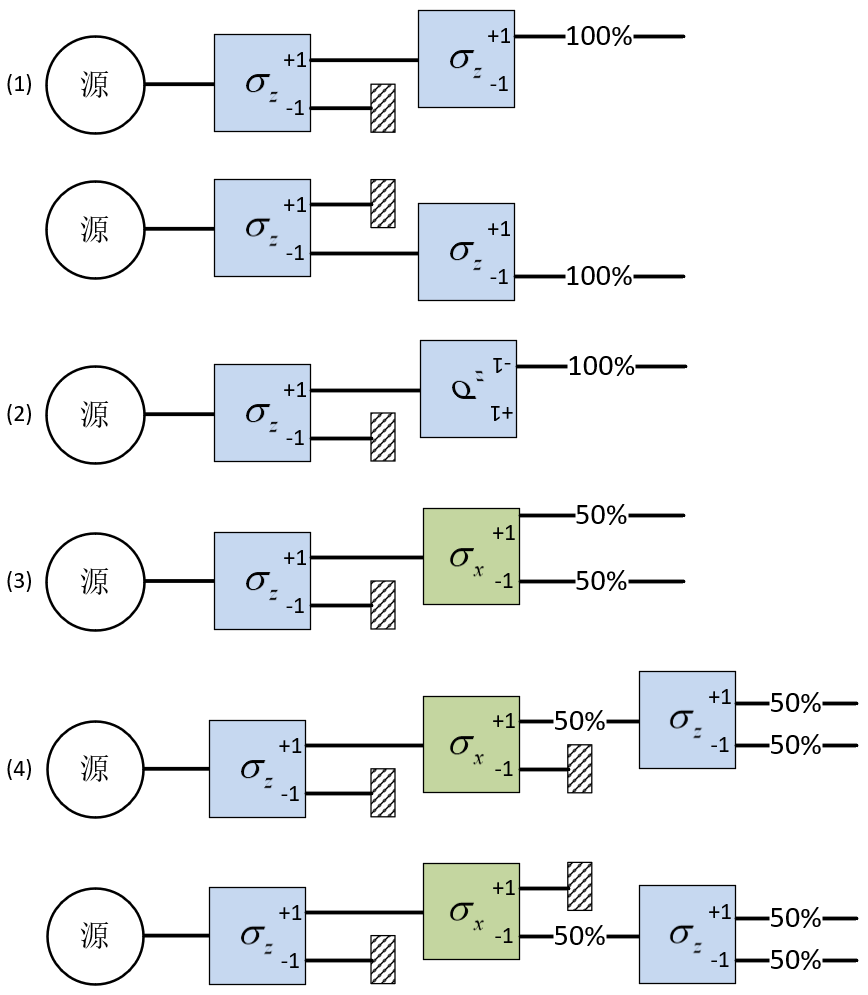
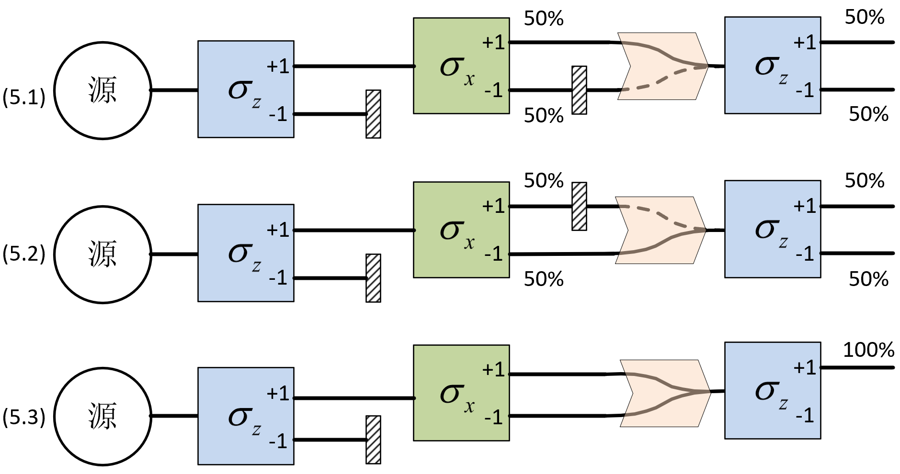

# Vectors and Quantum States

We begin with a simple experiment and let its results guide us toward the principles of modern quantum mechanics. Our starting point is a spin-1/2 system: measuring its spin along any chosen direction gives only two possible outcomes. This two-state system provides a simple setting in which to explore quantum states and develop the vector-space language used to describe them.

## The Stern–Gerlach experiment

Spin angular momentum ${\bf{S}}$ is an intrinsic property of a microscopic particle, just as charge and mass are. Charge and mass are scalars, whereas spin is a vector. Its magnitude is fixed, but its projection along a chosen spatial direction can take different, quantized values. For electrons, neutrons, and protons, there are just two possibilities: $+ {\hbar/2}$ or $- {\hbar/2}$. These are spin-1/2 particles. To avoid repeatedly writing ${\hbar/2}$, we define a new quantity $\boldsymbol{\sigma}$:

$$
{\bf{S}} \equiv \frac{\hbar }{2}{\boldsymbol{\sigma}}
$$ {#eq-zeqnnum505139}

Choose a direction in space defined by a unit vector ${\bf{n}}$. The quantity ${\sigma _n} \equiv {\boldsymbol{\sigma}} \cdot {\bf{n}}$ is the projection of ${\boldsymbol{\sigma}}$ along ${\bf{n}}$. When we measure ${\sigma _n}$ for a spin-1/2 particle, there are only two possible answers: $+ 1$ or $- 1$.

A Stern–Gerlach (SG) apparatus[^01-vectors-and-quantum-states-1] has a sensitive axis and measures the spin projection along that axis. With its axis oriented along $x$, it acts as a ${\sigma _x}$ detector; with its axis along $z$, it acts as a ${\sigma _z}$ detector. A spin-1/2 particle passing through the detector leaves through one of two exits, labelled $+1$ and $-1$, corresponding to the two possible values of ${\sigma _n}$.

[^01-vectors-and-quantum-states-1]: A Stern–Gerlach apparatus separates particles through the interaction of their magnetic moment with a nonuniform magnetic field. For the systems considered here, the magnetic moment is proportional to the spin, $\boldsymbol{\mu}=\gamma\mathbf{S}$, where $\gamma$ is a constant. The exits can therefore be labelled by the measured spin projection.

Imagine a source continuously emitting spin-1/2 particles with random spin orientations. We make the beam weak enough that particles travel through the apparatus one at a time and do not interact with one another. We can now arrange the apparatuses as shown in @fig-sg-sequences and follow what happens to the particles.

Before reading the result of each experiment, pause and make a prediction. Keep track of what has been measured and which outgoing beam is allowed to continue.

{#fig-sg-sequences width="537px"}

**Experiment 1: repeating a measurement.** Place an SG detector immediately after the source, with its sensitive axis along $z$, to measure ${\sigma _z}$. Particles from the random source leave through the $+1$ and $-1$ exits with equal probability. Block the $-1$ exit to admit only particles with ${\sigma _z}=+1$, and place a second ${\sigma _z}$ detector in their path. This time the beam does not split: every particle leaves through the second detector's $+1$ exit.

Similarly, admitting only particles from the first detector's $-1$ exit makes every particle leave through the second detector's $-1$ exit. The same agreement holds whenever both detectors measure the same spin component and no intervening process changes the state. **A repeated measurement gives the same result.** Selecting an exit also gives us a way to prepare particles with a definite value of ${\sigma _n}$.

**Experiment 2: reversing the detector.** Turn the second detector around so that its sensitive axis points opposite to that of the first. Every particle admitted from the first detector's $+1$ exit now leaves through the second detector's $-1$ exit, and vice versa.[^01-vectors-and-quantum-states-2] **Reversing the measurement axis reverses the sign of the result**, as expected for a vector projection.

[^01-vectors-and-quantum-states-2]: Keep the laboratory $z$ axis fixed. A detector pointing along $+z$ measures $\sigma_z$, whereas one pointing along $-z$ measures $\sigma_{-z}=-\sigma_z$. The sign change refers to the projection assigned by the detector; rotating the detector does not itself reverse the incoming particle's spin. We do not need the details of the particle's trajectory inside the apparatus to interpret the two readings.

**Experiment 3: measuring a different component.** Use a ${\sigma _z}$ detector to admit only particles with ${\sigma _z}=+1$, then send them through a ${\sigma _x}$ detector. The beam splits evenly: $50\%$ leave through the $+1$ exit and $50\%$ through the $-1$ exit.

A natural classical interpretation is that the second detector has simply sorted the particles by another pre-existing property. If so, particles leaving its $+1$ exit would have both ${\sigma _z}=+1$ and ${\sigma _x}=+1$, while those leaving its $-1$ exit would have both ${\sigma _z}=+1$ and ${\sigma _x}=-1$.

Hold on to that prediction. The next experiment puts it to the test.

**Experiment 4: testing the classical interpretation.** Admit particles from the ${\sigma _x}=+1$ exit in Experiment 3 and send them through a third detector measuring ${\sigma _z}$. The classical interpretation predicts ${\sigma _z}=+1$ for every particle. Instead, the beam splits evenly: $50\%$ give ${\sigma _z}=+1$ and $50\%$ give ${\sigma _z}=-1$. Admitting particles from the ${\sigma _x}=-1$ exit gives the same result.

Compare this with Experiment 1. The only intervening change is the measurement of ${\sigma _x}$. After that measurement, the initially certain ${\sigma _z}=+1$ result is no longer certain. **Measuring one spin component changes the predictions for another.** In quantum mechanics, a spin state cannot have definite values of both ${\sigma _x}$ and ${\sigma _z}$.

{#fig-sg-recombination width="554px"}

**Experiment 5: recombining the two paths.** In Experiment 4, we admitted particles from just one exit of the ${\sigma _x}$ detector. Now introduce an ideal beam combiner between the second and third detectors, as shown in @fig-sg-recombination. The combiner brings the two outgoing paths back together. No additional device records which path a particle takes.

- **Experiments 5.1–5.2: one path open.** Block either exit of the ${\sigma _x}$ detector and send the admitted particles through the combiner into the final ${\sigma _z}$ detector. As in Experiment 4, the final outcomes $+1$ and $-1$ each occur with probability $50\%$. This show the combiner only bends the path of the beams with no other effects.

- **Experiment 5.3: both paths open.** Now, let's remove the blocking plate so that both paths reach the combiner. What will be the outcome oft he final detector?

  Every particle now leaves the final detector through its $+1$ exit!

If opening both paths merely combined the results of the two one-path cases, the final outcomes would still occur with equal probability. They do not. **With both paths open and no record of which path a particle takes, every particle gives** $+1$ at the final detector. If a device records the path, an observer can determine the corresponding $\sigma_x$ result, and the final detector again gives $+1$ and $-1$ with equal probability. The key distinction is whether the setup makes the path information available to an observer. The record need not actually be read. We will return to this distinction when we discuss measurement.

These experiments set the requirements for our theory: it must explain repeatable measurements, the effect of changing the measurement axis, and the difference between selecting one path and recombining both paths without recording the path.

**Measurements along an arbitrary axis.** Let the unit vectors $\mathbf{n}$ and $\mathbf{m}$ make an angle $\theta$. Prepare particles with $\sigma_n=+1$, then measure $\sigma_m$. The probabilities of the two outcomes are

$$
P(\sigma_m=+1)=\cos^2(\theta/2),\qquad
P(\sigma_m=-1)=\sin^2(\theta/2).
$$

Experiments 1, 2, and 3 correspond to $\theta=0$, $\theta=\pi$, and $\theta=\pi/2$, respectively. The mean result over many identically prepared particles is

$$
\langle\sigma_m\rangle
=(+1)\cos^2(\theta/2)+(-1)\sin^2(\theta/2)
=\cos\theta.
$$

Thus the mean follows the familiar rule for projecting a Cartesian vector, even though each individual measurement gives only $+1$ or $-1$.

Keep these experiments in mind as we turn to the mathematics. We will build the language of quantum mechanics step by step, then return to the puzzles that brought us here.

## Vector spaces

In classical mechanics, a system’s state is specified by the instantaneous values of its dynamical variables, such as the positions and momenta of its particles. Given the forces, an exact initial state determines the subsequent motion. This is **classical determinism**; statistical predictions arise when our knowledge of the initial state is incomplete.

A quantum state cannot be specified in the same way. Some observables, such as position and its corresponding momentum component, cannot simultaneously have definite values. Even a single electron cannot have definite spin projections along two nonparallel directions. We therefore distinguish the **quantum state** from the **observables** measured on the system. For an isolated system, the Schrödinger equation determines the state’s evolution, while the state generally predicts probabilities for measurement outcomes of the observables.

We will the vector-space formulation of quantum mechanics: **pure states are represented by vectors, and observables by operators**. Matrix mechanics and wave mechanics provide concrete representations of this framework. This chapter introduces the vectors; the next introduces the operators.

**Quantum postulate for pure states.** A pure quantum state contains all the information about a system at a given instant. It is represented by a nonzero vector in a complex vector space. We normally choose this vector to have unit norm. Multiplying a normalized state vector by an overall phase factor $e^{i\alpha}$ does not change the physical state.

When you hear *vector*, you may picture an arrow in three-dimensional space. Keep that familiar picture, but make room for a second meaning: a vector can also represent a quantum state. We will call vectors in physical three-dimensional space **Cartesian vectors** and vectors representing quantum states **state vectors**. The latter belong to the system's **state space**, or **Hilbert space**.

Dirac gave state vectors their own notation: $\lvert\text{vector name}\rangle$. A vector written this way is called a **ket**. The symbols may look unfamiliar at first, but they obey the vector-space rules we are about to use.

For example, write $|+z\rangle$ for the state prepared by admitting particles from the $\sigma_z=+1$ exit of an SG detector, and $|-z\rangle$ for the state prepared from its $\sigma_z=-1$ exit. These kets belong to the spin state space; they are not arrows pointing along the spatial $z$ axis.

Some useful vector-space identities are:

$$
\begin{aligned}
\text{Commutativity:}\quad &\lvert\psi_\alpha\rangle+\lvert\psi_\beta\rangle=\lvert\psi_\beta\rangle+\lvert\psi_\alpha\rangle\\
\text{Associativity:}\quad &(\lvert\psi_\alpha\rangle+\lvert\psi_\beta\rangle)+\lvert\psi_\gamma\rangle
=\lvert\psi_\alpha\rangle+(\lvert\psi_\beta\rangle+\lvert\psi_\gamma\rangle)\\
\text{Scalar multiplication:}\quad &c\lvert\psi\rangle=\lvert\psi\rangle c\\
\text{Scalar associativity:}\quad &c_1(c_2\lvert\psi\rangle)=(c_1c_2)\lvert\psi\rangle\\
\text{Scalar identity:}\quad &1\lvert\psi\rangle=\lvert\psi\rangle\\
\text{Distributivity:}\quad &(c_1+c_2)\lvert\psi\rangle=c_1\lvert\psi\rangle+c_2\lvert\psi\rangle\\
&c(\lvert\psi_\alpha\rangle+\lvert\psi_\beta\rangle)=c\lvert\psi_\alpha\rangle+c\lvert\psi_\beta\rangle
\end{aligned}
$$ {#eq-zeqnnum995300}

Here $c,{c_1},{c_2}$ are complex numbers. Read these identities as rules for working with vectors. A vector space is closed under addition and scalar multiplication: these operations always produce another vector in the same space.

**Zero vector.** Every vector space contains a zero vector, $\left\vert  {{\rm{null}}} \right\rangle$, which may be thought of as having zero length. It is defined by the following condition for every vector $|\psi\rangle$:

$$
\left\vert  {{\rm{null}}} \right\rangle + |\psi\rangle = |\psi\rangle , \qquad  \qquad  0|\psi\rangle = \left\vert  {{\rm{null}}} \right\rangle
$$ {#eq-zeqnnum835984}

The zero vector is needed for vector addition and cancellation, but represents no physical state.

If $|\psi_1\rangle$ and $|\psi_2\rangle$ belong to the same vector space, their linear combination $|\psi\rangle=c_1|\psi_1\rangle+c_2|\psi_2\rangle$ belongs to that space as well. A set of vectors is **linearly dependent** if some linear combination of them equals the zero vector with coefficients that are not all zero. In particular, the set $\{|\psi\rangle,|\psi_1\rangle,|\psi_2\rangle\}$ is linearly dependent because $|\psi\rangle-c_1|\psi_1\rangle-c_2|\psi_2\rangle=0$.

## Examples of complex linear vector spaces

The word *vector* may bring an arrow to mind, but a vector space can contain other kinds of objects. What matters is how those objects add and how they multiply by scalars. In each example below, check that adding two members or multiplying a member by a complex number gives us another memeber within the collection.

**Example 1: complex column vectors.**

Let us start with some familiar object: a column of $n$ complex numbers. Add two such columns element by element, or multiply every element by a complex number. The result is still a column with $n$ components. These columns therefore form a complex vector space.

$$
\begin{pmatrix}a_1\\a_2\\a_3\\\vdots\\a_n\end{pmatrix},\quad a_i\in\mathbb C;\qquad\lvert\mathrm{null}\rangle=\begin{pmatrix}0\\0\\0\\\vdots\\0\end{pmatrix}
$$ {#eq-ch01-p0170}

**Example 2: solutions of a homogeneous linear differential equation.**

Now consider a different kind of object: a function that solves the equation

$$
\frac{{{d^2}}}{{d{t^2}}}x(t) + 2\beta \frac{d}{{dt}}x(t) + \omega _0^2x(t) = 0
$$ {#eq-ch01-p0173}

Here we allow complex-valued solutions. If ${x_1}(t)$ and ${x_2}(t)$ are solutions, any complex linear combination of them is also a solution. Thus, the collection of solutions forms a complex vector space.

## Bras and inner products

So far, we can add vectors and multiply them by complex numbers. To discuss their lengths and how they relate to one another, we need another operation. Think of the dot product of two Cartesian vectors: it takes two vectors and returns a number. An **inner product** generalizes this idea to complex vector spaces. It is a rule that assigns a complex number to each ordered pair of vectors.

Dirac introduced a neat notation for this operation. To write the inner product of $|\varphi\rangle$ and $|\psi\rangle$, we write the first vector as $\langle\varphi|$, and place it next to the second vector's ket. The two brackets fit together:

$$
\langle \varphi|  \cdot |\psi\rangle \equiv \langle \varphi|\psi\rangle = c
$$ {#eq-zeqnnum133573} Here $c$ is the resulting complex number. The inner product supplies the rule for calculating it; the bra–ket notation gives us a compact way to write it.

$\langle\varphi|$ is called **bra.** A bra is the dual object associated with a ket. For now, we can work with this correspondence through the rules below. Kets and bras each form a complex vector space. The correspondence between them is **antilinear**: when we convert a ket into its corresponding bra, we take the complex conjugate of each coefficient. The conversion rules are

$$
\begin{aligned}
|\psi\rangle &\longleftrightarrow \langle\psi|,\\
c|\psi\rangle &\longleftrightarrow c^*\langle\psi|,\\
c_1|\alpha\rangle+c_2|\beta\rangle
&\longleftrightarrow c_1^*\langle\alpha|+c_2^*\langle\beta|.
\end{aligned}
$$ {#eq-zeqnnum136783}

We can now express the defining properties of the inner product in bra–ket notation.

**Linearity in the ket and in the bra:**

$$
\begin{array}{l} \langle \gamma\vert \left( {{c_1}\vert \alpha\rangle + {c_2}\vert \beta\rangle } \right) = {c_1}\langle \gamma|\alpha\rangle + {c_2}\langle \gamma|\beta\rangle ,\\ \left( {{c_1}\langle \gamma\vert {\rm{ + }}{c_2}\langle \beta\vert } \right)\vert \alpha\rangle = {c_1}\langle \gamma|\alpha\rangle + {c_2}\langle \beta|\alpha\rangle \end{array}
$$ {#eq-zeqnnum320588}

**Conjugate symmetry:**

$$
\langle \varphi|\psi\rangle = \langle \psi|\varphi\rangle ^*
$$ {#eq-zeqnnum921664}

Applying conjugate symmetry, @eq-zeqnnum921664, to the inner product of a vector with itself. $$
\langle \psi|\psi\rangle = \langle \psi|\psi\rangle ^*
$$ {#eq-ch01-p0188} The result equals its own complex conjugate, so $\langle \psi\|\psi\rangle$ must be real.

**Positive definiteness.** To make this quantity behave like a squared length, we require $$
\langle \psi|\psi\rangle \ge 0
$$ {#eq-zeqnnum281628} Equality holds only for $\vert \psi\rangle = \vert {{\rm{null}}}\rangle$.

A vector $\vert \psi\rangle$ whose inner product with itself is one, $\langle \psi\|\psi\rangle = 1$ is **normalized**. Any nonzero, unnormalized vector $|\psi\rangle$ can be normalized as follows: $$
\left\vert  {\tilde \psi } \right\rangle = \frac{{|\psi\rangle }}{{\sqrt {\langle \psi|\psi\rangle } }}
$$ {#eq-ch01-p0194}

Let us put the bra–ket notation to work with column vectors. Here we can see every step of the calculation.

**Example: inner products of column vectors.** Complex column vectors form a complex vector space. Their standard inner product is obtained by multiplying the conjugate transpose of the first column by the second column. Thus, if a column represents a ket, its conjugate-transpose row represents the corresponding bra. For example,

$$
\begin{array}{l} |\phi\rangle = \left( {\begin{array}{*{20}{c}} {{a_1}}\\ {{a_2}} \end{array}} \right) \leftrightarrow \langle \phi|  = \left( {\begin{array}{*{20}{c}} {a_1^*}&{a_2^*} \end{array}} \right)\\ |\psi\rangle = \left( {\begin{array}{*{20}{c}} {{b_1}}\\ {{b_2}} \end{array}} \right) \leftrightarrow \langle \psi|  = \left( {\begin{array}{*{20}{c}} {b_1^*}&{b_2^*} \end{array}} \right) \end{array}
$$ {#eq-ch01-p0197} inner product $\langle \phi|\psi\rangle$ can then be defined by ordinary matrix multiplication:

$$
\langle \phi|\psi\rangle = \left( {\begin{array}{*{20}{c}} {a_1^*}&{a_2^*} \end{array}} \right)\left( {\begin{array}{*{20}{c}} {{b_1}}\\ {{b_2}} \end{array}} \right) = a_1^*{b_1} + a_2^*{b_2}
$$ {#eq-zeqnnum248635} definitions satisfy all the required properties. Check conjugate symmetry, @eq-zeqnnum921664, explicitly by reversing the two vectors:

$$
\langle \psi|\phi\rangle = \left( {\begin{array}{*{20}{c}} {b_1^*}&{b_2^*} \end{array}} \right)\left( {\begin{array}{*{20}{c}} {{a_1}}\\ {{a_2}} \end{array}} \right) = b_1^*{a_1} + b_2^*{a_2} = {({b_1}a_1^* + {b_2}a_2^*)^*} = {\langle \phi|\psi\rangle ^*}
$$ {#eq-ch01-p0201}

## Orthogonality and basis vectors

Let us start with some familiar objects. Two Cartesian vectors ${\bf{a}},{\bf{b}}$ are perpendicular when ${\bf{a}} \cdot {\bf{b}} = 0$. At most three nonzero vectors in three-dimensional Cartesian space can be mutually perpendicular. Rotating such a set gives infinitely many alternative sets. But we can never find more than three mutually perpendicular vectors. That is why the dimension of Cartesian space is three.

Given mutually perpendicular unit vectors ${\bf{x}},{\bf{y}},{\bf{z}}$ in a Cartesian space, they are called basis vectors. Any Cartesian vector ${\bf{v}}$ can be expressed as the linear combination of basis vectors:

$$
{\bf{v}} = \left( {{\bf{x}} \cdot {\bf{v}}} \right){\bf{x}} + \left( {{\bf{y}} \cdot {\bf{v}}} \right){\bf{y}} + \left( {{\bf{z}} \cdot {\bf{v}}} \right){\bf{z}} = {v_x}{\bf{x}} + {v_y}{\bf{y}} + {v_z}{\bf{z}}
$$ {#eq-ch01-p0204} can collect the three components of ${\bf{v}}$ into a column vector:

$$
{\bf{v}} = \left( {\begin{array}{*{20}{c}} {{v_x}}\\ {{v_y}}\\ {{v_z}} \end{array}} \right){\rm{ = }}\left( {\begin{array}{*{20}{c}} {{\bf{x}} \cdot {\bf{v}}}\\ {{\bf{y}} \cdot {\bf{v}}}\\ {{\bf{z}} \cdot {\bf{v}}} \end{array}} \right)
$$ {#eq-ch01-p0206} a fixed vector ${\bf{v}}$ while you rotate the coordinate axes. Rotating the ${\bf{x}},{\bf{y}},{\bf{z}}$ axes changes the components of ${\bf{v}}$, even though the vector itself stays fixed.

In their own coordinate system, the Cartesian basis vectors always have the following column representations:

$$
{\bf{x}} = \left( {\begin{array}{*{20}{c}} 1\\ 0\\ 0 \end{array}} \right), \qquad  {\bf{y}} = \left( {\begin{array}{*{20}{c}} 0\\ 1\\ 0 \end{array}} \right), \qquad  {\bf{z}} = \left( {\begin{array}{*{20}{c}} 0\\ 0\\ 1 \end{array}} \right)
$$ {#eq-ch01-p0208}

We can carry this familiar geometry into the complex vector space. Two nonzero vectors $|\psi\rangle$ and $|\phi\rangle$ are **orthogonal** if and only if their inner product vanishes, $\langle \psi\vert \phi\rangle = 0$. The dimension of a complex vector space is the maximum number of mutually orthogonal nonzero vectors. Using the inner product defined in @eq-zeqnnum248635, we can find infinitely many orthogonal pairs of two-component columns. Here are three pairs of normalized vectors:

$$
\begin{aligned}
&\begin{pmatrix}1\\0\end{pmatrix},\quad \begin{pmatrix}0\\1\end{pmatrix};\\[0.6em]
&\frac{1}{\sqrt{2}}\begin{pmatrix}1\\1\end{pmatrix},\quad \frac{1}{\sqrt{2}}\begin{pmatrix}1\\-1\end{pmatrix};\\[0.6em]
&\frac{1}{\sqrt{2}}\begin{pmatrix}1\\i\end{pmatrix},\quad \frac{1}{\sqrt{2}}\begin{pmatrix}1\\-i\end{pmatrix}.
\end{aligned}
$$ {#eq-zeqnnum282640} any one of these pairs and we cannot find a third nonzero column vector orthogonal to both members. Thus, the vector space of two-component columns has dimension two.

A **basis** is a linearly independent set of vectors that spans the space; it need not be orthogonal or normalized. A set of $N$ mutually orthogonal, normalized vectors in an $N$-dimensional vector space forms a **complete orthonormal basis**. Unless stated otherwise, the bases used in this book are complete and orthonormal. For any two vectors $|i\rangle,|j\rangle$ in such a basis,

$$
\langle j|i\rangle = {\delta _{ij}}
$$ {#eq-zeqnnum766490} symbol ${\delta _{ij}}$ is the **Kronecker delta**, defined by

$$
{\delta _{ij}} = \left\{ \begin{array}{l} 1, & i = j\\ 0, & i \ne j \end{array} \right.
$$ {#eq-ch01-p0216}

Just like a Cartesian vector has a unique expansion in a Cartesian basis: every state vector has a unique expansion as a linear combination of the basis vectors. In an $N$-dimensional space with basis $\{|i\rangle\}_{i=1}^{N}$, any vector $|\psi\rangle$ can be written as

$$
|\psi\rangle = \sum\limits_i {{a_i}|i\rangle }
$$ {#eq-ch01-p0218} ${a_i}$ is the complex coefficient of $|i\rangle$ in the expansion of $|\psi\rangle$. To find a particular coefficient, lets say $a_j$, apply the bra $\langle j|$ to both sides. Orthogonality removes every term except the one we want:

$$
\langle j|\psi\rangle = \sum\limits_i {\langle j| {a_i}|i\rangle } = \sum\limits_i {{a_i}\langle j|i\rangle } = \sum\limits_i {{a_i}{\delta _{ij}}} = {a_j}
$$ {#eq-ch01-p0220} the component of $|\psi\rangle$ along $|j\rangle$ is $\langle j|\psi\rangle$, and

$$
|\psi\rangle = \sum\limits_i {\langle i|\psi\rangle |i\rangle } = \sum\limits_i {|i\rangle } \langle i|\psi\rangle
$$ {#eq-zeqnnum935342} identity reconstructs a vector from its components. In the final expression, moving the scalar $\langle i|\psi\rangle$ to the right of the ket groups the factors as $|i\rangle\langle i|$. The [section on outer products, projection operators, and completeness](02-operators.qmd#outer-products-projection-operators-and-completeness) explains the meaning of these factors.

Taking the corresponding bra, using @eq-zeqnnum136783 and @eq-zeqnnum921664, gives

$$
\langle \psi|  = \sum\limits_i {\langle \psi|i\rangle } \langle i|
$$ {#eq-ch01-p0224}

## Matrix representations of vectors

Once we have chosen an ordered orthonormal basis, we can gather the expansion coefficients in @eq-zeqnnum935342 into a column. This gives a concrete representation of the state vector in the chosen basis:

$$
\lvert\psi\rangle:=\begin{pmatrix}\langle 1\vert\psi\rangle\\\langle 2\vert\psi\rangle\\\vdots\\\langle N\vert\psi\rangle\end{pmatrix}
$$ {#eq-zeqnnum343100}

In this basis, each basis vector is represented as:

$$
|1\rangle = \left( {\begin{array}{*{20}{c}} 1\\ 0\\ \vdots \\ 0 \end{array}} \right), \qquad  |2\rangle = \left( {\begin{array}{*{20}{c}} 0\\ 1\\ \vdots \\ 0 \end{array}} \right), \qquad  \cdots \qquad  |N\rangle = \left( {\begin{array}{*{20}{c}} 0\\ 0\\ \vdots \\ 1 \end{array}} \right)
$$ {#eq-ch01-p0229}

Always keep track of the basis attached to a column. Changing the basis changes the elements, so columns written in different bases must first be converted to a common basis before we combine them in a matrix calculation.

The comparison below connects state-vector notation to Cartesian geometry. Here $\mathbf{e}_i$ denotes a Cartesian basis vector. In both settings, an orthonormal basis lets us obtain a vector's components by taking inner products with the basis vectors:

$$
\begin{array}{ll}
\text{Cartesian vectors} & \text{Complex state vectors}\\[0.5em]
\mathbf{a}\cdot\mathbf{b}=\mathbf{b}\cdot\mathbf{a}
& \langle\phi|\psi\rangle=\langle\psi|\phi\rangle^*\\[0.5em]
\mathbf{a}\cdot\mathbf{b}=0
& \langle\phi|\psi\rangle=0\\[0.5em]
\text{Orthonormal Cartesian basis}
& \text{Orthonormal basis }\{|i\rangle\}\\[0.5em]
 v_i=\mathbf{e}_i\cdot\mathbf{v}
& a_i=\langle i|\psi\rangle\\[0.5em]
\mathbf{v}=\sum_i v_i\mathbf{e}_i
& |\psi\rangle=\sum_i a_i|i\rangle
\end{array}
$$ {#eq-ch01-p0232}

## Exercises

**1.1** Given

$$
|\chi\rangle=\begin{pmatrix}2\\i\end{pmatrix} \quad \rm{ and }\quad |\eta\rangle=\begin{pmatrix}1\\1\end{pmatrix}
$$write their bras, calculate $\langle\chi|\eta\rangle$ and $\langle\eta|\chi\rangle$, and normalize $|\chi\rangle$. Check conjugate symmetry.

**1.2.** Test each collection below: does it form a complex vector space under the usual addition and scalar multiplication? Focus on the vector-space rules; an inner product and completeness are not required.

- All complex numbers.

- All vectors in three-dimensional Cartesian space.

- All complex-valued solutions $\psi(x)$ of the following equation on a fixed interval, with fixed real $E$ and a finite, continuous $V(x)$. No normalization or boundary conditions are imposed.

$$
\left[ { - \frac{{{\hbar ^2}}}{{2m}}\frac{{{d^2}}}{{d{x^2}}} + V(x)} \right]\psi (x) = E\psi (x)
$$ {#eq-ch01-p0240}

**1.3.** Prove the Cauchy–Schwarz inequality, $\langle \alpha|\alpha\rangle \langle \beta|\beta\rangle \ge {\left\vert  {\langle \alpha|\beta\rangle } \right\vert ^2}$.

Hint: construct $\vert \psi \rangle$ as a suitable linear combination of $\vert \alpha\rangle$ and $\vert \beta\rangle$, and use the nonnegative squared norm in @eq-zeqnnum281628.

**1.4.** A vector $|\psi\rangle$ in a two-dimensional complex vector space has the following expansion in the orthonormal basis $\left\{ {\vert {\alpha _1}\rangle ,\vert {\alpha _2}\rangle } \right\}$:

$$
\vert \psi \rangle = \vert {\alpha _1}\rangle + 3\vert {\alpha _2}\rangle
$$ {#eq-ch01-p0246}

A second basis $\left\{ {\vert {\beta _1}\rangle ,\vert {\beta _2}\rangle } \right\}$ satisfies

$$
\left\vert  {{\beta _1}} \right\rangle = \frac{1}{{\sqrt 2 }}\left( {\vert {\alpha _1}\rangle + i\vert {\alpha _2}\rangle } \right), \qquad  \left\vert  {{\beta _2}} \right\rangle = \frac{1}{{\sqrt 2 }}\left( {\vert {\alpha _1}\rangle - i\vert {\alpha _2}\rangle } \right)
$$ {#eq-ch01-p0248} $|\psi\rangle$ in the second basis using two different methods, and check that your answers agree.