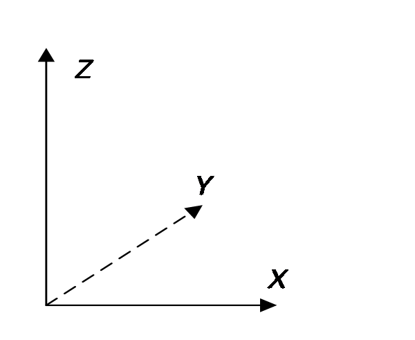
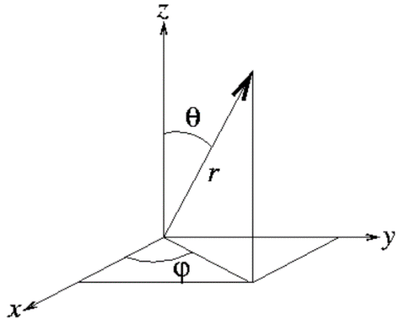

# Quantum Measurement

The previous chapters introduced state vectors and operators. We now use them to predict measurement outcomes: which values can occur, how likely each value is, and what state remains after a measurement. Spin-$1/2$ provides a concrete example.

## The measurement postulates

We begin with **pure states** and **ideal projective measurements** of observables with discrete spectra. Unless stated otherwise, the eigenvalues are nondegenerate and the eigenstates form a complete orthonormal basis.

- **Quantum postulate 1—observables.** An observable is represented by a Hermitian operator $\hat A$. Its eigenvalues are the possible measurement outcomes.

- **Quantum postulate 2—states.** A pure state is represented by a normalized vector $\lvert\psi\rangle$, with $\langle\psi\vert\psi\rangle=1$. This vector determines the probabilities of all measurement outcomes. Vectors $e^{i\alpha}\lvert\psi\rangle$ and $\lvert\psi\rangle$ represent the same physical state: an overall phase has no observable effect.

- **Quantum postulate 3—superposition.** Any nonzero linear combination of allowed state vectors is also an allowed state vector after normalization. In an orthonormal basis $\{\lvert\psi_j\rangle\}$, the superposition $\sum_j c_j\lvert\psi_j\rangle$ is normalized when $\sum_j\lvert c_j\rvert^2=1$.

- **Quantum postulate 4—definite values.** An observable $\hat A$ has a definite value $a$ in a state if and only if that state lies in the eigenspace with eigenvalue $a$. For a nondegenerate eigenvalue, this means the state is $\lvert a\rangle$, up to an overall phase.

- **Quantum postulate 5—the measurement principle.** Measuring $\hat A$ in a normalized state $\lvert\psi\rangle$ yields $a_j$ with probability $p(a_j)=\lvert\langle a_j\vert\psi\rangle\rvert^2$. Immediately after an ideal measurement that gives $a_j$, the state is $\lvert a_j\rangle$, up to an overall phase. The overlap $\langle a_j\vert\psi\rangle$ is the **probability amplitude**. More generally, $\lvert\langle\phi\vert\psi\rangle\rvert^2$ is the probability that a projective test for the normalized state $\lvert\phi\rangle$ succeeds when the initial state is $\lvert\psi\rangle$.

To apply the measurement principle, solve $\hat A\lvert a_j\rangle=a_j\lvert a_j\rangle$ for the eigenvalues and normalized eigenstates. For an initial state $\lvert\psi\rangle$, the possible outcomes and the corresponding states are

$$
\begin{array}{c|c|c}
\text{Result} & \text{State immediately after measurement} & \text{Probability} \\
\hline
 a_1 & \lvert a_1\rangle & \lvert\langle a_1\vert\psi\rangle\rvert^2 \\
 \vdots & \vdots & \vdots \\
 a_j & \lvert a_j\rangle & \lvert\langle a_j\vert\psi\rangle\rvert^2 \\
 \vdots & \vdots & \vdots
\end{array}
$$ {#eq-ch03-p0440}

The outcome is generally random: the state determines the probabilities, but does not specify which outcome occurs in a particular trial. If the initial state is already an eigenstate $\lvert a\rangle$, the outcome is certainly $a$ and an ideal measurement leaves the physical state unchanged. An immediate repetition therefore gives the same result, provided no intervening evolution or measurement changes the state.

Measuring $\hat A$ must yield some eigenvalue of $\hat A$, so the probabilities sum to $1$:

$$
\sum_j p(a_j)=\sum_j\lvert\langle a_j\vert\psi\rangle\rvert^2=1
$$ {#eq-ch03-p0443}
Equivalently,
$$
\sum_j\langle\psi\vert a_j\rangle\langle a_j\vert\psi\rangle=1
$$ {#eq-ch03-p0445} 
By completeness, @eq-zeqnnum286146, this simplifies to
$$
\langle\psi\vert\psi\rangle=1
$$ {#eq-ch03-p0447} 
Normalization ensures that the probabilities of all possible outcomes sum to one.

For a degenerate eigenvalue $a$, an ideal projective measurement uses the projector $\hat P_a$ onto the whole eigenspace: $p(a)=\langle\psi\vert\hat P_a\vert\psi\rangle$. Conditional on this outcome, the state becomes $\hat P_a\lvert\psi\rangle/\sqrt{p(a)}$. Obtaining $a$ need not select a unique eigenvector within that eigenspace.

The postulates also imply the following.

- **State preparation.** Keeping only systems for which the measurement gives $a_j$ prepares the state $\lvert a_j\rangle$. This selection is called postselection.

- **Distinguishability.** Two pure states can be distinguished with certainty in a single trial only if they are orthogonal. Orthogonal states can be included in an orthonormal measurement basis.

- **Sequential measurements.** Starting in $\lvert a\rangle$, the probability of obtaining $b$ when measuring $\hat B$ is $\lvert\langle b\vert a\rangle\rvert^2$. If that outcome occurs, the state becomes $\lvert b\rangle$, so a subsequent measurement of $\hat A$ returns $a$ with probability $\lvert\langle a\vert b\rangle\rvert^2$. The joint probability of both outcomes is the product of these two probabilities. We assume ideal measurements and no evolution between them.

**Theorem 3.1.** In a normalized state $\lvert\psi\rangle$, the **expectation value** of $\hat A$ is $\langle\hat A\rangle=\langle\psi\vert\hat A\vert\psi\rangle$. This is the average of measurements on many systems prepared in the same initial state; it need not itself be a possible outcome.

**Proof.**

$$
\begin{aligned}
\langle\psi\vert\hat A\vert\psi\rangle
 &=\sum_i\langle\psi\vert\hat A\vert a_i\rangle\langle a_i\vert\psi\rangle \\
 &=\sum_i a_i\langle\psi\vert a_i\rangle\langle a_i\vert\psi\rangle \\
 &=\sum_i a_i\lvert\langle a_i\vert\psi\rangle\rvert^2
 =\sum_i a_i p(a_i).
\end{aligned}
$$ {#eq-zeqnnum739477}
The final expression is the probability-weighted average of all outcomes, proving the theorem. We write $\langle\hat A\rangle$ when the state is understood. Repeated measurements on a single system generally do not sample the initial distribution, because the first measurement changes its state.

## A two-state spin system

A **two-state system** has a two-dimensional state space: two orthonormal basis states suffice to describe every state, although there are infinitely many superpositions. The spin state of a spin-$1/2$ particle is an example. Write $\hat\sigma_n=\hat{\boldsymbol\sigma}\cdot\mathbf n$, where $\mathbf n$ is a spatial unit vector and $\hat{\boldsymbol\sigma}=2\hat{\mathbf S}/\hbar$. Thus $\hat\sigma_n$ is a dimensionless spin component; the physical component $\hat S_n=(\hbar/2)\hat\sigma_n$ has outcomes $\pm\hbar/2$.

- **Experiment:** measuring ${\hat \sigma _n}$ yields either $+ 1$ or $- 1$.

- **Postulate:** a measurement of an observable always yields one of its eigenvalues.

- **Conclusion:** ${\hat \sigma _n}$ has only two eigenvalues, $+ 1$ and $- 1$. Assuming each is nondegenerate, call their eigenstates $\left\vert  {\hat n + } \right\rangle$ and $\left\vert  {\hat n - } \right\rangle$:

$$
{\hat \sigma _n}\left\vert  {\hat n + } \right\rangle = + \left\vert  {\hat n + } \right\rangle , \qquad  \qquad  {\hat \sigma _n}\left\vert  {\hat n - } \right\rangle = - \left\vert  {\hat n - } \right\rangle
$$ {#eq-ch03-p0464}

The eigenvalues differ, so $\left\langle {{\hat n + }} \mathrel{\left \vert  {\vphantom {{\hat n + } {\hat n - }}} \right. \kern-1.2pt } {{\hat n - }} \right\rangle = 0$. These normalized eigenstates form an orthonormal basis. Expressing states and operators in this basis defines the ${\hat \sigma _n}$ representation.

We give the states memorable names. In the coordinates of Figure 3.1, the states for ${\sigma _z} = + 1$ and $- 1$ are $\left\vert  U \right\rangle$ and $\left\vert  D \right\rangle$ (Up and Down); those for ${\sigma _x} = + 1$ and $- 1$ are $\left\vert  R \right\rangle$ and $\left\vert  L \right\rangle$ (Right and Left). Measuring the projection along $y$, we call the states for ${\sigma _y} = + 1$ and $- 1$ $\left\vert  I \right\rangle$ and $\left\vert  O \right\rangle$ (In and Out).

{width="200px"}

::: source-caption
Figure 3.1. Coordinates defining Up and Down, Left and Right, and In and Out.
:::

The eigenstates of ${\hat \sigma _z}$ are $\left\vert  U \right\rangle$ and $\left\vert  D \right\rangle$, with eigenvalues $+ 1$ and $- 1$, respectively. Hence

$$
{\hat \sigma _z}\left\vert  U \right\rangle = + \left\vert  U \right\rangle , \qquad  \qquad  {\hat \sigma _z}\left\vert  D \right\rangle = - \left\vert  D \right\rangle , \qquad  \qquad  \left\langle {U} \mathrel{\left \vert  {\vphantom {U D}} \right. \kern-1.2pt } {D} \right\rangle = 0
$$ {#eq-ch03-p0470}
Similarly, for ${\hat \sigma _x}$ and ${\hat \sigma _y}$,

$$
{\hat \sigma _x}\left\vert  R \right\rangle = + \left\vert  R \right\rangle , \qquad  \qquad  {\hat \sigma _x}\left\vert  L \right\rangle = - \left\vert  L \right\rangle , \qquad  \qquad  \left\langle {R} \mathrel{\left \vert  {\vphantom {R L}} \right. \kern-1.2pt } {L} \right\rangle = 0
$$ {#eq-zeqnnum903599}

$$
{\hat \sigma _y}\left\vert  I \right\rangle = + \left\vert  I \right\rangle , \qquad  \qquad  {\hat \sigma _y}\left\vert  O \right\rangle = - \left\vert  O \right\rangle , \qquad  \qquad  \left\langle {I} \mathrel{\left \vert  {\vphantom {I O}} \right. \kern-1.2pt } {O} \right\rangle = 0
$$ {#eq-ch03-p0473}

To explain the experiments, we must now determine the relationships between these different states.

## Superposition of quantum states

### Choosing a basis

We begin with eigenstates of different observables. In a spin-$1/2$ state space, at most two states can be mutually orthogonal, such as $\left\vert  U \right\rangle$ and $\left\vert  D \right\rangle$, $\left\vert  R \right\rangle$ and $\left\vert  L \right\rangle$, or $\left\vert  I \right\rangle$ and $\left\vert  O \right\rangle$. Choosing the ${\hat \sigma _z}$ representation with basis $\left\vert  U \right\rangle$ and $\left\vert  D \right\rangle$, completeness @eq-zeqnnum286146 gives

$$
\left\vert  U \right\rangle \left\langle U \right\vert  + \left\vert  D \right\rangle \left\langle D \right\vert  = \hat I
$$ {#eq-ch03-p0477}
Any spin state $\left\vert  \psi \right\rangle$ is a linear combination of $\left\vert  U \right\rangle$ and $\left\vert  D \right\rangle$. Following @eq-zeqnnum935342,

$$
\left\vert  \psi \right\rangle = \left\vert  U \right\rangle \left\langle {U} \mathrel{\left \vert  {\vphantom {U \psi }} \right. \kern-1.2pt } {\psi } \right\rangle + \left\vert  D \right\rangle \left\langle {D} \mathrel{\left \vert  {\vphantom {D \psi }} \right. \kern-1.2pt } {\psi } \right\rangle
$$ {#eq-zeqnnum905994}

### States for measurements along $x$

To express $\left\vert  R \right\rangle$ and $\left\vert  L \right\rangle$ in basis $\left\{ {\left\vert  U \right\rangle ,\left\vert  D \right\rangle } \right\}$, use @eq-zeqnnum905994:

$$
\begin{array}{l} \left\vert  R \right\rangle = \left\vert  U \right\rangle \left\langle {U} \mathrel{\left \vert  {\vphantom {U R}} \right. \kern-1.2pt } {R} \right\rangle + \left\vert  D \right\rangle \left\langle {D} \mathrel{\left \vert  {\vphantom {D R}} \right. \kern-1.2pt } {R} \right\rangle \\ \left\vert  L \right\rangle = \left\vert  U \right\rangle \left\langle {U} \mathrel{\left \vert  {\vphantom {U L}} \right. \kern-1.2pt } {L} \right\rangle + \left\vert  D \right\rangle \left\langle {D} \mathrel{\left \vert  {\vphantom {D L}} \right. \kern-1.2pt } {L} \right\rangle \end{array}
$$ {#eq-ch03-p0481}
In a Stern–Gerlach (SG) experiment, a system prepared in $\lvert R\rangle$ has the definite value $\sigma_x=+1$. A measurement along $z$ then gives $+1$ or $-1$ with probability $1/2$ each. Therefore,

$$\begin{equation}
{\left\vert  {\left\langle {U} \mathrel{\left \vert  {\vphantom {U R}} \right. \kern-1.2pt } {R} \right\rangle } \right\vert ^2} = {\left\vert  {\left\langle {D} \mathrel{\left \vert  {\vphantom {D R}} \right. \kern-1.2pt } {R} \right\rangle } \right\vert ^2} = 1/2
\end{equation}
$$ {#eq-zeqnnum248257}

The general solution is
$$
\left\langle {U} \mathrel{\left \vert  {\vphantom {U R}} \right. \kern-1.2pt } {R} \right\rangle = \frac{1}{{\sqrt 2 }}{e^{i{\phi _U}}}, \qquad  \qquad  \left\langle {D} \mathrel{\left \vert  {\vphantom {D R}} \right. \kern-1.2pt } {R} \right\rangle = \frac{1}{{\sqrt 2 }}{e^{i{\phi _D}}}
$$ {#eq-ch03-p0485}
The angles ${\phi _U}$ and ${\phi _D}$ are undetermined phases. The expansion of $\left\vert  R \right\rangle$ is therefore
$$
\left\vert  R \right\rangle = \frac{1}{{\sqrt 2 }}\left( {\left\vert  U \right\rangle + {e^{i\delta }}\left\vert  D \right\rangle } \right){e^{i{\phi _U}}}
$$ {#eq-zeqnnum575274}
Here $\delta = {\phi _D} - {\phi _U}$. Since an overall phase is arbitrary, choose ${\phi _U} = 0$, or ${e^{i{\phi _U}}} = 1$, giving

$$
\left\vert  R \right\rangle = \frac{1}{{\sqrt 2 }}\left( {\left\vert  U \right\rangle + {e^{i\delta }}\left\vert  D \right\rangle } \right)
$$ {#eq-zeqnnum655177}
The relative phase $e^{i\delta}$ is not fixed by the $z$-measurement probabilities. Once the laboratory axes are fixed, however, it is not a freely adjustable physical property of $\lvert R\rangle$. We may choose the phases of the basis vectors $\lvert U\rangle$ and $\lvert D\rangle$ so that this particular state has real, positive coefficients. With that basis convention, $\delta=0$, giving

$$
\left\vert  R \right\rangle = \frac{1}{{\sqrt 2 }}\left( {\left\vert  U \right\rangle + \left\vert  D \right\rangle } \right)
$$ {#eq-zeqnnum225749}
That is,
$$
\left\langle {U} \mathrel{\left \vert  {\vphantom {U R}} \right. \kern-1.2pt } {R} \right\rangle = \frac{1}{{\sqrt 2 }}, \qquad  \left\langle {D} \mathrel{\left \vert  {\vphantom {D R}} \right. \kern-1.2pt } {R} \right\rangle = \frac{1}{{\sqrt 2 }}
$$ {#eq-ch03-p0493}
Next express $\left\vert  L \right\rangle$ in the ${\hat \sigma _z}$ representation. Using $\left\langle {L} \mathrel{\left \vert  {\vphantom {L R}} \right. \kern-1.2pt } {R} \right\rangle = 0$ and $\left\langle {L} \mathrel{\left \vert  {\vphantom {L L}} \right. \kern-1.2pt } {L} \right\rangle = 1$, and setting an irrelevant overall phase to $1$, gives
$$
\left\vert  L \right\rangle = \frac{1}{{\sqrt 2 }}\left( {\left\vert  U \right\rangle - \left\vert  D \right\rangle } \right)
$$ {#eq-zeqnnum448258}
The states $\lvert R\rangle$ and $\lvert L\rangle$ give identical probabilities for a $z$ measurement, but opposite definite outcomes for an $x$ measurement. The relative sign therefore matters physically. A coherent superposition is different from a statistical mixture: a 50:50 mixture of $U$ and $D$ gives both $x$ outcomes with equal probability, whereas $\lvert R\rangle$ gives $+1$ with certainty.

Equations @eq-zeqnnum225749 and @eq-zeqnnum448258 expand $\left\vert  R \right\rangle {\rm{,}}\left\vert  L \right\rangle$ in the ${\hat \sigma _z}$ representation. Inverting them gives the expansion of $\left\vert  U \right\rangle {\rm{,}}\left\vert  D \right\rangle$ in the ${\hat \sigma _x}$ representation:

$$ \left\vert  U \right\rangle = \frac{1}{{\sqrt 2 }}\left( {\left\vert  R \right\rangle + \left\vert  L \right\rangle } \right), \qquad  \qquad  \left\vert  D \right\rangle = \frac{1}{{\sqrt 2 }}\left( {\left\vert  R \right\rangle - \left\vert  L \right\rangle } \right) $$
Thus, when ${\sigma _z}$ is definitely $+ 1$ or $- 1$, a measurement of ${\sigma _x}$ yields $+ 1$ and $- 1$ with equal 50% probabilities, agreeing with experiment.

### States for measurements along $y$

Finally, express the eigenstates $\left\vert  I \right\rangle$ and $\left\vert  O \right\rangle$ of ${\hat \sigma _y}$ in the ${\hat \sigma _z}$ representation. In an eigenstate of ${\hat \sigma _z}$, measurements of ${\hat \sigma _y}$ and ${\hat \sigma _x}$ are symmetric, so, as in @eq-zeqnnum248257,

$$
{\left\vert  {\left\langle {U} \mathrel{\left \vert  {\vphantom {U I}} \right. \kern-1.2pt } {I} \right\rangle } \right\vert ^2} = {\left\vert  {\left\langle {D} \mathrel{\left \vert  {\vphantom {D I}} \right. \kern-1.2pt } {I} \right\rangle } \right\vert ^2} = \frac{1}{2}
$$ {#eq-ch03-p0500} 
The reasoning from @eq-zeqnnum248257 to @eq-zeqnnum655177 gives
$$
\left\vert  I \right\rangle = \frac{1}{{\sqrt 2 }}\left( {\left\vert  U \right\rangle + {e^{i\delta }}\left\vert  D \right\rangle } \right)
$$ {#eq-zeqnnum757923} 
have now fixed the relative phase convention of the $U,D$ basis using $\lvert R\rangle$. In this same basis, the phase in $\lvert I\rangle$ must reproduce the probabilities for measurements along both $z$ and $x$. A $y$-up state gives either $x$ outcome with probability $1/2$, so

$$
{\left\vert  {\left\langle {R} \mathrel{\left \vert  {\vphantom {R I}} \right. \kern-1.2pt } {I} \right\rangle } \right\vert ^2} = {\left\vert  {\left\langle {L} \mathrel{\left \vert  {\vphantom {L I}} \right. \kern-1.2pt } {I} \right\rangle } \right\vert ^2} = \frac{1}{2}
$$ {#eq-zeqnnum871161} 
@eq-zeqnnum225749 and @eq-zeqnnum757923 into @eq-zeqnnum871161 gives

$$
\left\langle {R} \mathrel{\left \vert  {\vphantom {R I}} \right. \kern-1.2pt } {I} \right\rangle = \frac{1}{{\sqrt 2 }}\left( {\left\langle U \right\vert  + \left\langle D \right\vert } \right) \cdot \frac{1}{{\sqrt 2 }}\left( {\left\vert  U \right\rangle + {e^{i\delta }}\left\vert  D \right\rangle } \right) = \frac{{1 + {e^{i\delta }}}}{2}
$$ {#eq-ch03-p0506}

$$
\frac{1}{2} = {\left\vert  {\left\langle {I} \mathrel{\left \vert  {\vphantom {I R}} \right. \kern-1.2pt } {R} \right\rangle } \right\vert ^2} = \frac{{1 + {e^{ - i\delta }}}}{2} \cdot \frac{{1 + {e^{i\delta }}}}{2} = \frac{{2 + 2\cos \delta }}{4} = \frac{1}{2} + \frac{{\cos \delta }}{2}
$$ {#eq-ch03-p0507}

$$
\delta=\pm\frac{\pi}{2}
$$ {#eq-ch03-p0509} 
The condition $\lvert\langle L\vert I\rangle\rvert^2=1/2$ gives the same result. The phase $\delta$ still has two choices because these probabilities alone do not distinguish $+y$ from $-y$. If we use a right-handed coordinate system, the $+y$ eigenstate has $\delta=\pi/2$, and hence

$$
\left\vert  I \right\rangle = \frac{1}{{\sqrt 2 }}\left( {\left\vert  U \right\rangle + i\left\vert  D \right\rangle } \right)
$$ {#eq-zeqnnum920345}

Using $\left\langle {I} \mathrel{\left \vert  {\vphantom {I O}} \right. \kern-1.2pt } {O} \right\rangle = 0,\;\left\langle {O} \mathrel{\left \vert  {\vphantom {O O}} \right. \kern-1.2pt } {O} \right\rangle = 1,\;{\left\vert  {\left\langle {U} \mathrel{\left \vert  {\vphantom {U O}} \right. \kern-1.2pt } {O} \right\rangle } \right\vert ^2} = {\left\vert  {\left\langle {D} \mathrel{\left \vert  {\vphantom {D O}} \right. \kern-1.2pt } {O} \right\rangle } \right\vert ^2} = {1 \mathord{\left/ {\vphantom {1 2}} \right. \kern-1.2pt } 2}$ then gives

$$
\left\vert  O \right\rangle = \frac{1}{{\sqrt 2 }}\left( {\left\vert  U \right\rangle - i\left\vert  D \right\rangle } \right)
$$ {#eq-ch03-p0513}
With the $x$ eigenstates chosen to have real coefficients, the $y$ eigenstates necessarily involve $i$. Relative phases are essential for describing spin states along all three axes.

## Matrix representations of states and observables

Matrices greatly simplify calculations, but the representation must always be clear. All matrices combined in a calculation must nevertheless use the same basis. Physical predictions are independent of the chosen representation.

### Matrices of the ${\sigma }_{x,y,z}$ eigenstates

From @eq-zeqnnum935342 and @eq-zeqnnum343100, choosing $\left\vert  U \right\rangle$ and $\left\vert  D \right\rangle$ as basis vectors gives the following column for any state $\left\vert  \psi \right\rangle$:

$$
\left\vert  \psi \right\rangle = \left\vert  U \right\rangle \left\langle {U} \mathrel{\left \vert  {\vphantom {U \psi }} \right. \kern-1.2pt } {\psi } \right\rangle + \left\vert  D \right\rangle \left\langle {D} \mathrel{\left \vert  {\vphantom {D \psi }} \right. \kern-1.2pt } {\psi } \right\rangle \buildrel\textstyle.\over= \left( {\begin{array}{*{20}{c}} {\left\langle {U} \mathrel{\left \vert  {\vphantom {U \psi }} \right. \kern-1.2pt } {\psi } \right\rangle }\\ {\left\langle {D} \mathrel{\left \vert  {\vphantom {D \psi }} \right. \kern-1.2pt } {\psi } \right\rangle } \end{array}} \right)
$$ {#eq-ch03-p0519}

Thus,
$$
\left\vert  U \right\rangle = \left( {\begin{array}{*{20}{c}} 1\\ 0 \end{array}} \right), \qquad  \left\vert  D \right\rangle = \left( {\begin{array}{*{20}{c}} 0\\ 1 \end{array}} \right)
$$ {#eq-ch03-p0521}

$$
\left\vert  R \right\rangle = \frac{1}{{\sqrt 2 }}\left( {\begin{array}{*{20}{c}} 1\\ 1 \end{array}} \right), \qquad  \left\vert  L \right\rangle = \frac{1}{{\sqrt 2 }}\left( {\begin{array}{*{20}{c}} 1\\ { - 1} \end{array}} \right)
$$ {#eq-zeqnnum109578}

$$
\left\vert  I \right\rangle = \frac{1}{{\sqrt 2 }}\left( {\begin{array}{*{20}{c}} 1\\ i \end{array}} \right), \qquad  \left\vert  O \right\rangle = \frac{1}{{\sqrt 2 }}\left( {\begin{array}{*{20}{c}} 1\\ { - i} \end{array}} \right)
$$ {#eq-zeqnnum389239}

As an example, prove ${\left\vert  {\left\langle {I} \mathrel{\left \vert  {\vphantom {I R}} \right. \kern-1.2pt } {R} \right\rangle } \right\vert ^2} = {1 \mathord{\left/ {\vphantom {1 2}} \right. \kern-1.2pt } 2}$ using matrices.

**Proof.** Use the matrices of $\vert R\rangle$ and $\vert I\rangle$ in @eq-zeqnnum109578 and @eq-zeqnnum389239:

$$
\left\langle {I} \mathrel{\left \vert  {\vphantom {I R}} \right. \kern-1.2pt } {R} \right\rangle = \frac{1}{{\sqrt 2 }}\left( {\begin{array}{*{20}{c}} 1&{ - i} \end{array}} \right)\frac{1}{{\sqrt 2 }}\left( {\begin{array}{*{20}{c}} 1\\ 1 \end{array}} \right) = \frac{{1 - i}}{2}
$$ {#eq-zeqnnum316358}
When converting a ket column into a bra row, remember to take the complex conjugate as well as the transpose.

$$
{\left\vert  {\left\langle {I} \mathrel{\left \vert  {\vphantom {I R}} \right. \kern-1.2pt } {R} \right\rangle } \right\vert ^2} = \frac{{1 - i}}{2} \cdot \frac{{1 + i}}{2} = \frac{1}{2}
$$ {#eq-ch03-p0528}

### Matrices of the ${\sigma }_{x,y,z}$ operators

By @eq-zeqnnum449673, the matrix of ${\hat \sigma _z}$ in the ${\hat \sigma _z}$ representation is

$$
{\hat \sigma _z} = \left( {\begin{array}{*{20}{c}} 1&0\\ 0&{ - 1} \end{array}} \right)
$$ {#eq-ch03-p0531}

Next find the matrix of ${\hat \sigma _x}$ in the ${\hat \sigma _z}$ representation.

**Method 1.** Using the state expansions above and @eq-zeqnnum903599,

$$
\begin{array}{l} {{\hat \sigma }_x}\vert U\rangle = \frac{1}{{\sqrt 2 }}{{\hat \sigma }_x}\left( {\vert R\rangle + \vert L\rangle } \right) = \frac{1}{{\sqrt 2 }}\left( {\vert R\rangle - \vert L\rangle } \right) = \vert D\rangle \\ {{\hat \sigma }_x}\vert D\rangle = \frac{1}{{\sqrt 2 }}{{\hat \sigma }_x}\left( {\vert R\rangle - \vert L\rangle } \right) = \frac{1}{{\sqrt 2 }}\left( {\vert R\rangle + \vert L\rangle } \right) = \vert U\rangle \end{array}
$$ {#eq-ch03-p0534}
Thus ${\hat \sigma _x}$ has the following matrix in the ${\hat \sigma _z}$ representation:

$$
\hat\sigma_x
 =\begin{pmatrix}
 \langle U\vert\hat\sigma_x\vert U\rangle & \langle U\vert\hat\sigma_x\vert D\rangle \\
 \langle D\vert\hat\sigma_x\vert U\rangle & \langle D\vert\hat\sigma_x\vert D\rangle
 \end{pmatrix}
 =\begin{pmatrix}
 \langle U\vert D\rangle & \langle U\vert U\rangle \\
 \langle D\vert D\rangle & \langle D\vert U\rangle
 \end{pmatrix}
 =\begin{pmatrix}0&1\\1&0\end{pmatrix}
$$ {#eq-ch03-p0536}

**Method 2.** First expand ${\hat \sigma _x}$ in its own eigenvectors:

$$
{\hat \sigma _x} = {\hat \sigma _x}\hat I = {\hat \sigma _x}\left( {\left\vert  R \right\rangle \left\langle R \right\vert  + \left\vert  L \right\rangle \left\langle L \right\vert } \right) = \left\vert  R \right\rangle \left\langle R \right\vert  - \left\vert  L \right\rangle \left\langle L \right\vert
$$ {#eq-zeqnnum507960}
Substitute the matrices @eq-zeqnnum109578 of $\vert R\rangle ,\vert L\rangle$ in the ${\hat \sigma _z}$ representation into @eq-zeqnnum507960:
$$
\hat\sigma_x
 =\lvert R\rangle\langle R\rvert-\lvert L\rangle\langle L\rvert
 =\frac12\begin{pmatrix}1\\1\end{pmatrix}\begin{pmatrix}1&1\end{pmatrix}
 -\frac12\begin{pmatrix}1\\-1\end{pmatrix}\begin{pmatrix}1&-1\end{pmatrix}
 =\begin{pmatrix}0&1\\1&0\end{pmatrix}
$$ {#eq-ch03-p0540}
Similarly, the matrix of ${\hat \sigma _y}$ in the ${\hat \sigma _z}$ representation follows from @eq-zeqnnum298708 and @eq-zeqnnum389239:
$$
{\hat \sigma _y} = \left\vert  I \right\rangle \left\langle I \right\vert  - \left\vert  O \right\rangle \left\langle O \right\vert  = \left( {\begin{array}{*{20}{c}} 0&{ - i}\\ i&0 \end{array}} \right)
$$ {#eq-zeqnnum872439}
For reference, the matrices of ${\hat \sigma _x}$, ${\hat \sigma _y}$, and ${\hat \sigma _z}$ in the ${\hat \sigma _z}$ representation are the **Pauli matrices**:
$$
{\hat \sigma _x} = \left( {\begin{array}{*{20}{c}} 0&1\\ 1&0 \end{array}} \right),{\rm{ }}\;\;\;{\hat \sigma _y} = \left( {\begin{array}{*{20}{c}} 0&{ - i}\\ i&0 \end{array}} \right),{\rm{ }}\;\;\;{\hat \sigma _z} = \left( {\begin{array}{*{20}{c}} 1&0\\ 0&{ - 1} \end{array}} \right)
$$ {#eq-zeqnnum418366}

Two useful pairs of relations are
$$
{\hat \sigma _x}\vert U\rangle = \vert D\rangle , \qquad  {\hat \sigma _x}\vert D\rangle = \vert U\rangle
$$ {#eq-ch03-p0546}

$$
{\hat \sigma _y}\vert U\rangle = i\vert D\rangle , \qquad  {\hat \sigma _y}\vert D\rangle = - i\vert U\rangle
$$ {#eq-ch03-p0547}Using $\hat{\mathbf S}=(\hbar/2)\hat{\boldsymbol\sigma}$, the three Cartesian spin-component operators for a spin-$1/2$ particle have the following matrices in the $\hat\sigma_z$ representation:

$$
{\hat S_x} = \frac{\hbar }{2}\left( {\begin{array}{*{20}{c}} 0&1\\ 1&0 \end{array}} \right),\;\;\;\;\;{\hat S_y} = \frac{\hbar }{2}\left( {\begin{array}{*{20}{c}} 0&{ - i}\\ i&0 \end{array}} \right),\;\;\;\;\;{\hat S_z} = \frac{\hbar }{2}\left( {\begin{array}{*{20}{c}} 1&0\\ 0&{ - 1} \end{array}} \right)
$$ {#eq-zeqnnum931030}

For teaching purposes, we inferred the eigenvalues and eigenstate relationships of ${\hat \sigma _{x,y,z}}$ from experiments and then obtained the operator matrices. In applications, we usually start with the Hermitian operator representing an observable and solve its eigenvalue equation to obtain its eigenvalues and eigenvectors.

## Common conceptual confusions

### How to express a measurement

If we measure $\hat A$ in state $\left\vert  \psi \right\rangle$, does the state become $\hat A\left\vert  \psi \right\rangle$?

Measurement is not simply multiplication by the observable. The vector $\hat A\lvert\psi\rangle$ is generally neither normalized nor an eigenstate of $\hat A$. For an ideal measurement, the outcome is selected according to the Born probabilities. Once an outcome $a_j$ is known, the state update is expressed by the projector $\hat P_j=\lvert a_j\rangle\langle a_j\rvert$:

$$
\lvert\psi\rangle\longrightarrow
\frac{\hat P_j\lvert\psi\rangle}{\sqrt{\langle\psi\vert\hat P_j\vert\psi\rangle}}
\qquad\text{with probability }p(a_j)=\langle\psi\vert\hat P_j\vert\psi\rangle.
$$The conditional state is determined once the outcome is specified; the choice of outcome is generally random. For a nondegenerate eigenvalue, the conditional state is $\lvert a_j\rangle$ up to an overall phase.

### Quantum and classical dynamical quantities

In a quantum model, observables are represented by operators. An externally applied field can nevertheless be treated as a prescribed classical quantity when its quantum fluctuations and the system's effect on it are negligible. For example, the spin magnetic interaction of an electron in a field $\mathbf B=B_z\mathbf e_z$ is

$$
\hat H=-\hat{\boldsymbol\mu}\cdot\mathbf B=-\hat\mu_z B_z
$$ {#eq-zeqnnum392782}
Here ${B_z}$ is a numerical variable, whether produced by Earth's field or a current-carrying coil. The $z$ component ${\hat \mu _z}$ of the electron magnetic moment is a Hermitian operator, as is the energy $\hat H$.

### An observable versus its value

For a fixed observable, its eigenvalues and eigenspaces do not depend on the current state. Saying that $\hat L$ has a definite value $\lambda$ means the state satisfies $\hat L\lvert\psi\rangle=\lambda\lvert\psi\rangle$, so its measurement certainly returns $\lambda$. We may use $L=\lambda$ for the measured value, provided the distinction between $L$ and $\hat L$ is clear.

Expressions such as $\hat A = c$ sometimes suppress an identity operator. Their actual meaning is $\hat A = c\hat I$.

### Spatial vectors and state vectors

State vectors represent quantum states. For example, eigenstates $\left\vert  U \right\rangle$ and $\left\vert  D \right\rangle$ of ${\hat \sigma _z}$ represent positive and negative spin projections along $z$. Although their spatial spin directions are opposite, their state vectors are orthogonal: one measurement of ${\hat \sigma _z}$ distinguishes them with certainty. Conversely, $\vert R\rangle$ and $\vert U\rangle$ represent spin right and spin up. Those spatial directions are perpendicular, but the state vectors are not orthogonal because $\langle U\vert R\rangle =1/ {\sqrt 2 }$ is nonzero. No single measurement can distinguish them with certainty.

Several kinds of spatial vectors occur in quantum mechanics:

- Cartesian basis vectors have definite directions and are not observables.

- Macroscopic vector quantities, such as applied magnetic and electric fields or electromagnetic waves, may be approximated by classical vectors; ${\bf{B}}$ in @eq-zeqnnum392782 is an example.

- A vector observable consists of three component operators. For spin $1/2$, $\hat S_x$, $\hat S_y$, and $\hat S_z$ have no common eigenstate, so all three components cannot be definite simultaneously. The expectation values of a vector observable form an ordinary spatial vector, $\langle\hat{\mathbf S}\rangle=\langle\hat S_x\rangle\mathbf e_x+\langle\hat S_y\rangle\mathbf e_y+\langle\hat S_z\rangle\mathbf e_z$.

- The three Cartesian position components can have simultaneous definite values. So do the three Cartesian momentum components.

The next chapter develops the conditions for simultaneous definite values in terms of commutators.

## Summary of vector and operator matrices

Choose a complete orthonormal eigenbasis $\{\lvert a_j\rangle\}$ of $\hat A$, and keep its ordering fixed. Abstract states and operators do not depend on a basis; their matrices do. Below, $\longleftrightarrow$ means “is represented by” in this basis. Elsewhere in the chapter, equalities between operators or kets and matrices use this same shorthand.

- **Ket matrix:**

$$
\lvert\psi\rangle=\sum_j\lvert a_j\rangle\langle a_j\vert\psi\rangle
\quad\longleftrightarrow\quad
\begin{pmatrix}\langle a_1\vert\psi\rangle\\\langle a_2\vert\psi\rangle\\\vdots\end{pmatrix}
$$ {#eq-zeqnnum168984}
The expression on the right depends on the representation. For example, the matrices of $\left\vert  R \right\rangle$ in the ${\hat \sigma _z}$ and ${\hat \sigma _x}$ representations are

$$
\begin{aligned}
\lvert R\rangle&=\frac{\lvert U\rangle+\lvert D\rangle}{\sqrt2}
 \quad\longleftrightarrow\quad\frac1{\sqrt2}\begin{pmatrix}1\\1\end{pmatrix}
 &&\text{in the ordered }(U,D)\text{ basis},\\
\lvert R\rangle&=1\lvert R\rangle+0\lvert L\rangle
 \quad\longleftrightarrow\quad\begin{pmatrix}1\\0\end{pmatrix}
 &&\text{in the ordered }(R,L)\text{ basis}.
\end{aligned}
$$ {#eq-ch03-p0576}

- **Bra matrix:** the conjugate transpose of the ket column.

$$
\langle\psi\rvert=\sum_j\langle\psi\vert a_j\rangle\langle a_j\rvert
\quad\longleftrightarrow\quad
\begin{pmatrix}\langle\psi\vert a_1\rangle&\langle\psi\vert a_2\rangle&\cdots\end{pmatrix}
$$ {#eq-ch03-p0578}

- **Inner product:** $\left\langle {\phi } \mathrel{\left \vert  {\vphantom {\phi \psi }} \right. \kern-1.2pt } {\psi } \right\rangle$ is a row matrix multiplied by a column matrix.

$$
\begin{aligned}
\langle\phi\vert\psi\rangle
 &=\sum_j\langle\phi\vert a_j\rangle\langle a_j\vert\psi\rangle\\
 &=\begin{pmatrix}\langle\phi\vert a_1\rangle&\langle\phi\vert a_2\rangle&\cdots\end{pmatrix}
 \begin{pmatrix}\langle a_1\vert\psi\rangle\\\langle a_2\vert\psi\rangle\\\vdots\end{pmatrix}.
\end{aligned}
$$ {#eq-ch03-p0580}

- **Eigenvector** $\left\vert  {{a_i}} \right\rangle$ of $\hat A$ in its own representation:

$$
\lvert a_i\rangle=\sum_j\lvert a_j\rangle\delta_{ji}\quad\longleftrightarrow\quad\begin{pmatrix}0\\\vdots\\1\\\vdots\\0\end{pmatrix}\quad\text{(1 in row }i\text{)}
$$ {#eq-ch03-p0582}

- **Dirac expansion of an arbitrary operator** $\hat M$ in the $\hat A$ representation:

$$
\hat M=\sum_{i,j}M_{ij}\lvert a_i\rangle\langle a_j\rvert,\qquad M_{ij}=\langle a_i\vert\hat M\vert a_j\rangle
$$ {#eq-ch03-p0584}

- **Matrix of an arbitrary operator** $\hat M$ in the $\hat A$ representation:

$$
\hat M\quad\longleftrightarrow\quad\begin{pmatrix}M_{11}&M_{12}&\cdots\\M_{21}&M_{22}&\cdots\\\vdots&\vdots&\ddots\end{pmatrix}
$$ {#eq-zeqnnum452145}

- **Dirac expansion of** $\hat A$ in its own representation:

$$
\hat A=\hat A\sum_i\lvert a_i\rangle\langle a_i\rvert=\sum_i a_i\lvert a_i\rangle\langle a_i\rvert
$$ {#eq-ch03-p0588}

- **Matrix of** $\hat A$ in its own representation: a diagonal matrix containing the eigenvalues of $\hat A$.

$$
\hat A\quad\longleftrightarrow\quad\begin{pmatrix}a_1&0&\cdots\\0&a_2&\cdots\\\vdots&\vdots&\ddots\end{pmatrix}
$$ {#eq-zeqnnum761044}

- **Matrix of** $\left\vert  {{a_i}} \right\rangle \left\langle {{a_j}} \right\vert$ in the $\hat A$ representation:

$$
\lvert a_i\rangle\langle a_j\rvert\quad\longleftrightarrow\quad\bigl(\delta_{ki}\delta_{lj}\bigr)_{kl}\quad\text{(1 in row }i\text{, column }j\text{; 0 elsewhere)}
$$ {#eq-ch03-p0592}

- **Eigenvalue equation, eigenvalues, and eigenvectors of** $\hat L$:

$$
\hat L\left\vert  {{\lambda _j}} \right\rangle = {\lambda _j}\left\vert  {{\lambda _j}} \right\rangle
$$ {#eq-ch03-p0594}

In the $\hat A$ representation, this equation becomes
$$
\begin{pmatrix}L_{11}&L_{12}&\cdots\\L_{21}&L_{22}&\cdots\\\vdots&\vdots&\ddots\end{pmatrix}
\begin{pmatrix}v_1^{(j)}\\v_2^{(j)}\\\vdots\end{pmatrix}
=\lambda_j\begin{pmatrix}v_1^{(j)}\\v_2^{(j)}\\\vdots\end{pmatrix},
\qquad L_{ik}=\langle a_i\vert\hat L\vert a_k\rangle,\quad
v_i^{(j)}=\langle a_i\vert\lambda_j\rangle.
$$ {#eq-zeqnnum662634}

## Exercises

**3.1.** A spin-$1/2$ particle is initially described by the unnormalized vector $\lvert\psi\rangle=\lvert U\rangle+2i\lvert D\rangle$. Use the normalized state for all probabilities below. Assume ideal measurements with no intervening time evolution.

- Normalize $\left. \vert \psi \right\rangle$.

- In state $\left. \vert \psi \right\rangle$, what is the probability that measuring ${\sigma }_{z}$ gives $+1$?

- In state $\left. \vert \psi \right\rangle$, what is the probability that measuring ${\sigma }_{x}$ gives $-1$?

- In state $\left. \vert \psi \right\rangle$, first measure ${\sigma }_{z}$, then ${\sigma }_{x}$. What is the probability that both results equal $+1$?

- In state $\left. \vert \psi \right\rangle$, first measure $\sigma_x$, then ${\sigma }_{z}$. What is the probability that both results equal $+1$?

**3.2.** In the approximation $g=2$, the electron spin magnetic moment is $\hat{\boldsymbol\mu}=-2\mu_{\mathrm B}\hat{\mathbf S}/\hbar$, where $\mu_{\mathrm B}>0$ is the Bohr magneton. Consider only its spin interaction with a uniform, prescribed magnetic field $\mathbf B=B\mathbf n$, where $B>0$ and $\mathbf n$ is a unit vector. Using $\hat H=-\hat{\boldsymbol\mu}\cdot\mathbf B$, find its energy eigenvalues, eigenstates, and level separation. **Hint:** Choose the quantization axis along the field. Ignore orbital motion and the small correction to $g=2$.

**3.3.** Let $\mathbf n(\theta,\phi)$ be the unit vector shown below, with polar angle $\theta$ measured from $+z$ and azimuthal angle $\phi$ measured from $+x$ toward $+y$. The dimensionless spin projection along this direction is $\hat\sigma_n=\hat{\boldsymbol\sigma}\cdot\mathbf n$.

{width="172px"}

- Write the matrix of ${\hat \sigma _n}$ in the ${\hat \sigma _z}$ representation. Show that its eigenvalues are $+ 1, - 1$, with the following eigenvectors:

$$
\left\vert  {\hat n + } \right\rangle \buildrel\textstyle.\over= \left( {\begin{array}{*{20}{c}} {\cos \frac{\theta }{2}}\\ {{e^{i\phi }}\sin \frac{\theta }{2}} \end{array}} \right), \qquad  \left\vert  {\hat n - } \right\rangle \buildrel\textstyle.\over= \left( {\begin{array}{*{20}{c}} {{e^{ - i\phi }}\sin \frac{\theta }{2}}\\ { - \cos \frac{\theta }{2}} \end{array}} \right)
$$ {#eq-ch03-p0610}

- A particle is prepared in $\lvert R\rangle$, so $\sigma_x=+1$ is definite. Find the probability that a measurement of $\hat\sigma_n$ gives $-1$.

- Find the expectation-value vector $\langle\hat{\boldsymbol\sigma}\rangle=(\langle\hat\sigma_x\rangle,\langle\hat\sigma_y\rangle,\langle\hat\sigma_z\rangle)$ in $\lvert\hat n+\rangle$, and compare its direction and length with those of $\mathbf n$.

**Hint:**

$$
{\hat \sigma _n} = {\bf{\hat \sigma }} \cdot {\bf{n}} = \left( {{{\hat \sigma }_x}{\bf{x}} + {{\hat \sigma }_y}{\bf{y}} + {{\hat \sigma }_z}{\bf{z}}} \right) \cdot \left( {{n_x}{\bf{x}} + {n_y}{\bf{y}} + {n_z}{\bf{z}}} \right){\rm{ = }}{\hat \sigma _x}{n_x} + {\hat \sigma _y}{n_y} + {\hat \sigma _z}{n_z}
$$ {#eq-ch03-p0614}

${\bf{x}},{\bf{y}},{\bf{z}}$ and ${\bf{n}}$ are spatial unit vectors. The components of ${\bf{n}}$ along ${\bf{x}},{\bf{y}},{\bf{z}}$ are numbers:

$$
{\rm{(}}{n_x},\;{n_y},\;{n_z}) = (\sin \theta \cos \phi ,\;\sin \theta \sin \phi ,\;\cos \theta )
$$ {#eq-ch03-p0616}

By contrast, ${\bf{\hat \sigma }}$ is a vector observable; its projections along the three ${\bf{x}},{\bf{y}},{\bf{z}}$ directions are operators.
