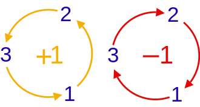

# Commutation Relations of Observables

Imagine that you prepare a spin-$1/2$ particle with a definite $z$ component of spin. If you measure that component again straight away, you get the same answer. Now put an $x$-component measurement between the two $z$-component measurements. Suddenly, the last answer is no longer certain. Why should measuring the spin component along a different direction change what you can predict?

To understand this, we need to look at what difference will it make by changing the order in which operators act. We'll introduce a tool called the **commutator** to keep track of that difference. Then we'll ask which quantities can have definite values together. Finally, we'll learn how to change basis and see how commutators lead to the uncertainty principle.

## Commutators and common eigenstates

Let's start with two operators, $\hat A$ and $\hat B$. If $\hat B$ acts first and $\hat A$ acts second, we write the result as $\hat A\hat B$. Remember to read this from right to left: the operator closest to the ket acts first. Reversing the order gives $\hat B\hat A$, which need not give the same result. The **commutator** is the difference between these two orders:

$$
\left[ {\hat A,\hat B} \right] \equiv \hat A\hat B - \hat B\hat A
$$ {#eq-zeqnnum285812}

If $[\hat A,\hat B]=0$, the order makes no difference: we say the operators **commute**. The corresponding observables are called **compatible**. If $[\hat A,\hat B]\ne0$, they are **incompatible**. Here, zero means the zero operator: it gives $\lvert\mathrm{null}\rangle$ when acting on *every* state. A nonzero commutator might still give $\lvert\mathrm{null}\rangle$ on one particular state, so checking just one state is not enough.

You can work out the following rules just by expanding the definition in @eq-zeqnnum285812. There's no new physics in them; they are useful shortcuts for calculations. Here $c$ is an ordinary number. When we add it to an operator or put it in a commutator, it means $c\hat I$. The exponents $m,n$ are nonnegative integers:

$$
\left[ {\hat A,\hat B} \right] = - \left[ {\hat B,\hat A} \right], \qquad  \qquad  \left[ {c\hat A,\hat B} \right] = \left[ {\hat A,c\hat B} \right] = c\left[ {\hat A,\hat B} \right]
$$ {#eq-zeqnnum530166}

$$
\left[ {\hat A,\hat A} \right] = 0, \qquad  \left[ {{{\hat A}^m},{{\hat A}^n}} \right] = 0, \qquad  \left[ {\hat A,c} \right] = 0
$$ {#eq-ch04-p0626}

$$
\left[ {\hat A + \hat B,\hat C} \right] = \left[ {\hat A,\hat C} \right] + \left[ {\hat B,\hat C} \right], \qquad  \qquad  \left[ {\hat A,\hat B + \hat C} \right] = \left[ {\hat A,\hat B} \right] + \left[ {\hat A,\hat C} \right]
$$ {#eq-ch04-p0627}

$$
\left[ {\hat A\hat B,\hat C} \right] = \hat A\left[ {\hat B,\hat C} \right] + \left[ {\hat A,\hat C} \right]\hat B, \qquad  \qquad  \left[ {\hat A,\hat B\hat C} \right] = \hat B\left[ {\hat A,\hat C} \right] + \left[ {\hat A,\hat B} \right]\hat C
$$ {#eq-zeqnnum842864}

The product rules in @eq-zeqnnum842864 are especially handy when an operator contains several factors. They let you tackle one factor at a time. 

### Spin: incompatible components, compatible magnitude

Let's try these ideas on the two-state spin system you already know. Using the matrices of $\hat S_n$ in @eq-zeqnnum931030, multiply in both orders and subtract. You get

$$
\left[ {{{\hat S}_x},{{\hat S}_y}} \right] = i\hbar {\hat S_z},\quad \qquad  \left[ {{{\hat S}_y},{{\hat S}_z}} \right] = i\hbar {\hat S_x},\quad \qquad  \left[ {{{\hat S}_z},{{\hat S}_x}} \right] = i\hbar {\hat S_y}
$$ {#eq-zeqnnum232011}

We can fit all three equations into one line:

$$
\left[ {{{\hat S}_j},{{\hat S}_k}} \right] = i\hbar {\varepsilon _{jkl}}{\hat S_l}
$$ {#eq-zeqnnum743287}

The **Levi-Civita symbol**, $\varepsilon_{jkl}$, is a number that can be $+1$, $-1$, or $0$. The indices $1,2,3$ stand for $x,y,z$. In @eq-zeqnnum743287, for two different components $j$ and $k$, $l$ denotes the remaining direction; there is no sum over $l$ here. If any two indices are the same, you get $\varepsilon_{jkl} = 0$. If all three indices are different, you use the diagram below to remember whether it is $+1$ or $-1$.:

{width="177px" fig-align="center"}

Follow the order $1\to2\to3\to1$ around the left diagram and you get $+1$. Go the other way, as in the right diagram, and you get $-1$.  For example, ${\varepsilon _{312}} = {\varepsilon _{231}} = 1,\;\;{\varepsilon _{132}} = {\varepsilon _{213}} = - 1,\;\;{\varepsilon _{133}} = 0$.

So the commutator of two different spin components gives the third component. We'll meet exactly the same pattern for the three components of orbital angular momentum, $\mathbf L=\mathbf r\times\mathbf p$. It turns out that this pattern belongs to angular momentum in general.

The components of spin don't commute with each other. But what about the total squared magnitude? Can that be definite at the same time as one component? For spin $1/2$, we can answer by direct calculation. First define

$$
\hat S_x^2\equiv\hat S_x\hat S_x,\qquad
\hat S_y^2\equiv\hat S_y\hat S_y,\qquad
\hat S_z^2\equiv\hat S_z\hat S_z,\qquad
\mathbf{\hat S}^2\equiv\hat S_x^2+\hat S_y^2+\hat S_z^2
$$ {#eq-ch04-p0638}

The first three operators square the individual components; adding them gives the squared magnitude. Substituting the spin-$1/2$ matrices from @eq-zeqnnum931030 gives

$$
\hat S_x^2 = \hat S_y^2 = \hat S_z^2 = \frac{{{\hbar ^2}}}{4}\left( {\begin{array}{*{20}{c}} 1&0\\ 0&1 \end{array}} \right) = \frac{{{\hbar ^2}}}{4}\hat I
$$ {#eq-ch04-p0640}

$$
{{\bf{\hat S}}^2} \equiv \frac{3}{4}{\hbar ^2}\hat I
$$ {#eq-ch04-p0641}

Notice each operator is just a number times the identity. The identity leaves any state alone, so it commutes with every operator on the same space. It follows that

$$
\left[ {\hat S_n^2,{{\hat S}_{n'}}} \right] = 0, \qquad  \left[ {{{{\bf{\hat S}}}^2},{{\hat S}_n}} \right] = 0 \qquad  n,n' \in \{ x,y,z\}
$$ {#eq-ch04-p0643}

In particular, every spin state gives the same value when we measure the squared magnitude:

$$
{{\bf{S}}^2} = \frac{3}{4}{\hbar ^2}
$$ {#eq-ch04-p0645}

This is a good place to pause and check our intuition. A classical arrow pointing along $z$ has no $x$ or $y$ component. Spin doesn't behave that way. In $\lvert U\rangle$, measuring $S_z$ always gives $\hbar/2$, but measuring either $S_x$ or $S_y$ gives $+\hbar/2$ or $-\hbar/2$ with equal probability. Those positive and negative results average to zero. Their *squares*, however, always equal $\hbar^2/4$. Adding the three squared components gives $3\hbar^2/4$, even though no component can exceed $\hbar/2$. So a classical arrow can help us picture directions, but it cannot capture all the properties of spin.

Every spin state is an eigenstate of $\mathbf{\hat S}^2$ with that same eigenvalue. Since the spin space has dimension two, we call this eigenvalue **doubly degenerate**: two independent states share it. You can choose any orthonormal pair as an eigenbasis, including $\{\lvert U\rangle,\lvert D\rangle\}$, $\{\lvert R\rangle,\lvert L\rangle\}$, or $\{\lvert I\rangle,\lvert O\rangle\}$. Each pair is also an eigenbasis of one spin component. We have found a **common eigenbasis**: a basis whose states give definite values for both observables.

## Common eigenstates of compatible observables

What does it mean for two observables to have definite values together? It means that the prepared state is an eigenstate of both operators. Finding one such state tells us about one possible preparation. Finding a **complete common eigenbasis** tells us much more: we can build *any* state as a superposition of states in which both quantities are definite. Let's see how this connects to commuting operators.

**Theorem 4.1.** Two observables with a complete common eigenbasis commute.

**Proof.** Choose a complete common eigenbasis $\left\{ {\left\vert i \right\rangle} \right\}$. On each basis state, $\hat A$ and $\hat B$ simply multiply the ket by their respective eigenvalues:

$$
\hat A\left\vert  i \right\rangle = {a_i}\left\vert  i \right\rangle ,\quad \hat B\left\vert  i \right\rangle = {b_i}\left\vert  i \right\rangle
$$ {#eq-ch04-p0652}

Now apply the operators in both orders. The eigenvalues are ordinary numbers, so multiplying them in either order gives the same answer:

$$
\hat A\hat B\left\vert  i \right\rangle = \hat A{b_i}\left\vert  i \right\rangle = {a_i}{b_i}\left\vert  i \right\rangle
$$ {#eq-ch04-p0654}

$$
\hat B\hat A\left\vert  i \right\rangle = \hat B{a_i}\left\vert  i \right\rangle = {a_i}{b_i}\left\vert  i \right\rangle
$$ {#eq-ch04-p0655}

Thus $\hat A\hat B\vert i\rangle = \hat B\hat A\vert i\rangle$ for every basis state. Why is that enough? Because the basis is complete: any state is a sum of these basis states. Write an arbitrary state as $\vert\psi\rangle=\sum_i\psi_i\vert i\rangle$ and apply the operators term by term:

$$
\hat A\hat B\lvert\psi\rangle
=\sum_i\psi_i\hat A\hat B\lvert i\rangle
=\sum_i\psi_i\hat B\hat A\lvert i\rangle
=\hat B\hat A\sum_i\psi_i\lvert i\rangle
=\hat B\hat A\lvert\psi\rangle
$$ {#eq-ch04-p0657}

The two orders agree on every state, so $\hat A\hat B=\hat B\hat A$. That is exactly what it means to commute.

We can also read the theorem the other way around: if two observables do not commute, they cannot have a complete common eigenbasis. Be careful about the word *complete*. They might still share some eigenstates; the theorem does not exclude that possibility.

For spin $1/2$, the situation is stronger: $\hat S_z$ and $\hat S_x$ (or $\hat\sigma_z$ and $\hat\sigma_x$) share no eigenstate at all. Prepare $\lvert U\rangle$ and you know the $z$ component, but an $x$ measurement still has two equally likely outcomes. Prepare a definite $x$ component and the $z$ result becomes uncertain instead.

You can give a common eigenstate a direct experimental meaning. Prepare that state, then make ideal measurements of $A$ and $B$. Each measurement returns the corresponding eigenvalue and leaves the state unchanged. You can repeat the measurements in either order and keep getting the same answers. The spin experiment at the start of the chapter does not have this property.

**Theorem 4.2.** If $[\hat A,\hat B] = 0$ and $\hat A$'s eigenvalues are all nondegenerate, then every eigenstate of $\hat A$ is also an eigenstate of $\hat B$.

**Proof.** Start with an orthonormal eigenbasis $\left\{ {\left\vert {{a_j}} \right\rangle} \right\}$ of $\hat A$. Each state satisfies

$$
\hat A\left\vert  {{a_j}} \right\rangle = {a_j}\left\vert  {{a_j}} \right\rangle
$$ {#eq-ch04-p0664}

Apply $\hat B$ to one of these states. Because the operators commute, we can move $\hat A$ past $\hat B$:

$$
\hat A\left( {\hat B\left\vert  {{a_j}} \right\rangle } \right) = \hat B\left( {\hat A\left\vert  {{a_j}} \right\rangle } \right) = \hat B{a_j}\left\vert  {{a_j}} \right\rangle = {a_j}\left( {\hat B\left\vert  {{a_j}} \right\rangle } \right)
$$ {#eq-zeqnnum209049}

Read @eq-zeqnnum209049 as an eigenvalue equation: it says that $\hat B\lvert a_j\rangle$ is the eigenket of $A$ with eigenvalue, $a_j$. But $a_j$ is nondegenerate, so there is only one independent eigenstate with that value. Applying $\hat B$ can therefore only multiply $\lvert a_j\rangle$ by a number including zero:

$$
\hat B\left\vert  {{a_j}} \right\rangle = {b_j}\left\vert  {{a_j}} \right\rangle
$$ {#eq-ch04-p0668}

This is the eigenvalue equation for $\hat B$. So $\lvert a_j\rangle$ is an eigenstate of both operators, and $b_j$ is real because $\hat B$ is Hermitian. We can make both definite values visible by writing the same ket as $\lvert a_j,b_j\rangle$:

$$
\begin{array}{l} \hat A\left\vert  {{a_j},{b_j}} \right\rangle = {a_j}\left\vert  {{a_j},{b_j}} \right\rangle \\ \hat B\left\vert  {{a_j},{b_j}} \right\rangle = {b_j}\left\vert  {{a_j},{b_j}} \right\rangle \end{array}
$$ {#eq-zeqnnum348929}

What changes if an eigenvalue of $\hat A$ is degenerate? Now several independent states share the same value, so $\hat B$ can turn one of them into a combination of the others. Equation @eq-zeqnnum209049 still tells us that it stays within that eigenspace. We can choose an eigenbasis of $\hat B$ inside each such space; all those states remain eigenstates of $\hat A$ as well. Putting these bases together gives a complete common eigenbasis. Thus, in finite dimensions, **two Hermitian operators commute if and only if they have a complete common eigenbasis**.

## Using compatible observables to label states

Once we have a common eigenbasis, we can use its eigenvalues as labels for the basis states. But how many labels do we need? The following tables make the possibilities easier to see. Each dot is one basis state. A row fixes the value of $A$, and a column fixes the value of $B$.

### When either value identifies the state

Start with the simplest case, Figure 4.1. Both observables have nondegenerate eigenvalues, so each row and each column contains exactly one dot.



::: source-caption
Figure 4.1. Nondegenerate common eigenstates.
:::

Knowing either $a_j$ or $b_j$ is enough to pick out the basis state $\lvert a_j,b_j\rangle$. You can include both labels, but either one does the job.

**Example: spin in a magnetic field.** Consider an electron in a nonzero magnetic field $B_0$ along $z$, keeping only its spin contribution to the energy. In this model its magnetic moment is $\mathbf{\hat\mu}=-2\mu_B\mathbf{\hat S}/\hbar$, so its energy operator is

$$
\hat H = - {\bf{\hat \mu }} \cdot {\bf{B}} = - {\hat \mu _z}{B_0} = 2\frac{{{\mu _B}}}{\hbar }{B_0}{\hat S_z}
$$ {#eq-ch04-p0750}

Here $\hat H$ is just a constant times $\hat S_z$, so the two operators commute. Both have two distinct eigenvalues, with common eigenbasis $\{\lvert U\rangle,\lvert D\rangle\}$. In this model, knowing the spin energy tells you the $z$ component of spin, and knowing the $z$ component tells you the spin energy.

### Resolving degeneracy with additional labels

Degeneracy means that several independent states give the same measurement value. That value alone no longer tells us which basis state we have. Figure 4.2 shows how many independent eigenstates share each eigenvalue of $\hat A$.



::: source-caption
Figure 4.2. Degenerate eigenvalues.
:::

If $n$ independent states share an eigenvalue of $\hat A$, they span an $n$-dimensional eigenspace. Within that space, we can choose $n$ orthonormal basis states. To tell those states apart, we need more information. A commuting observable $\hat B$ can supply it: if those states are also eigenstates of $\hat B$ with distinct eigenvalues, a measurement of $B$ distinguishes them while keeping $A$ definite.

Look at Figure 4.3. The label $a_1$ leaves four dots to choose from, but adding a $B$ value picks out just one. Similarly, $b_4$ alone leaves three possibilities, and an $A$ value tells them apart. Each pair $(a_j,b_l)$ now identifies a single dot, even when neither label does so on its own.



::: source-caption
Figure 4.3. Resolving degeneracy with a second observable.
:::

**Example: orbital angular momentum.** We can label angular momentum states using the squared orbital angular momentum, $\mathbf{\hat L}^2$, and one component, $\hat L_z$. These operators commute. Their common eigenstates are written $\lvert l,m\rangle$, with

$$
\begin{array}{l} {{{\bf{\hat L}}}^2}\left\vert  {l,m} \right\rangle = l(l + 1){\hbar ^2}\left\vert  {l,m} \right\rangle , & & l = 0,1,2 \cdots \\ {{\hat L}_z}\left\vert  {l,m} \right\rangle = m\hbar \left\vert  {l,m} \right\rangle , & & m = - l, - l + 1, \cdots ,l & & \end{array}
$$ {#eq-ch04-p0890}



::: source-caption
Figure 4.4. Orbital angular-momentum quantum numbers.
:::

For each $l$, there are $2l+1$ allowed values of $m$. For example, $l=1$ allows $m=-1,0,1$. These three angular states have the same $L^2$ value, but different $L_z$ values. That is why we need both labels.

Sometimes even two labels are not enough. In Figure 4.5, the cell $(a_3,b_7)$ contains three dots. Knowing both $A$ and $B$ still leaves three independent states to distinguish. We need another observable $\hat C$ that commutes with both and supplies the missing information. We keep adding compatible observables until each allowed set of eigenvalues picks out one common basis state. We then have a **complete set of commuting observables**, whose common eigenvectors form a complete common eigenbasis.



::: source-caption
Figure 4.5. Residual degeneracy: two commuting observables need not form a complete set.
:::

So degeneracy is a problem of labels: we can still choose a complete orthonormal eigenbasis, but one eigenvalue may name several basis states. Additional commuting observables let us tell them apart. Once the labels are complete, write the states as $\lvert a_j,b_l,c_u,\ldots\rangle$. The next two equations say that different basis states are orthogonal and that, together, the basis states span the space:

$$
\left\langle {{{a_i},{b_l},{c_u}{\rm{,}} \cdots }} \mathrel{\left \vert  {\vphantom {{{a_i},{b_l},{c_u}{\rm{,}} \cdots } {{a_j},{b_m},{c_v}, \cdots }}} \right. \kern-1.2pt } {{{a_j},{b_m},{c_v}, \cdots }} \right\rangle = {\delta _{ij}}{\delta _{lm}}{\delta _{uv}} \cdots
$$ {#eq-ch04-p1092}

$$
\sum\limits_i {\sum\limits_l {\sum\limits_u {\sum\limits_ \cdots {\left\vert  {{a_i},{b_l},{c_u}{\rm{,}} \cdots } \right\rangle \left\langle {{a_i},{b_l},{c_u}{\rm{,}} \cdots } \right\vert } } } } = \hat I
$$ {#eq-ch04-p1093}

**Example: hydrogen bound states.** In the basic hydrogen model, before including interactions such as spin–orbit coupling, the energy, $\mathbf{\hat L}^2$, $\hat L_z$, and $\hat s_z$ commute. We label their common bound eigenstates $\lvert n,l,m_l,m_s\rangle$. Each label answers a different question: $n$ tells us the energy, $l$ tells us the squared orbital angular momentum, $m_l$ tells us its $z$ component, and $m_s$ tells us the $z$ component of the electron spin.

An energy value alone usually leaves several possibilities. All four labels together pick out one bound eigenstate, and superpositions of these eigenstates describe any state in the bound-state subspace. To describe unbound states too, we would also need the continuum of states in which the electron is not bound to the atom.

### Independent degrees of freedom

Observables can also commute for a simple reason: they act on different parts of a system. One might describe an electron's orbital motion and the other its spin. Or one might act on the spin of one electron and the other on the spin of a second electron. We describe these separate degrees of freedom using a **tensor-product state space**.

Each eigenvalue of the first observable can be paired with every eigenvalue of the second. That is why Figure 4.6 has a dot at every position in the grid.



::: source-caption
Figure 4.6. Observables on independent vector spaces.
:::

On the combined space, we write the operators as $\hat A\otimes\hat I_B$ and $\hat I_A\otimes\hat B$. The identity factors say "leave the other part alone." Here $\hat I_A$ and $\hat I_B$ are the identities on the first and second spaces. The product eigenstates are $\lvert a_j\rangle\otimes\lvert b_l\rangle$, often shortened to $\lvert a_j\rangle\lvert b_l\rangle$ or $\lvert a_j,b_l\rangle$. If the first space has dimension two and the second has dimension three, the combined space has dimension six. In general, the dimensions multiply.

Leaving out the identity factors for readability, we can see that each operator acts only on its own ket:

$$
\hat A\hat B\left\vert  {{a_1}} \right\rangle \left\vert  {{b_1}} \right\rangle = \left( {\hat A\left\vert  {{a_1}} \right\rangle } \right)\left( {\hat B\left\vert  {{b_1}} \right\rangle } \right) = {a_1}{b_1}\left\vert  {{a_1}} \right\rangle \left\vert  {{b_1}} \right\rangle
$$ {#eq-ch04-p1198}

## Measurement paths and interference

Let's return to the measurement experiment. Suppose an intermediate device separates the particles into several paths, and we leave all those paths open to the final apparatus. Is that the same as removing the intermediate device? It depends on whether anything keeps a record of which path was taken.

There are two rules to keep track of. For a selected sequence of ideal measurement outcomes, we multiply conditional probabilities. For coherent paths that lead to the same final outcome and leave no distinguishable record, we add **amplitudes** first and then square the magnitude. Let's work through both cases.

### A selected intermediate outcome

$$
\boxed{\hat A}\xrightarrow{\lvert a'\rangle}\boxed{\hat B}\xrightarrow{\lvert b'\rangle}\boxed{\hat A}\xrightarrow{\lvert a''\rangle}
$$ {#eq-measurement-paths-1203}

Figure 4.7. A selected sequence of measurement outcomes; other channels are blocked.

In Figure 4.7, only one intermediate channel is allowed through. Let $\hat A$ and $\hat B$ be incompatible observables with complete, nondegenerate eigenbases. The first measurement prepares $\lvert a'\rangle$. The chance of then getting $b'$ is $\lvert\langle b'\vert a'\rangle\rvert^2$. If we get that result, the state becomes $\lvert b'\rangle$, so the chance of the final result $a''$ is $\lvert\langle a''\vert b'\rangle\rvert^2$. To find the probability of getting *both* selected results, given the initial preparation, multiply these two probabilities:

$$
{\left\vert  {\left\langle {{b'}} \mathrel{\left \vert  {\vphantom {{b'} {a'}}} \right. \kern-1.2pt } {{a'}} \right\rangle } \right\vert ^2} \times {\left\vert  {\left\langle {{a''}} \mathrel{\left \vert  {\vphantom {{a''} {b'}}} \right. \kern-1.2pt } {{b'}} \right\rangle } \right\vert ^2}
$$ {#eq-zeqnnum197115}

$$
\boxed{\hat A}\xrightarrow{\lvert a'\rangle}\boxed{\hat B}\xrightarrow{\text{all channels open}}\boxed{\hat A}\xrightarrow{\lvert a''\rangle}
$$ {#eq-measurement-paths-1205}

Figure 4.8. All intermediate channels are open.

### Open channels: recorded or coherently recombined?

Now open all the intermediate channels, as in Figure 4.8. First suppose a detector actually measures $B$, or the environment keeps a record that distinguishes its possible outcomes. Ignoring the record does not undo the measurement. The particles form a **statistical mixture** of the intermediate outcomes, so we add the probabilities of the separate sequences:

$$
\sum\limits_{b'} {{{\left\vert  {\left\langle {{b'}} \mathrel{\left \vert  {\vphantom {{b'} {a'}}} \right. \kern-1.2pt } {{a'}} \right\rangle } \right\vert }^2}{{\left\vert  {\left\langle {{a''}} \mathrel{\left \vert  {\vphantom {{a''} {b'}}} \right. \kern-1.2pt } {{b'}} \right\rangle } \right\vert }^2}} = \sum\limits_{b'} {\left\langle {{a'}} \mathrel{\left \vert  {\vphantom {{a'} {b'}}} \right. \kern-1.2pt } {{b'}} \right\rangle \left\langle {{b'}} \mathrel{\left \vert  {\vphantom {{b'} {a'}}} \right. \kern-1.2pt } {{a'}} \right\rangle \left\langle {{a''}} \mathrel{\left \vert  {\vphantom {{a''} {b'}}} \right. \kern-1.2pt } {{b'}} \right\rangle \left\langle {{b'}} \mathrel{\left \vert  {\vphantom {{b'} {a''}}} \right. \kern-1.2pt } {{a''}} \right\rangle }
$$ {#eq-zeqnnum885144}

Next, imagine separating the $B$ channels and bringing them back together **coherently**. This means keeping their relative phases well defined and leaving no record that distinguishes the paths. For the ideal arrangement here, we also assume that splitting and recombining the paths produces no net relative phase shift or other change of state.

For each path, multiply the amplitudes for its successive steps. Then add the amplitudes of the coherent alternatives and take the squared magnitude of the total. Doing the addition first preserves the relative phases, which can make the contributions reinforce or cancel each other.

The total amplitude for Figure 4.7 is $\left\langle {{b'}} \mathrel{\left \vert  {\vphantom {{b'} {a'}}} \right. \kern-1.2pt } {{a'}} \right\rangle \left\langle {{a''}} \mathrel{\left \vert  {\vphantom {{a''} {b'}}} \right. \kern-1.2pt } {{b'}} \right\rangle$, so its probability is

$$
{\left\vert  {\left\langle {{b'}} \mathrel{\left \vert  {\vphantom {{b'} {a'}}} \right. \kern-1.2pt } {{a'}} \right\rangle \left\langle {{a''}} \mathrel{\left \vert  {\vphantom {{a''} {b'}}} \right. \kern-1.2pt } {{b'}} \right\rangle } \right\vert ^2} = {\left\vert  {\left\langle {{b'}} \mathrel{\left \vert  {\vphantom {{b'} {a'}}} \right. \kern-1.2pt } {{a'}} \right\rangle } \right\vert ^2} \times {\left\vert  {\left\langle {{a''}} \mathrel{\left \vert  {\vphantom {{a''} {b'}}} \right. \kern-1.2pt } {{b'}} \right\rangle } \right\vert ^2}
$$ {#eq-ch04-p1209}

For one selected path, we recover @eq-zeqnnum197115. But with the paths coherently recombined in Figure 4.8, we must sum their amplitudes. The $B$ basis is complete, meaning $\sum_{b'}\lvert b'\rangle\langle b'\rvert=\hat I$. This lets the whole sum collapse to a single inner product:

$$
\sum\limits_{b'} {\left\langle {{b'}} \mathrel{\left \vert  {\vphantom {{b'} {a'}}} \right. \kern-1.2pt } {{a'}} \right\rangle \left\langle {{a''}} \mathrel{\left \vert  {\vphantom {{a''} {b'}}} \right. \kern-1.2pt } {{b'}} \right\rangle } = \sum\limits_{b'} {\left\langle {{a''}} \mathrel{\left \vert  {\vphantom {{a''} {b'}}} \right. \kern-1.2pt } {{b'}} \right\rangle \left\langle {{b'}} \mathrel{\left \vert  {\vphantom {{b'} {a'}}} \right. \kern-1.2pt } {{a'}} \right\rangle } = \left\langle {{a''}} \mathrel{\left \vert  {\vphantom {{a''} {a'}}} \right. \kern-1.2pt } {{a'}} \right\rangle
$$ {#eq-ch04-p1211}

Squaring the magnitude gives $\lvert\langle a''\vert a'\rangle\rvert^2$, the same probability we would get with no intermediate apparatus. The assumptions about recombination matter here. If the device measures $B$ and we simply ignore the result, we must use the probability sum in @eq-zeqnnum885144.

### Spin paths that cancel

Let's put numbers into this using spin. Interpret the final experiment in Figure 1.2 as the ideal coherent arrangement just described. Start with $\lvert U\rangle$, split it into the $R$ and $L$ channels of a $\hat\sigma_x$ device, and recombine those channels before measuring $\hat\sigma_z$. No path record remains. The probability of getting $\hat U$ again is

$$
{\left\vert  {\left\langle {U} \mathrel{\left \vert  {\vphantom {U U}} \right. \kern-1.2pt } {U} \right\rangle } \right\vert ^2} = 1
$$ {#eq-ch04-p1214}

Similarly, the probability of $\left\vert  D \right\rangle$ is

$$
{\left\vert  {\left\langle {D} \mathrel{\left \vert  {\vphantom {D U}} \right. \kern-1.2pt } {U} \right\rangle } \right\vert ^2} = 0
$$ {#eq-ch04-p1216}

How can the $D$ probability be zero when either path on its own could lead to $D$? Calculate the two path amplitudes explicitly:

$$
{\left\vert  {\left\langle {R} \mathrel{\left \vert  {\vphantom {R U}} \right. \kern-1.2pt } {U} \right\rangle \left\langle {D} \mathrel{\left \vert  {\vphantom {D R}} \right. \kern-1.2pt } {R} \right\rangle + \left\langle {L} \mathrel{\left \vert  {\vphantom {L U}} \right. \kern-1.2pt } {U} \right\rangle \left\langle {D} \mathrel{\left \vert  {\vphantom {D L}} \right. \kern-1.2pt } {L} \right\rangle } \right\vert ^2} = {\left\vert  {\frac{1}{{\sqrt 2 }}\frac{1}{{\sqrt 2 }} + \left( { - \frac{1}{{\sqrt 2 }}} \right)\frac{1}{{\sqrt 2 }}} \right\vert ^2} = 0
$$ {#eq-ch04-p1218}

The two contributions are $+1/2$ and $-1/2$. Each is nonzero, but their sum is zero. This is **destructive interference**: the $D$ outcome disappears because its amplitudes cancel. If we recorded the intermediate $x$ result, we would instead square each contribution first. Each path would contribute a probability of $1/4$, giving $P(D)=1/2$ and likewise $P(U)=1/2$. Adding first or squaring first makes a measurable difference.

You have seen a similar idea in optics. When light reaches a point on a screen by two paths, we add the electric fields and then square the magnitude to find the intensity. Depending on their relative phase, the fields reinforce or cancel each other. Quantum amplitudes combine in the same mathematical way. This is one reason we speak of **wave behavior** in quantum mechanics.

When deciding which rule to use, ask whether a distinguishable path record remains. A detector or the environment can keep that record even if nobody reads it. Losing interference this way is called **decoherence**. Small particles can lose coherence, and larger systems can show interference if they are suitably isolated. The rule is the same in each case: add probabilities for alternatives with distinguishable records; add amplitudes for coherent alternatives.

## Changing representations

In Chapter 3 we expressed every object using the $\hat\sigma_z$ eigenbasis $\{\lvert U\rangle,\lvert D\rangle\}$. We could instead use the $\hat\sigma_x$ eigenbasis $\{\lvert R\rangle,\lvert L\rangle\}$. Think of describing a spatial vector using a new set of coordinate axes. Its components change, but the vector itself does not. A change of **representation** works the same way for a quantum state.

### Transformation rules

Take two complete orthonormal bases, $\{\lvert a_i\rangle\}$ and $\{\lvert b_i\rangle\}$, which are the eigenvectos of two incompatible observables $\hat A$ and $\hat B$. Choose an order for each basis and pair up the first kets, the second kets, and so on. Define an operator $\hat U$ as
$$
\hat U = \sum\limits_i {\left\vert  {{b_i}} \right\rangle \left\langle {{a_i}} \right\vert }
$$ {#eq-zeqnnum306910}
For any basis vector in $\{\lvert a_i\rangle\}$, we have
$$
\hat U\left\vert  {{a_j}} \right\rangle = \left\vert  {{b_j}} \right\rangle
$$ {#eq-ch04-p1227}
Thus $\hat U$ is the transformation operator that map each old basis ket to its partner in the new basis:

Taking the adjoint of $\hat U$ using @eq-zeqnnum917915 gives
$$
{\hat U^\dagger } = \sum\limits_i {\left\vert  {{a_i}} \right\rangle } \left\langle {{b_i}} \right\vert
$$ {#eq-zeqnnum147961}
Try acting with this on $\lvert b_j\rangle$. It takes us back to the original basis ket:
$$
{\hat U^\dagger }\left\vert  {{b_j}} \right\rangle = \left\vert  {{a_j}} \right\rangle
$$ {#eq-ch04-p1233}

So $\hat U^\dagger$ is the inverse transformation. Multiplying the expressions in @eq-zeqnnum306910 and @eq-zeqnnum147961 confirms that
$$
\hat U{\hat U^\dagger } = {\hat U^\dagger }\hat U = \hat I
$$ {#eq-ch04-p1235}

An operator with this property is called **unitary**: its inverse is its adjoint, $\hat U^{-1}=\hat U^\dagger$. Unitary operators preserve inner products and lengths. That is what we need here, because choosing a different orthonormal basis must preserve the probabilities we calculate.

**The matrix of $\hat U$**

Now lets look at the matrix of $\hat U$ in each representation. In the $\hat A$ representation, $\hat U$'s matrix elements are
$$
\langle {{a_l}}\vert {\hat U}\vert {{a_m}}\rangle = \sum\limits_i {\left\langle {{a_l}} \right.\left\vert  {{b_i}} \right\rangle \left\langle {{a_i}} \right\vert } \left. {{a_m}} \right\rangle = \sum\limits_i {\left\langle {{a_l}} \right.\left\vert  {{b_i}} \right\rangle {\delta _{im}}} = \left\langle {{a_l}} \right.\left\vert  {{b_m}} \right\rangle
$$ {#eq-ch04-p1238}

In the $\hat B$ representation, $\hat U$ becomes
$$
\langle b_l\vert\hat U\vert b_m\rangle
=\sum_i\langle b_l\vert b_i\rangle\langle a_i\vert b_m\rangle
=\sum_i\delta_{li}\langle a_i\vert b_m\rangle
=\langle a_l\vert b_m\rangle
$$ {#eq-ch04-p1240}

Thus the basis transformation operator has the same matrix form in both bases：
$$
\hat U \buildrel\textstyle.\over= \left( {\begin{array}{*{20}{c}} {\left\langle {{{a_1}}} \mathrel{\left \vert  {\vphantom {{{a_1}} {{b_1}}}} \right. \kern-1.2pt } {{{b_1}}} \right\rangle }&{\left\langle {{{a_1}}} \mathrel{\left \vert  {\vphantom {{{a_1}} {{b_2}}}} \right. \kern-1.2pt } {{{b_2}}} \right\rangle }& \cdots \\ {\left\langle {{{a_2}}} \mathrel{\left \vert  {\vphantom {{{a_2}} {{b_1}}}} \right. \kern-1.2pt } {{{b_1}}} \right\rangle }&{\left\langle {{{a_2}}} \mathrel{\left \vert  {\vphantom {{{a_2}} {{b_2}}}} \right. \kern-1.2pt } {{{b_2}}} \right\rangle }& \cdots \\ \vdots & \vdots & \ddots \end{array}} \right)
$$ {#eq-zeqnnum504142}

The inverse $\hat U^\dagger$ also has the same matrix in these two bases. Its elements are

$$
\hat U_{ij}^\dagger = {\left( {{{\hat U}_{ji}}} \right)^*} = \left\langle {{{b_i}}} \mathrel{\left \vert  {\vphantom {{{b_i}} {{a_j}}}} \right. \kern-1.2pt } {{{a_j}}} \right\rangle
$$ {#eq-zeqnnum682052}

**Transformation of state representation**

Now let's find relation between the components of a state $\lvert\psi\rangle$ in the two bases. The $i$th new component is $\langle b_i\vert\psi\rangle$. Insert the identity $\sum_j\lvert a_j\rangle\langle a_j\rvert$ to express it in terms of the old components:

$$
\left\langle {{{b_i}}} \mathrel{\left \vert  {\vphantom {{{b_i}} \psi }} \right. \kern-1.2pt } {\psi } \right\rangle = \sum\limits_j {\left\langle {{{b_i}}} \mathrel{\left \vert  {\vphantom {{{b_i}} {{a_j}}}} \right. \kern-1.2pt } {{{a_j}}} \right\rangle } \left\langle {{{a_j}}} \mathrel{\left \vert  {\vphantom {{{a_j}} \psi }} \right. \kern-1.2pt } {\psi } \right\rangle = \sum\limits_j {\left\langle {{a_i}} \right\vert {{\hat U}^\dagger }\left\vert  {{a_j}} \right\rangle } \left\langle {{{a_j}}} \mathrel{\left \vert  {\vphantom {{{a_j}} \psi }} \right. \kern-1.2pt } {\psi } \right\rangle
$$ {#eq-ch04-p1246}

Collect all the components into columns and this becomes an ordinary matrix multiplication:

$$
\left( \begin{array}{c} \left\langle {{{b_1}}} \mathrel{\left \vert  {\vphantom {{{b_1}} \psi }} \right. \kern-1.2pt } {\psi } \right\rangle \\ \left\langle {{{b_2}}} \mathrel{\left \vert  {\vphantom {{{b_2}} \psi }} \right. \kern-1.2pt } {\psi } \right\rangle \\ \vdots \end{array} \right) = \left( {\begin{array}{*{20}{c}} {\left\langle {{{b_1}}} \mathrel{\left \vert  {\vphantom {{{b_1}} {{a_1}}}} \right. \kern-1.2pt } {{{a_1}}} \right\rangle }&{\left\langle {{{b_1}}} \mathrel{\left \vert  {\vphantom {{{b_1}} {{a_2}}}} \right. \kern-1.2pt } {{{a_2}}} \right\rangle }& \cdots \\ {\left\langle {{{b_2}}} \mathrel{\left \vert  {\vphantom {{{b_2}} {{a_1}}}} \right. \kern-1.2pt } {{{a_1}}} \right\rangle }&{\left\langle {{{b_2}}} \mathrel{\left \vert  {\vphantom {{{b_2}} {{a_2}}}} \right. \kern-1.2pt } {{{a_2}}} \right\rangle }& \cdots \\ \vdots & \vdots & \ddots \end{array}} \right)\left( \begin{array}{c} \left\langle {{{a_1}}} \mathrel{\left \vert  {\vphantom {{{a_1}} \psi }} \right. \kern-1.2pt } {\psi } \right\rangle \\ \left\langle {{{a_2}}} \mathrel{\left \vert  {\vphantom {{{a_2}} \psi }} \right. \kern-1.2pt } {\psi } \right\rangle \\ \vdots \end{array} \right)
$$ {#eq-ch04-p1248}
So we can write
$$
{\left\vert  \psi \right\rangle _B} = {\hat U^\dagger }{\left\vert  \psi \right\rangle _A}
$$ {#eq-zeqnnum557165}
Compare @eq-zeqnnum557165 with @eq-ch04-p1233, we see that the state representation transforms in the opsite way as the basis kets.

**Transformation of operator representation**

As the representatin of a state changes in the new basis, an operator's matrix must change too, so that its action on a state is independent of the basis we use to describe that state. In the $B$ basis, the matrix elements of an operator $\hat X$ are:
$$
\begin{array}{c} \left\langle {{b_i}} \right\vert \hat X\left\vert  {{b_j}} \right\rangle = \sum\limits_{l,m} {\left\langle {{{b_i}}} \mathrel{\left \vert  {\vphantom {{{b_i}} {{a_l}}}} \right. \kern-1.2pt } {{{a_l}}} \right\rangle } \left\langle {{a_l}} \right\vert \hat X\left\vert  {{a_m}} \right\rangle \left\langle {{{a_m}}} \mathrel{\left \vert  {\vphantom {{{a_m}} {{b_j}}}} \right. \kern-1.2pt } {{{b_j}}} \right\rangle \\ = \sum\limits_{l,m} {\left\langle {{a_i}} \right\vert {{\hat U}^\dagger }\left\vert  {{a_l}} \right\rangle } \left\langle {{a_l}} \right\vert \hat X\left\vert  {{a_m}} \right\rangle \left\langle {{a_m}} \right\vert \hat U\left\vert  {{a_j}} \right\rangle \end{array}
$$ {#eq-zeqnnum132759}
The left side is a matrix element of $\hat X$ in the $B$ basis. The three factors on the right are matrix elements of $\hat U^\dagger$, $X_A$, and $\hat U$ in the $\hat A$ basis. In matrix notation,

$$
{\hat X_B} = {\hat U^\dagger }{\hat X_A}\hat U
$$ {#eq-zeqnnum834377}
The rule $\hat X_B=\hat U^\dagger\hat X_A\hat U$ is called a **unitary similarity transformation**. You can remember it by following a state column from right to left: $\hat U$ converts its $\hat B$ components to $\hat A$ components, $X_A$ acts on them, and $U^\dagger$ converts the result back to $B$ components.

**Example: spin in the $x$ basis.** Let's find the matrices of $\hat\sigma_x$, $\hat\sigma_y$, and $\hat\sigma_z$ in the $\hat\sigma_x$ eigenbasis. Before calculating, predict one feature of the answer: $\hat\sigma_x$ must be diagonal, because each basis state has a definite $x$ spin.

Our old basis is $\{\lvert U\rangle,\lvert D\rangle\}$, and our new basis is $\{\lvert R\rangle,\lvert L\rangle\}$. Following @eq-zeqnnum504142, we get

$$
\hat U \buildrel\textstyle.\over= \left( {\begin{array}{*{20}{c}} {\left\langle {U} \mathrel{\left \vert  {\vphantom {U R}} \right. \kern-1.2pt } {R} \right\rangle }&{\left\langle {U} \mathrel{\left \vert  {\vphantom {U L}} \right. \kern-1.2pt } {L} \right\rangle }\\ {\left\langle {D} \mathrel{\left \vert  {\vphantom {D R}} \right. \kern-1.2pt } {R} \right\rangle }&{\left\langle {D} \mathrel{\left \vert  {\vphantom {D L}} \right. \kern-1.2pt } {L} \right\rangle } \end{array}} \right) = \frac{1}{{\sqrt 2 }}\left( {\begin{array}{*{20}{c}} 1&1\\ 1&{ - 1} \end{array}} \right)
$$ {#eq-ch04-p1258}
In this example the matrix is real and symmetric, so taking its conjugate transpose leaves it unchanged. Its inverse is therefore
$$
{\hat U^\dagger } \buildrel\textstyle.\over= \frac{1}{{\sqrt 2 }}\left( {\begin{array}{*{20}{c}} 1&1\\ 1&{ - 1} \end{array}} \right)
$$ {#eq-ch04-p1260}

Now apply @eq-zeqnnum834377 to each Pauli matrix. In the $\hat\sigma_x$ basis, the results are
$$
\begin{array}{l} {{\hat \sigma }_x} \buildrel\textstyle.\over= \frac{1}{{\sqrt 2 }}\left( {\begin{array}{*{20}{c}} 1&1\\ 1&{ - 1} \end{array}} \right)\left( {\begin{array}{*{20}{c}} 0&1\\ 1&0 \end{array}} \right)\frac{1}{{\sqrt 2 }}\left( {\begin{array}{*{20}{c}} 1&1\\ 1&{ - 1} \end{array}} \right) = \left( {\begin{array}{*{20}{c}} 1&0\\ 0&{ - 1} \end{array}} \right)\\ {{\hat \sigma }_y} \buildrel\textstyle.\over= \frac{1}{{\sqrt 2 }}\left( {\begin{array}{*{20}{c}} 1&1\\ 1&{ - 1} \end{array}} \right)\left( {\begin{array}{*{20}{c}} 0&{ - i}\\ i&0 \end{array}} \right)\frac{1}{{\sqrt 2 }}\left( {\begin{array}{*{20}{c}} 1&1\\ 1&{ - 1} \end{array}} \right) = \left( {\begin{array}{*{20}{c}} 0&i\\ { - i}&0 \end{array}} \right)\\ {{\hat \sigma }_z} \buildrel\textstyle.\over= \frac{1}{{\sqrt 2 }}\left( {\begin{array}{*{20}{c}} 1&1\\ 1&{ - 1} \end{array}} \right)\left( {\begin{array}{*{20}{c}} 1&0\\ 0&{ - 1} \end{array}} \right)\frac{1}{{\sqrt 2 }}\left( {\begin{array}{*{20}{c}} 1&1\\ 1&{ - 1} \end{array}} \right) = \left( {\begin{array}{*{20}{c}} 0&1\\ 1&0 \end{array}} \right) \end{array}
$$ {#eq-ch04-p1262}

One useful check on a basis change is the **trace**, the sum of a matrix's diagonal elements. The individual elements may change, but their sum stays the same.

**Theorem 4.3.** An observable's matrix has the same trace in every basis. The trace equals the sum of its eigenvalues, counting each eigenvalue as many times as its degeneracy.

$$
\sum\limits_i {\left\langle {{b_i}} \right\vert \hat X\left\vert  {{b_i}} \right\rangle } = \sum\limits_j {\left\langle {{a_j}} \right\vert \hat X\left\vert  {{a_j}} \right\rangle }
$$ {#eq-ch04-p1264}

**Proof.** Use the transformation rule @eq-zeqnnum834377 and the identity ${\rm Tr}(AB)={\rm Tr}(BA)$. This identity lets us move the last factor to the front inside the trace, where $\hat U\hat U^\dagger=\hat I$:

$$
{\text{Tr}}\left( {{{\hat X}_B}} \right) = {\text{Tr}}\;\left( {{{\hat U}^\dagger }{{\hat X}_A}\hat U} \right) = {\text{Tr}}\;\left( {\hat U{{\hat U}^\dagger }{{\hat X}_A}} \right) = {\text{Tr}}\left( {{{\hat X}_A}} \right)
$$ {#eq-ch04-p1266}

To see why the trace also equals the sum of eigenvalues, choose the observable's eigenbasis. The matrix is then diagonal (@eq-zeqnnum449673), with the eigenvalues on its diagonal. Add them up, including repeated elements for degenerate eigenvalues. Since the trace does not depend on the basis, you get the same sum in any representation.

### Eigenvalue equations and changes of basis

We can find the basis-transformation matrix given the matrix of $\hat B$ in the $\hat A$ basis. Solve its eigenvalue equation in that basis:
$$
\sum_i\langle a_l\vert\hat B\vert a_i\rangle
\langle a_i\vert b_m\rangle
=b_m\langle a_l\vert b_m\rangle
$$ {#eq-ch04-p1270}

The $m$th normalized eigenvector has components $\langle a_i\vert b_m\rangle$. Those are exactly the elements we need for column $m$ of $\hat U$. So solve for an orthonormal set of eigenvectors and place them side by side as columns. The resulting matrix is $\hat U$. It transforms $\hat B_A$ into $\hat U^\dagger\hat B_A\hat U=\hat B_B$, whose diagonal elements are the eigenvalues $b_m$. This process is called **diagonalization**.

If an eigenvalue is degenerate, you have some freedom: several choices of basis inside its eigenspace will work. Choose an orthonormal set there so that the full basis-transformation matrix remains unitary.

### Summary of changes of representation

Here are the rules to keep nearby when doing calculations. We define the basis-tranformation operator as $\hat U\lvert a_j\rangle=\lvert b_j\rangle$, so column $j$ of $\hat U$ contains the new ket $\lvert b_j\rangle$ expressed in the old basis: $U_{ij}=\langle a_i\vert b_j\rangle$. With that convention:

- **Reverse the basis mapping:** $\lvert a_j\rangle=\hat U^\dagger\lvert b_j\rangle$.

- **Unitarity:** $\hat U\hat U^\dagger=\hat U^\dagger\hat U=\hat I$.

- **State vector in the new basis:** $\lvert\psi\rangle_B=\hat U^\dagger\lvert\psi\rangle_A$.

- **Operator matrices:** $\hat X_B=\hat U^\dagger\hat X_A\hat U$.

The basis-transformation operator has the same matrices in the two bases it connects, and the same is true of its adjoint:

$$
\begin{array}{l} \langle {{a_l}}\vert {\hat U}\vert {{a_m}}\rangle = \langle {{b_l}}\vert {\hat U}\vert {{b_m}}\rangle = \langle {{a_l}}\vert {{b_m}}\rangle \\ \langle {{a_l}}\vert {{{\hat U}^\dagger }}\vert {{a_m}}\rangle = \langle {{b_l}}\vert {{\hat U}^\dagger }\vert {{b_m}}\rangle = \langle {b_l}\vert {{a_m}}\rangle \end{array}
$$ {#eq-ch04-p1279}

## \* The Heisenberg uncertainty principle

So far, we've asked whether observables can have definite values together. Now let's ask how widely the measurement results are spread when a value is not definite, especially the relation between the spreads of two observables. 

Prepare many systems in the same state and measure the same quantity on each one. If every result is identical, the spread is zero. If the results vary, we need a number to describe that spread. 
It is helpful to measure each result relative to its mean. We do that with the **deviation operators** $\Delta\hat A=\hat A-\langle\hat A\rangle\hat I$ and $\Delta\hat B=\hat B-\langle\hat B\rangle\hat I$. They simply subtract the mean from the observable.

The average squared deviation is the **variance**, $\langle(\Delta\hat A)^2\rangle=\langle\hat A^2\rangle-\langle\hat A\rangle^2$. Taking its square root gives the **standard deviation**, $\Delta A$, a measure of the spread in the same units as $A$. Watch the notation: $\Delta A$ is a number describing the spread, while $\Delta\hat A$ is an operator.

We will show that these spreads obey the **Heisenberg uncertainty relation** (first derived by Robertson): $\Delta A\,\Delta B\ge\tfrac12\lvert\langle[\hat A,\hat B]\rangle\rvert$. If the right side is nonzero, both spreads cannot be arbitrarily small. The proof has several steps, but the plan is simple: Use the Schwarz inequality to relate the spreads, and separate the real and imaginary parts of an expectation value.

**Proof.** Alongside the commutator, introduce the **anticommutator**, $\{\hat X,\hat Y\}=\hat X\hat Y+\hat Y\hat X$. Thus, we can write any product of two operators as a sum of a commutator and an anticommutator:
$$
\hat X\hat Y = \frac{1}{2}[\hat X,\hat Y] + \frac{1}{2}{\rm{\{ }}\hat X,\hat Y{\rm{\} }}
$$ {#eq-zeqnnum676215}

Now take $\hat A$ and $\hat B$ to be Hermitian, as required for observables.

Remember that taking an adjoint reverses the order of a product. Since $\hat A$ and $\hat B$ are Hermitian, this gives $[\hat A,\hat B]^\dagger=-[\hat A,\hat B]$ and $\{\hat A,\hat B\}^\dagger=\{\hat A,\hat B\}$. In other words, the commutator is anti-Hermitian and the anticommutator is Hermitian.

Their expectation values therefore have a useful property:

$$
\langle [\hat A,\hat B]\rangle \text{ is purely imaginary}, \qquad  \langle \{ \hat A,\hat B\} \rangle \text{ is real}
$$ {#eq-zeqnnum864955}

Subtracting the means does not change the commutator, because numbers times the identity commute with everything. For the anticommutator, expanding the two products gives

$$
\langle [\Delta \hat A,\Delta \hat B]\rangle = \langle [\hat A,\hat B]\rangle , \qquad  \langle \{ \Delta \hat A,\Delta \hat B\} \rangle = \langle \{ \hat A,\hat B\} \rangle - 2\langle {\hat A}\rangle \langle {\hat B}\rangle
$$ {#eq-zeqnnum374297}

So the same distinction between imaginary and real parts holds for the deviation operators:

$$
\langle [\Delta \hat A,\Delta \hat B]\rangle = \langle [\hat A,\hat B]\rangle \;\text{ is purely imaginary}, \qquad  \langle \{ \Delta \hat A,\Delta \hat B\} \rangle \;\text{ is real}
$$ {#eq-zeqnnum153390}

Now put $\hat X=\Delta\hat A$ and $\hat Y=\Delta\hat B$ into @eq-zeqnnum676215 and take the expectation value. We have separated one possibly complex number into an imaginary part and a real part:

$$
\langle {\Delta \hat A\Delta \hat B}\rangle = \frac{1}{2}\langle {[\Delta \hat A,\Delta \hat B]}\rangle + \frac{1}{2}\langle {{\rm{\{ }}\Delta \hat A,\Delta \hat B{\rm{\} }}}\rangle
$$ {#eq-zeqnnum473569}

The next ingredient is the Schwarz inequality, which relates the lengths of two vectors to their inner product. For any kets $\vert\alpha\rangle$ and $\vert\beta\rangle$, it says

$$
\langle \alpha \vert \alpha \rangle \langle \beta \vert \beta \rangle \ge {\left\vert  {\langle \alpha \vert \beta \rangle } \right\vert ^2}
$$ {#eq-zeqnnum750071}

Choose $\lvert\alpha\rangle=\Delta\hat A\lvert\psi\rangle$ and $\lvert\beta\rangle=\Delta\hat B\lvert\psi\rangle$. Their squared lengths are exactly the two variances we want to relate. Their inner product is $\langle\Delta\hat A\Delta\hat B\rangle$, which we have just split into real and imaginary parts. The squared magnitude of a complex number is the sum of the squares of those two parts, so

$$
\langle {{{(\Delta \hat A)}^2}}\rangle \langle {{{(\Delta \hat B)}^2}}\rangle \ge {\left\vert  {\langle {\Delta \hat A\Delta \hat B}\rangle } \right\vert ^2} = {\left( {\frac{1}{{2i}}\langle [\hat A,\hat B]\rangle } \right)^2} + {\left( {\frac{1}{2}\langle \{ \Delta \hat A,\Delta \hat B\} \rangle } \right)^2}
$$ {#eq-zeqnnum813888}

We are almost there. The second term on the right of @eq-zeqnnum813888 is a real number squared, so it cannot be negative. Dropping it gives a weaker inequality that is still true:

$$
\langle {{{(\Delta \hat A)}^2}}\rangle \langle {{{(\Delta \hat B)}^2}}\rangle \ge \frac{1}{4}{\left( {i\langle [\hat A,\hat B]\rangle } \right)^2}
$$ {#eq-zeqnnum704405}

Finally, use $\Delta A=\sqrt{\langle(\Delta\hat A)^2\rangle}$, and similarly for $\Delta B$. Taking square roots gives

$$
\Delta A\Delta B \ge \frac{1}{2}\left\vert  {\langle [\hat A,\hat B]\rangle } \right\vert
$$ {#eq-zeqnnum149609}

What would this mean in an experiment? Prepare two groups of systems in exactly the same way. Measure $A$ on the first group and use the results to find $\Delta A$. Measure $B$ on the second group and find $\Delta B$. These spreads obey the inequality above. The relation concerns the spread inherent in a preparation; by itself, it does not tell us how much one measurement disturbs a later one.

For position and momentum, $[\hat x,\hat p_x]=i\hbar\hat I$, so $\Delta x\,\Delta p_x\ge\hbar/2$. A preparation with a very narrow position spread must therefore have a larger momentum spread.

For spin, $[\hat S_x,\hat S_y]=i\hbar\hat S_z$ gives $\Delta S_x\,\Delta S_y\ge(\hbar/2)\lvert\langle\hat S_z\rangle\rvert$. In $\lvert U\rangle$, both spreads are $\hbar/2$, so the two sides are equal: this state reaches the lower bound. Unlike the position–momentum bound, the spin bound depends on the state. If $\langle\hat S_z\rangle=0$, its right side is zero. That makes this particular inequality less informative; it does not tell us that both spin components are definite.

You may also have heard of an energy–time uncertainty relation. Time plays a different role here: it is a parameter describing evolution, so we cannot simply put a time operator into the inequality we just proved. One precise version asks how quickly an observable's mean changes. For an observable with no explicit time dependence, define $\tau_A=\Delta A/\lvert d\langle\hat A\rangle/dt\rvert$. This is the time scale estimated by dividing its spread by the current rate of change of its mean.

For unitary evolution with a time-independent Hamiltonian and a nonzero rate of change, the uncertainty relation and the equation of motion give $\Delta E\,\tau_A\ge\hbar/2$. A smaller energy spread therefore sets a longer minimum time scale for this change. We'll meet the equation of motion in the chapter on time evolution.

## Exercises

**4.1.** The anticommutator is defined by ${\rm{\{ }}\hat A,\hat B{\rm{\} }}\equiv\hat A\hat B+\hat B\hat A$. Show that adding half the commutator and half the anticommutator gives back the original product:

$$
\hat A\hat B = \frac{1}{2}\left[ {\hat A,\hat B} \right] + \frac{1}{2}\left\{ {\hat A,\hat B} \right\}
$$

**4.2.** Let $\vert a_i\rangle$ and $\vert a_j\rangle$ be eigenstates of $\hat A$ with different eigenvalues $a_i$ and $a_j$. Suppose $[\hat A,\hat B]=0$. Show that

$$
\langle {{a_i}}\vert {\hat B}\vert {{a_j}}\rangle = 0
$$ {#eq-ch04-p1309}

**4.3.** Use @eq-zeqnnum842864 and @eq-zeqnnum232011 to prove the first relation below for any spin. To prove the second relation, use the spin-$1/2$ matrices in @eq-zeqnnum931030:

$$
\left[ {{{{\bf{\hat S}}}^2},{{\hat S}_z}} \right] = 0, \qquad  \left[ {\hat S_x^2,\hat S_y^2} \right] = 0
$$ {#eq-ch04-p1312}

**4.4.** An anti-Hermitian operator satisfies $\hat C^\dagger=-\hat C$. Show that its expectation value is purely imaginary.

**4.5.** Use the $\hat\sigma_y$ eigenbasis to write $\lvert R\rangle$ and $\lvert L\rangle$ as column vectors. Then find the matrix of $\hat\sigma_x$ in that same basis.

**4.6\*.** In a normalized state, write the expectation value of $\hat X$ as $\langle\hat X\rangle$ and define $\Delta\hat X=\hat X-\langle\hat X\rangle\hat I$. For Hermitian operators $\hat A$ and $\hat B$, show that:

- $\langle {[\hat A,\hat B]}\rangle$ is purely imaginary.

- $\langle {{\rm{\{ }}\Delta \hat A,\Delta \hat B{\rm{\} }}}\rangle$ is real.
