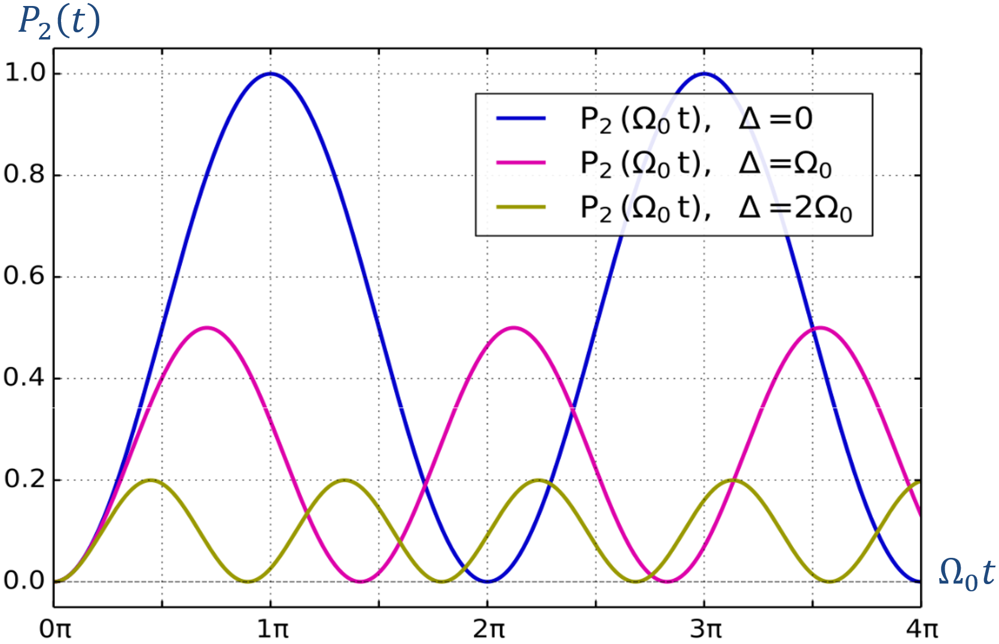
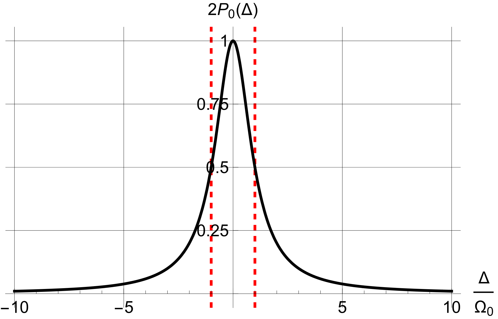
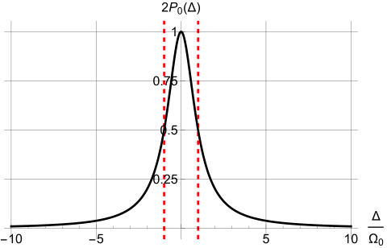

# Transitions

An energy eigenstate stays stationary under a time-independent Hamiltonian. How can we move the system into another energy state? We can apply a weak, periodic disturbance. If it couples the states, even a small disturbance can transfer the population back and forth. Let us see how this works for an electron's spin in a magnetic field.

## Magnetic resonance

Start with an electron in a static field $\mathbf B_0=B_0\hat{\mathbf z}$ and prepare its spin in $\vert U\rangle$. The states $\vert U\rangle$ and $\vert D\rangle$ have energies $\mu_{\mathrm B}B_0$ and $-\mu_{\mathrm B}B_0$. With the static field alone, each is stationary.

Now add a much weaker field $\mathbf B'$ perpendicular to $\mathbf B_0$, in the transverse plane, we call it **the drive**. Let it oscillate at angular frequency $\omega$. Although $|\mathbf B'|\ll|\mathbf B_0|$, we will see just like a small, repeated push: its timing can matter as much as its strength.

Write the transverse field in components:

$$
{\bf{B'}} = {B'_x}{\bf{\hat x}} + {B'_y}{\bf{\hat y}}
$$ {#eq-zeqnnum692846}

### Circularly polarized drive

As a first example, let $\mathbf B'$ rotate in the transverse plane in the same sense as the electron's precession in $\mathbf B_0$:

$$
{B'_x} = B'\cos \omega t; \qquad  \qquad  {B'_y} = B'\sin \omega t
$$ {#eq-zeqnnum766276}

interaction Hamiltonian for the total field is

$$
\hat H = - {{\bf{\mu }}_{\rm{S}}} \cdot \left( {{{\bf{B}}_0} + {\bf{B'}}} \right) = {\hat H_0} + \hat V(t)
$$ {#eq-zeqnnum126030}

have split the Hamiltonian into two parts. The static field gives $\hat H_0$, and the rotating field gives $\hat V$. In the $\hat\sigma_z$ basis,

$$
{\hat H_0} = - {{\bf{\mu }}_{\rm{S}}} \cdot {{\bf{B}}_0} = {\mu _{\rm{B}}}{\hat \sigma _z}{B_0} \buildrel\textstyle.\over= {\mu _{\rm{B}}}\left( {\begin{array}{*{20}{c}} {{B_0}}&0\\ 0&{ - {B_0}} \end{array}} \right) = \frac{\hbar }{2}\left( {\begin{array}{*{20}{c}} {{\omega _0}}&0\\ 0&{ - {\omega _0}} \end{array}} \right)
$$ {#eq-zeqnnum864064}

Here $\omega_0\equiv(E_1-E_2)/\hbar=2\mu_{\mathrm B}B_0/\hbar$ is the **Larmor frequency** in the static field. It sets the natural angular frequency against which we compare the drive.

$$
\begin{aligned}
\hat V(t) &= - {{\bf{\mu }}_{\rm{S}}} \cdot {\bf{B'}} = {\mu _{\rm{B}}}\left( {{{\hat \sigma }_x}{{B'}_x} + {{\hat \sigma }_y}{{B'}_y}} \right) \buildrel\textstyle.\over= {\mu _{\rm{B}}}\left( {\begin{array}{*{20}{c}} 0&{{{B'}_x} - i{{B'}_y}}\\ {{{B'}_x} + i{{B'}_y}}&0 \end{array}} \right) \\
 &= {\mu _{\rm{B}}}\left( {\begin{array}{*{20}{c}} 0&{B'{e^{ - i\omega t}}}\\ {B'{e^{i\omega t}}}&0 \end{array}} \right) = \frac{\hbar }{2}\left( {\begin{array}{*{20}{c}} 0&{{\Omega _0}{e^{ - i\omega t}}}\\ {{\Omega _0}{e^{i\omega t}}}&0 \end{array}} \right)
\end{aligned}
$$ {#eq-zeqnnum833059}

We call $\Omega_0\equiv2\mu_{\mathrm B}B'/\hbar$ the **resonant Rabi frequency**, which measures the strength of the drive in frequency units. (Rabi received the 1944 Nobel Prize in Physics for his magnetic-resonance method using atomic and molecular beams.)

The total Hamiltonian is therefore

$$
\hat H \buildrel\textstyle.\over= \frac{\hbar }{2}\left( {\begin{array}{*{20}{c}} {{\omega _0}}&{{\Omega _0}{e^{ - i\omega t}}}\\ {{\Omega _0}{e^{i\omega t}}}&{ - {\omega _0}} \end{array}} \right)
$$ {#eq-zeqnnum963082}

Expand the spin state in the $\hat\sigma_z$ basis. We also include the initial condition, which puts all the population in $\vert U\rangle$:

$$
\vert {\psi (t)}\rangle = {c_1}(t)\vert U\rangle + {c_2}(t)\left\vert  D \right\rangle \buildrel\textstyle.\over= \left( {\begin{array}{*{20}{c}} {{c_1}(t)}\\ {{c_2}(t)} \end{array}} \right), \qquad  {\left\vert  {{c_1}} \right\vert ^2} + {\left\vert  {{c_2}} \right\vert ^2} = 1,\;\;\left( {\begin{array}{*{20}{c}} {{c_1}(0) = 1}\\ {{c_2}(0) = 0} \end{array}} \right),\;\;
$$ {#eq-zeqnnum361616}

Substituting @eq-zeqnnum963082 and @eq-zeqnnum361616 into the Schrödinger equation gives

$$
\left( {\begin{array}{*{20}{c}} {{{\dot c}_1}}\\ {{{\dot c}_2}} \end{array}} \right) = - \frac{i}{2}\left( {\begin{array}{*{20}{c}} {{\omega _0}}&{{\Omega _0}{e^{ - i\omega t}}}\\ {{\Omega _0}{e^{i\omega t}}}&{ - {\omega _0}} \end{array}} \right)\left( {\begin{array}{*{20}{c}} {{c_1}}\\ {{c_2}} \end{array}} \right)
$$ {#eq-zeqnnum927934}

The rapidly changing phase factors make these equations look more complicated than they need to. We can simply them by defining

$$
{c_1}(t) = {d_1}(t){e^{ - {{i\omega t} \mathord{\left/ {\vphantom {{i\omega t} 2}} \right. \kern-1.2pt } 2}}}; \qquad  {c_2}(t) = {d_2}(t){e^{{{i\omega t} \mathord{\left/ {\vphantom {{i\omega t} 2}} \right. \kern-1.2pt } 2}}}.
$$ {#eq-zeqnnum414068}

This is equivalent of expressing the equation in the reference frame rotating with the drive[^06-transitions-1]. Then, @eq-zeqnnum927934 becomes

[^06-transitions-1]: Some books use the interaction picture, setting ${c_1}(t) = {d_1}(t)\exp ( - {{i{\omega _0}t} \mathord{\left/ {\vphantom {{i{\omega _0}t} 2}} \right. \kern-1.2pt } 2}); \qquad  {c_2}(t) = {d_2}(t)\exp ({{i{\omega _0}t} \mathord{\left/ {\vphantom {{i{\omega _0}t} 2}} \right. \kern-1.2pt } 2})$. The method used here is equivalent to a rotating coordinate frame in classical mechanics and gives a shorter derivation for a two-level system.

$$
\left( {\begin{array}{*{20}{c}} {{{\dot d}_1}}\\ {{{\dot d}_2}} \end{array}} \right) = \frac{i}{2}\left( {\begin{array}{*{20}{c}} \Delta &{ - {\Omega _0}}\\ { - {\Omega _0}}&{ - \Delta } \end{array}} \right)\left( {\begin{array}{*{20}{c}} {{d_1}}\\ {{d_2}} \end{array}} \right), \qquad  \left( {\begin{array}{*{20}{c}} {{d_1}(0)}\\ {{d_2}(0)} \end{array}} \right) = \left( {\begin{array}{*{20}{c}} 1\\ 0 \end{array}} \right)
$$ {#eq-zeqnnum721542}

The difference $\Delta\equiv\omega-\omega_0$ is the **detuning**. It tells us how far the drive is from the natural transition frequency. The solution of @eq-zeqnnum721542 is below; you can follow its derivation in the appendix.

$$
\begin{aligned}
{d_1}(t) &= \cos \frac{{\Omega t}}{2} + i\frac{\Delta }{\Omega }\sin \frac{{\Omega t}}{2} \\
{d_2}(t) &= - i\frac{{{\Omega _0}}}{\Omega }\sin \frac{{\Omega t}}{2}
\end{aligned}
$$ {#eq-zeqnnum460032}

Here $\Omega\equiv\sqrt{\Delta^2+\Omega_0^2}$ is the **generalized Rabi frequency**. To recover $\vert\psi(t)\rangle$, substitute @eq-zeqnnum460032 into @eq-zeqnnum414068 and then into @eq-zeqnnum361616. The probabilities for the two spin states are

$$
\begin{aligned}
{P_1}(t) \equiv {\left\vert  {{c_1}(t)} \right\vert ^2} &= \frac{1}{2}\left( {1 + \frac{{{\Delta ^2}}}{{{\Omega ^2}}}} \right) + \frac{1}{2}\frac{{\Omega _0^2}}{{{\Omega ^2}}}\cos \Omega t\xrightarrow{{\Delta = 0}}\frac{1}{2}\left( {1 + \cos {\Omega _0}t} \right) \\
{P_2}(t) \equiv {\left\vert  {{c_2}(t)} \right\vert ^2} &= \frac{1}{2}\frac{{\Omega _0^2}}{{{\Omega ^2}}}\left( {1 - \cos \Omega t} \right)\xrightarrow{{\Delta = 0}}\frac{1}{2}\left( {1 - \cos {\Omega _0}t} \right) \\
\Delta &\equiv \omega - {\omega _0},\, \qquad  {\Omega _0} \equiv {{2{\mu _{\text{B}}}B'} \mathord{\left/ {\vphantom {{2{\mu _{\text{B}}}B'} \hbar }} \right. \kern-1.2pt } \hbar }, \qquad  \;\;\;\;\;\;\Omega \equiv \sqrt {{\Delta ^2} + \Omega _0^2} ,
\end{aligned}
$$ {#eq-zeqnnum748213}

The probabilities $P_1$ and $P_2$ oscillate at angular frequency $\Omega$. Population flows from one level to the other and then back again. We call this motion **Rabi oscillation**.

Figure 6.1 shows how $P_2(t)$ changes when we vary the detuning. At $\Delta=0$, the drive is on **resonance**. The probability $P_2$ swings all the way from zero to one. The oscillation is slowest here, but its range is largest. Away from resonance, the oscillations get faster and their range shrinks.

According to \@eq-zeqnnum748213: at even multiples of $\pi$ in $\Omega t$, the initial population returns, with $P_2=0$ and $P_1=1$. At odd multiples, $P_2$ reaches its maximum for that detuning. Only on resonance does that maximum reach one, giving complete transfer to the other level.

As $P_2$ grows, the electron spin moves toward the lower-energy state. Its mean magnetic energy decreases, and energy goes to the drive. This is **stimulated emission**. As $P_2$ falls, the electron takes energy from the drive. This is **stimulated absorption**. The same coupling produces both processes, which explains why the corresponding Einstein coefficients are equal.

:::: text-center
{width="410px"}

::: source-caption
Figure 6.1. Probability of electron spin state $\vert D\rangle$ versus time at different detunings.
:::
::::

How much population can the drive transfer? By @eq-zeqnnum748213, the size of the oscillating part of either probability is

$$
{P_0}(\Delta ) = \frac{1}{2}\frac{{\Omega _0^2}}{{{\Omega ^2}}} = \frac{1}{2}\frac{{\Omega _0^2}}{{{\Delta ^2} + \Omega _0^2}}
$$ {#eq-zeqnnum340775}

Figure 6.2 shows the detuning dependence of $P_0(\Delta)$ with fixed drive strength $\Omega_0$. It is a Lorentizian peak whose half-width at half-maximum (HWHM) is $\Omega_0$: at that detuning, the peak has fallen to half its height. A stronger drive therefore makes the resonance broader. We call this **power broadening**. It matters when we use magnetic resonance or spectroscopy to measure energy-level separations.

:::: text-center
{width="379px"}{width="379px"}

::: source-caption
Figure 6.2. ${P_0}(\Delta )$ peaks at $\Delta = 0$ and has HWHM ${\Omega _0}$. Zero detuning is resonance.
:::
::::

We can also follow the mean spin vector by calculating $\langle\psi(t)\vert\hat S_{x,y,z}\vert\psi(t)\rangle$:

$$
\begin{aligned}
\langle {{{\hat S}_z}}(t)\rangle &= \frac{\hbar }{2}\left( {\begin{array}{*{20}{c}} {c_1^*,}&{c_2^*} \end{array}} \right)\left( {\begin{array}{*{20}{c}} 1&0 \\ 0&{ - 1} \end{array}} \right)\left( {\begin{array}{*{20}{c}} {{c_1}} \\ {{c_2}} \end{array}} \right) = \frac{\hbar }{2}\left( {{{\left\vert  {{c_1}} \right\vert }^2} - {{\left\vert  {{c_2}} \right\vert }^2}} \right) \\
 &= \frac{\hbar }{2}\left[ {\left( {1 - \frac{{\Omega _0^2}}{{{\Omega ^2}}}} \right) + \frac{{\Omega _0^2}}{{{\Omega ^2}}}\cos \Omega t} \right]\xrightarrow{{\Delta = 0}}\frac{\hbar }{2}\cos {\Omega _0}t
\end{aligned}
$$ {#eq-ch06-p1453}

$$
\begin{aligned}
\langle {{{\hat S}_x}(t)}\rangle &= \frac{\hbar }{2}\left( {\begin{array}{*{20}{c}} {c_1^*,}&{c_2^*} \end{array}} \right)\left( {\begin{array}{*{20}{c}} 0&1 \\ 1&0 \end{array}} \right)\left( {\begin{array}{*{20}{c}} {{c_1}} \\ {{c_2}} \end{array}} \right) = \frac{\hbar }{2}\left( {{c_1}c_2^* + c_1^*{c_2}} \right) \\
 &= \frac{\hbar }{2}\frac{{{\Omega _0}}}{{{\Omega ^2}}}\left[ {\Omega \sin \Omega t\sin \omega t - \Delta (1 - \cos \Omega t)\cos \omega t} \right] \\
 &\xrightarrow{{\Delta = 0}}\frac{\hbar }{2}\sin {\Omega _0}t\sin {\omega _0}t
\end{aligned}
$$ {#eq-ch06-p1454}

$$
\begin{aligned}
\langle {{{\hat S}_y}(t)}\rangle &= \frac{\hbar }{2}\left( {\begin{array}{*{20}{c}} {c_1^*,}&{c_2^*} \end{array}} \right)\left( {\begin{array}{*{20}{c}} 0&{ - i} \\ i&0 \end{array}} \right)\left( {\begin{array}{*{20}{c}} {{c_1}} \\ {{c_2}} \end{array}} \right) = \frac{{i\hbar }}{2}\left( {{c_1}c_2^* - c_1^*{c_2}} \right) \\
 &= - \frac{\hbar }{2}\frac{{{\Omega _0}}}{{{\Omega ^2}}}\left[ {\Omega \sin \Omega t\cos \omega t + \Delta (1 - \cos \Omega t)\sin \omega t} \right] \\
 &\xrightarrow{{\Delta = 0}} - \frac{\hbar }{2}\sin {\Omega _0}t\cos {\omega _0}t
\end{aligned}
$$ {#eq-ch06-p1455}

### Linearly polarized drive

We have worked out the transition caused by a circularly polarized drive. Now let us study the case for a linearly polarized drive. Let it point along $x$ and have amplitude $2B'$. We can write it as

$$
{B'_x} = 2B'\cos \omega t; \qquad  \qquad  {B'_y} = 0
$$ {#eq-ch06-p1457}

Its interaction with the electron's magnetic moment gives

$$
\begin{aligned}
\hat V(t) &= 2{\mu _{\rm{B}}}B'\cos \omega t\left( {\begin{array}{*{20}{c}} 0&1\\ 1&0 \end{array}} \right) = \hbar \left( {\begin{array}{*{20}{c}} 0&{{\Omega _0}\cos \omega t}\\ {{\Omega _0}\cos \omega t}&0 \end{array}} \right) \\
 &= \frac{\hbar }{2}\left( {\begin{array}{*{20}{c}} 0&{{\Omega _0}({e^{i\omega t}} + {e^{ - i\omega t}})}\\ {{\Omega _0}({e^{i\omega t}} + {e^{ - i\omega t}})}&0 \end{array}} \right)
\end{aligned}
$$ {#eq-zeqnnum472633}

Following @eq-zeqnnum833059 through @eq-zeqnnum927934, the Schrödinger equation becomes

$$
\left( {\begin{array}{*{20}{c}} {{{\dot c}_1}}\\ {{{\dot c}_2}} \end{array}} \right) = - \frac{i}{2}\left( {\begin{array}{*{20}{c}} {{\omega _0}}&{{\Omega _0}({e^{i\omega t}} + {e^{ - i\omega t}})}\\ {{\Omega _0}({e^{i\omega t}} + {e^{ - i\omega t}})}&{ - {\omega _0}} \end{array}} \right)\left( {\begin{array}{*{20}{c}} {{c_1}}\\ {{c_2}} \end{array}} \right)
$$ {#eq-ch06-p1461}

Using the definitions and method following @eq-zeqnnum414068 gives

$$
\begin{aligned}
{{\dot d}_1} &= \frac{i}{2}\left[ {\Delta {d_1} - {\Omega _0}({e^{2i\omega t}} + 1){d_2}} \right], \\
{{\dot d}_2} &= \frac{i}{2}\left[ { - {\Omega _0}(1 + {e^{ - 2i\omega t}}){d_1} - \Delta {d_2}} \right],
\end{aligned}
$$ {#eq-zeqnnum877206}

Now assume the weak drive is close to resonance: $B'\ll B_0$ and $\Omega_0,|\Delta|\ll\omega_0,\omega$. In @eq-zeqnnum877206, the factors $e^{\pm2i\omega t}$ then cycle much faster than $d_1$ and $d_2$ change. Their effects largely average out. Dropping these fast oscillating terms is called the **rotating-wave approximation**. Then the equation reduces to @eq-zeqnnum721542, so we can reuse the solution we already have.

Therefore, near resonance, a weak linear drive acts approximately like a circular drive with half its amplitude.

## Transitions in a general two-level system

The same mathematics works far beyond electron spin. Consider any two-level system with energy separation $\hbar\omega_0$. We can choose the zero of energy halfway between the levels and write

$$
\begin{aligned}
{{\hat H}_0}\vert 1\rangle &= \hbar \frac{{{\omega _0}}}{2}\vert 1\rangle \\
{{\hat H}_0}\vert 2\rangle &= - \hbar \frac{{{\omega _0}}}{2}\vert 2\rangle
\end{aligned}
$$ {#eq-ch06-p1468}

Here $\vert 1\rangle$ is the excited state and $\vert 2\rangle$ is the ground state. In this energy basis,

$$
{\hat H_0} = \hbar \left( {\begin{array}{*{20}{c}} {{{{\omega _0}} \mathord{\left/ {\vphantom {{{\omega _0}} 2}} \right. \kern-1.2pt } 2}}&0\\ 0&{{{ - {\omega _0}} \mathord{\left/ {\vphantom {{ - {\omega _0}} 2}} \right. \kern-1.2pt } 2}} \end{array}} \right)
$$ {#eq-zeqnnum616848}

Adding a oscillating perturbation $\hat V(t) = {\hat V_0}\cos \omega t$ gives

$$
\hat V(t) = \left( {\begin{array}{*{20}{c}} {\langle 1\vert {{{\hat V}_0}}\vert 1\rangle }&{\langle 1\vert {{{\hat V}_0}}\vert 2\rangle }\\ {{{\langle 1\vert {{{\hat V}}_0}\vert 2\rangle }^*}}&{\langle 2\vert {{{\hat V}_0}}\vert 2\rangle } \end{array}} \right)\cos \omega t
$$ {#eq-ch06-p1472}

It is very common we will see cases with zero diagonal elements $\langle1\vert\hat V_0\vert1\rangle=\langle2\vert\hat V_0\vert2\rangle=0$, and a real off-diagonal element $\langle1\vert\hat V_0\vert2\rangle$. Define $\Omega_0\equiv\langle1\vert\hat V_0\vert2\rangle/\hbar$. Then

$$
\hat V(t) = \hbar \left( {\begin{array}{*{20}{c}} 0&{{\Omega _0}\cos \omega t}\\ {\Omega _0^{}\cos \omega t}&0 \end{array}} \right)
$$ {#eq-zeqnnum790744}

Compare @eq-zeqnnum616848 and @eq-zeqnnum790744 with @eq-zeqnnum864064 and @eq-zeqnnum472633. They have the same form. We can therefore use the spin-1/2 magnetic-resonance calculation to describe this two-level transition too.

Thus, we obtain some common properties of transitions:

1.  A transition is possible only when the perturbation have non-zero matrix element connecting the two end states of the transition, thus they are called transition matrix elements.
2.  When the oscillating frequency of the perturbation is resonant with the energy gap of the two states, largest population swing occurs.
3.  The resonant transition rate ( $\Omega_0$ ) is proportional to the transition matrix element.

## \* Density matrices and the Bloch vector

So far, we have followed two complex amplitudes, $d_1$ and $d_2$. Can we picture their evolution? The **Bloch vector** turns this algebra into motion in ordinary three-dimensional space.

After choosing an overall phase, we can write any pure state of a two-level system as

$$
\left( {\begin{array}{*{20}{c}} {{d_1}}\\ {{d_2}} \end{array}} \right) = \left( {\begin{array}{*{20}{c}} {\cos \frac{\theta }{2}}\\ {{e^{i\phi }}\sin \frac{\theta }{2}} \end{array}} \right)
$$ {#eq-ch06-p1479}

Define a real vector $\mathbf P=\{u,v,w\}$, called the **Bloch vector**:

$$
\begin{aligned}
u &= {\rho _{12}} + {\rho _{21}} \\
v &= i({\rho _{12}} - {\rho _{21}}) \\
\omega &= {\rho _{11}} - {\rho _{22}}
\end{aligned}
$$ {#eq-zeqnnum365247}

where

$$
{\rho _{ij}} \equiv {d_i}d_j^*
$$ {#eq-zeqnnum448235}

$$
\begin{aligned}
{\rho _{12}} &= \frac{1}{2}{e^{ - i\phi }}\sin \theta \\
{\rho _{21}} &= \frac{1}{2}{e^{i\phi }}\sin \theta \\
{\rho _{11}} &= \frac{{1 + \cos \theta }}{2} \\
{\rho _{22}} &= \frac{{1 - \cos \theta }}{2}
\end{aligned}
$$ {#eq-ch06-p1484}

By @eq-zeqnnum365247,

$$
\begin{aligned}
u &= {\rho _{12}} + {\rho _{21}} = \sin \theta \cos \phi \\
v &= i({\rho _{12}} - {\rho _{21}}) = \sin \theta \sin \phi \\
\omega &= {\rho _{11}} - {\rho _{22}} = \cos \theta
\end{aligned}
$$ {#eq-ch06-p1486}

Check that $u^2+v^2+w^2=1$. The Bloch vector has unit length, and $\theta$ and $\phi$ give its direction. Its tip lies on the **Bloch sphere**. Each point on this surface represents a pure state. For example,

$$
\begin{array}{*{20}{c}} {\left( {0,0,1} \right) \leftrightarrow \;\vert U\rangle }&{\left( {0,0, - 1} \right) \leftrightarrow \;\vert D\rangle }\\ {\left( {1,0,0} \right) \leftrightarrow \;\frac{1}{{\sqrt 2 }}\left( {\;\vert U\rangle + \;\vert D\rangle } \right)}&{\left( { - 1,0,0} \right) \leftrightarrow \frac{1}{{\sqrt 2 }}\left( {\;\vert U\rangle - \;\vert D\rangle } \right)}\\ {\left( {0,1,0} \right) \leftrightarrow \;\;\frac{1}{{\sqrt 2 }}\left( {\;\vert U\rangle + i\;\vert D\rangle } \right)}&{\left( {0, - 1,0} \right) \leftrightarrow \;\frac{1}{{\sqrt 2 }}\left( {\;\vert U\rangle - i\;\vert D\rangle } \right)} \end{array}
$$ {#eq-ch06-p1488}

To see how the vector moves, differentiate its components. @eq-zeqnnum721542 and @eq-zeqnnum448235 give

$$
\begin{aligned}
{{\dot \rho }_{12}} &= i\Delta {\rho _{12}} + i\frac{{{\Omega _0}}}{2}\left( {{\rho _{11}} - {\rho _{22}}} \right) \\
{{\dot \rho }_{21}} &= - i\Delta {\rho _{21}} - i\frac{{{\Omega _0}}}{2}\left( {{\rho _{11}} - {\rho _{22}}} \right) \\
{{\dot \rho }_{11}} &= i\frac{{{\Omega _0}}}{2}\left( {{\rho _{12}} - {\rho _{21}}} \right) \\
{{\dot \rho }_{22}} &= - i\frac{{{\Omega _0}}}{2}\left( {{\rho _{12}} - {\rho _{21}}} \right)
\end{aligned}
$$ {#eq-zeqnnum821674}

Using @eq-zeqnnum821674 and @eq-zeqnnum365247,

$$
\begin{aligned}
\frac{{du}}{{dt}} &= \Delta v \\
\frac{{dv}}{{dt}} &= - \Delta u - {\Omega _0}w \\
\frac{{dw}}{{dt}} &= {\Omega _0}v
\end{aligned}
$$ {#eq-zeqnnum729193}

Now define $\boldsymbol\Omega=\{\Omega_0,0,-\Delta\}$. We can gather the three equations in @eq-zeqnnum729193 into one vector equation:

$$
\frac{{d{\bf{P}}}}{{dt}} = {\bf{\Omega }} \times {\bf{P}}
$$ {#eq-zeqnnum862867}

The vector $\boldsymbol\Omega$ is constant. @eq-zeqnnum862867 therefore describes precession: $\mathbf P$ sweeps around $\boldsymbol\Omega$ at angular speed $|\boldsymbol\Omega|=\sqrt{\Omega_0^2+\Delta^2}$. This is the geometric picture behind our two-level solution.[^06-transitions-2] For a linear drive, it holds within the rotating-wave approximation.

[^06-transitions-2]: Feynman, Vernon, and Hellwarth, “GEOMETRICAL REPRESENTATION OF THE SCHRODINGER EQUATION FOR SOLVING MASER PROBLEMS.”

## Appendix

Let us work through the solution of @eq-zeqnnum721542. First write the two equations together:

$$
\left( {\begin{array}{*{20}{c}} {{{\dot d}_1}}\\ {{{\dot d}_2}} \end{array}} \right) = \frac{i}{2}\left( {\begin{array}{*{20}{c}} \Delta &{ - {\Omega _0}}\\ { - {\Omega _0}}&{ - \Delta } \end{array}} \right)\left( {\begin{array}{*{20}{c}} {{d_1}}\\ {{d_2}} \end{array}} \right), \qquad  \left( {\begin{array}{*{20}{c}} {{d_1}(0)}\\ {{d_2}(0)} \end{array}} \right) = \left( {\begin{array}{*{20}{c}} 1\\ 0 \end{array}} \right)
$$ {#eq-ch06-p1500}

Try an exponential solution, $(d_1,d_2)=(k_1,k_2)e^{i\lambda t/2}$, with constant $k_1$ and $k_2$. Substitution gives an eigenvalue problem:

$$
\lambda \left( {\begin{array}{*{20}{c}} {{k_1}}\\ {{k_2}} \end{array}} \right) = \left( {\begin{array}{*{20}{c}} \Delta &{ - {\Omega _0}}\\ { - {\Omega _0}}&{ - \Delta } \end{array}} \right)\left( {\begin{array}{*{20}{c}} {{k_1}}\\ {{k_2}} \end{array}} \right) \Rightarrow \left( {\begin{array}{*{20}{c}} {\Delta - \lambda }&{ - {\Omega _0}}\\ { - {\Omega _0}}&{ - \Delta - \lambda } \end{array}} \right)\left( {\begin{array}{*{20}{c}} {{k_1}}\\ {{k_2}} \end{array}} \right) = \lvert\mathrm{null}\rangle,
$$ {#eq-zeqnnum238012}

For a nonzero eigenvector, the determinant must vanish:

$$
\left\vert  {\begin{array}{*{20}{c}} {\Delta - \lambda }&{ - {\Omega _0}}\\ { - {\Omega _0}}&{ - \Delta - \lambda } \end{array}} \right\vert  = 0
$$ {#eq-ch06-p1504}

The two eigenvalues are $\lambda_\pm=\pm\Omega$, where $\Omega=\sqrt{\Omega_0^2+\Delta^2}$. Put each one into @eq-zeqnnum238012 to find its eigenvector:

$$
\vert \lambda\rangle \equiv \left( {\begin{array}{*{20}{c}} {{k_1}}\\ {{k_2}} \end{array}} \right): \qquad  \vert {{\lambda _ + }}\rangle = \left( {\begin{array}{*{20}{c}} {{\Omega _0}}\\ {\Delta - \Omega } \end{array}} \right), \qquad  \vert {{\lambda _ - }}\rangle = \left( {\begin{array}{*{20}{c}} {{\Omega _0}}\\ {\Delta + \Omega } \end{array}} \right)
$$ {#eq-ch06-p1506}

Combine the two solutions to get the general one:

$$
\left( {\begin{array}{*{20}{c}} {{d_1}(t)}\\ {{d_2}(t)} \end{array}} \right) = {g_ + }\left( {\begin{array}{*{20}{c}} {{\Omega _0}}\\ {\Delta - \Omega } \end{array}} \right)\exp \left( {{{i{\lambda _ + }t} \mathord{\left/ {\vphantom {{i{\lambda _ + }t} 2}} \right. \kern-1.2pt } 2}} \right) + {g_ - }\left( {\begin{array}{*{20}{c}} {{\Omega _0}}\\ {\Delta + \Omega } \end{array}} \right)\exp \left( {{{i{\lambda _ - }t} \mathord{\left/ {\vphantom {{i{\lambda _ - }t} 2}} \right. \kern-1.2pt } 2}} \right)
$$ {#eq-zeqnnum771504}

The initial state fixes the coefficients $g_\pm$:

$$
\left( {\begin{array}{*{20}{c}} 1\\ 0 \end{array}} \right) = {g_ + }\left( {\begin{array}{*{20}{c}} {{\Omega _0}}\\ {\Delta - \Omega } \end{array}} \right) + {g_ - }\left( {\begin{array}{*{20}{c}} {{\Omega _0}}\\ {\Delta + \Omega } \end{array}} \right) = \left( {\begin{array}{*{20}{c}} {{\Omega _0}}&{{\Omega _0}}\\ {\Delta - \Omega }&{\Delta + \Omega } \end{array}} \right)\left( {\begin{array}{*{20}{c}} {{g_ + }}\\ {{g_ - }} \end{array}} \right) = D\left( {\begin{array}{*{20}{c}} {{g_ + }}\\ {{g_ - }} \end{array}} \right)
$$ {#eq-ch06-p1510}

Therefore,

$$
\left( {\begin{array}{*{20}{c}} {{g_ + }}\\ {{g_ - }} \end{array}} \right) = {D^{ - 1}}\left( {\begin{array}{*{20}{c}} 1\\ 0 \end{array}} \right) = \frac{1}{{2{\Omega _0}\Omega }}\left( {\begin{array}{*{20}{c}} {\Omega + \Delta }&{ - {\Omega _0}}\\ {\Omega - \Delta }&{{\Omega _0}} \end{array}} \right)\left( {\begin{array}{*{20}{c}} 1\\ 0 \end{array}} \right) = \frac{1}{{2{\Omega _0}\Omega }}\left( {\begin{array}{*{20}{c}} {\Omega + \Delta }\\ {\Omega - \Delta } \end{array}} \right)
$$ {#eq-ch06-p1512}

Substituting ${g_ \pm }$ into @eq-zeqnnum771504 gives

$$
\begin{aligned}
\left( {\begin{array}{*{20}{c}} {{d_1}(t)}\\ {{d_2}(t)} \end{array}} \right) &= \frac{1}{{2{\Omega _0}\Omega }}\left( {\begin{array}{*{20}{c}} {(\Omega + \Delta ){\Omega _0}}\\ {(\Omega + \Delta )(\Delta - \Omega )} \end{array}} \right){e^{{{i{\lambda _ + }t} \mathord{\left/ {\vphantom {{i{\lambda _ + }t} 2}} \right. \kern-1.2pt } 2}}} + \frac{1}{{2{\Omega _0}\Omega }}\left( {\begin{array}{*{20}{c}} {(\Omega - \Delta ){\Omega _0}}\\ {(\Omega - \Delta )(\Delta + \Omega )} \end{array}} \right){e^{{{i{\lambda _ - }t} \mathord{\left/ {\vphantom {{i{\lambda _ - }t} 2}} \right. \kern-1.2pt } 2}}}\\
&= \frac{1}{{2{\Omega _0}\Omega }}\left( {\begin{array}{*{20}{c}} {(\Omega + \Delta ){\Omega _0}{e^{{{i\Omega t} \mathord{\left/ {\vphantom {{i\Omega t} 2}} \right. \kern-1.2pt } 2}}} + (\Omega - \Delta ){\Omega _0}{e^{{{ - i\Omega t} \mathord{\left/ {\vphantom {{ - i\Omega t} 2}} \right. \kern-1.2pt } 2}}}}\\ { - \Omega _0^2{e^{{{i\Omega t} \mathord{\left/ {\vphantom {{i\Omega t} 2}} \right. \kern-1.2pt } 2}}} + \Omega _0^2{e^{{{ - i\Omega t} \mathord{\left/ {\vphantom {{ - i\Omega t} 2}} \right. \kern-1.2pt } 2}}}} \end{array}} \right)\\
&= \left( {\begin{array}{*{20}{c}} {\cos \left( {\frac{\Omega }{2}t} \right) + \frac{{i\Delta }}{\Omega }\sin \left( {\frac{\Omega }{2}t} \right)}\\ { - \frac{{i{\Omega _0}}}{\Omega }\sin \left( {\frac{\Omega }{2}t} \right)} \end{array}} \right)
\end{aligned}
$$ {#eq-ch06-p1514}

## Exercises

Ignore relaxation in both problems. Use the circularly polarized drive from this chapter, with constant amplitude while it is on. Take $\Omega_0>0$.

**6.1. Flipping a spin with a pulse.** Prepare an electron in $\vert U\rangle$. Turn on a resonant drive, so $\Delta=0$, and switch it off after a time $\tau$. This finite burst of the drive is called a **pulse**. Work in the rotating frame, using the amplitudes $d_1$ and $d_2$ defined in @eq-zeqnnum414068.

(1) Find $d_1(\tau)$ and $d_2(\tau)$. What is the probability of measuring $\vert D\rangle$ immediately after the pulse?

(2) Find the shortest pulse that transfers the electron completely to $\vert D\rangle$. Then find the shortest pulse that gives equal probabilities for $\vert U\rangle$ and $\vert D\rangle$. These are called a $\pi$ pulse and a $\pi/2$ pulse, respectively. For the $\pi/2$ pulse, also write the rotating-frame state and identify its relative phase. Do equal probabilities mean that the electron has lost its definite pure state?

(3) Suppose $\Omega_0/(2\pi)=25\,\mathrm{kHz}$. Calculate both pulse durations in microseconds. If you double the drive amplitude $B'$, how should you change the durations to produce the same final states?

Hint: use @eq-zeqnnum460032 with $\Delta=0$. Keep the complex amplitudes until you have found the state; taking their squared magnitudes too early loses the relative phase.

**6.2. A faster oscillation with a smaller swing.** Prepare another electron in $\vert U\rangle$. Keep the drive strength $\Omega_0$ fixed, but allow a nonzero detuning $\Delta=\omega-\omega_0$. Let the drive remain on.

(1) Starting from @eq-zeqnnum748213, show that the transition probability can be written as

$$
P_2(t)=\frac{\Omega_0^2}{\Omega_0^2+\Delta^2}
\sin^2\!\left(\frac{\sqrt{\Omega_0^2+\Delta^2}\,t}{2}\right).
$$ {#eq-ch06-ex-detuned-probability}

(2) Set $\Delta=\Omega_0$. Find the largest possible value of $P_2$ and the earliest time when it occurs. Compare this time with the resonant $\pi$-pulse duration. Can waiting longer give complete population transfer?

(3) You want at least $90\%$ of the population in $\vert D\rangle$ at some time. What range of detunings allows this? Express your answer as a bound on $|\Delta|/\Omega_0$.