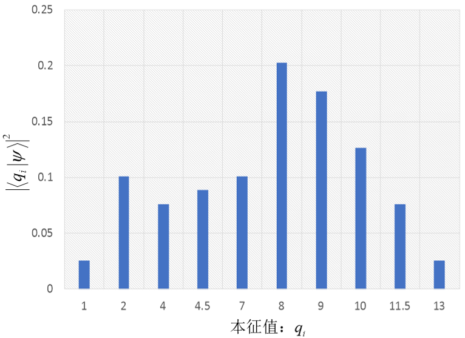
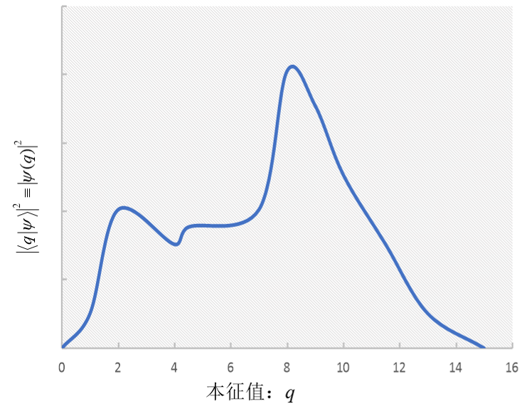
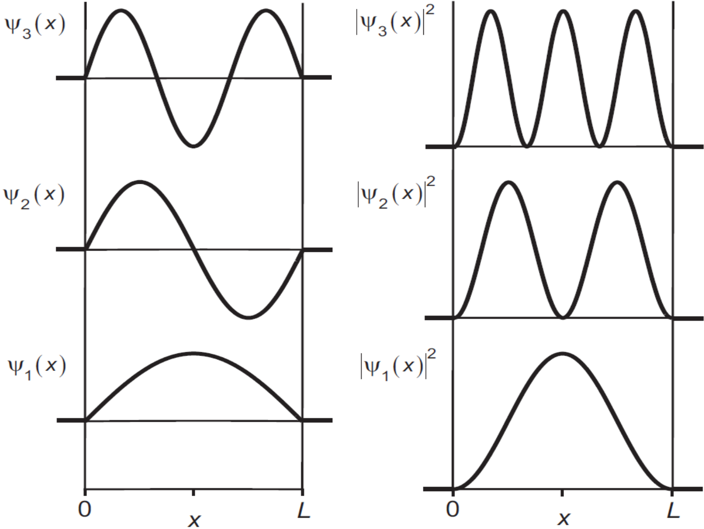
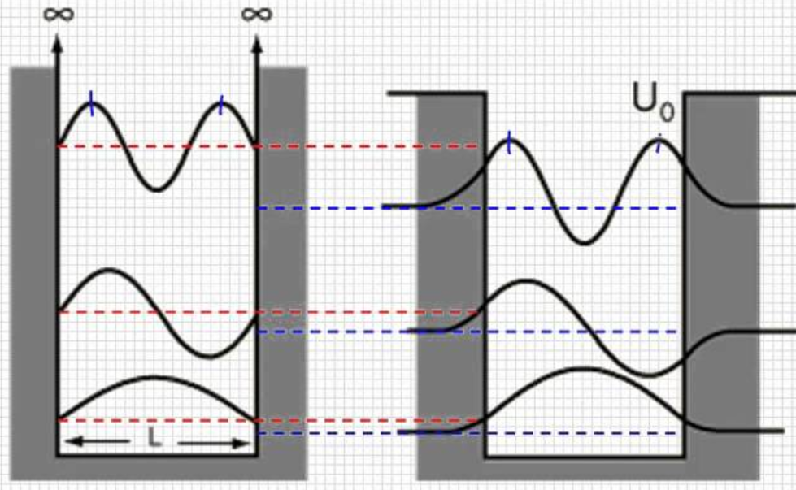
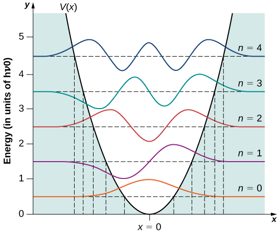

# Continuous Observables

A spin measurement gives us a short list of possible results. A position measurement is different: the result can lie anywhere along a line. How do we describe this continuous range? We keep the ideas we already know, but replace sums with integrals and probabilities with probability densities. These are **continuous representations**. Unless we state otherwise, integrals in this chapter run from negative to positive infinity.

## The Dirac delta function

We first need a mathematical tool that can pick out one point from a continuous range. The **Dirac delta function**, $\delta(x-x')$, does this job. Here $x$ is the variable and $x'$ marks a fixed point. Picture a spike at $x'$ with zero width and unit area. The first expression below is shorthand for that picture; the integral states its essential normalization:

$$
\delta \left( {x - x'} \right) = \left\{ {\begin{array}{*{20}{c}} {\infty ,}&{x = x'}\\ {0,}&{x \ne x'} \end{array}} \right.
$$ {#eq-ch07-p1520}

$$
\int_{ - \infty }^\infty {\delta \left( {x - x'} \right)dx} = 1
$$ {#eq-ch07-p1521}

The delta function obeys several useful rules:

$$
\delta \left( {x - x'} \right) = \delta \left( {x' - x} \right)
$$ {#eq-ch07-p1523}

$$
\delta \left( {x - x'} \right)F\left( x \right) = \delta \left( {x - x'} \right)F\left( {x'} \right)
$$ {#eq-ch07-p1524}

$$
\int {dx\;\delta \left( {x - x'} \right)F\left( x \right)} = F\left( {x'} \right)
$$ {#eq-zeqnnum269859}

@eq-zeqnnum269859 captures the key idea: inside an integral, the delta function picks out the value of $F$ at $x'$. In fact, we can use this rule as its definition. The delta function is a distribution, so we use it through such integrals rather than treat it as an ordinary function.

We can also build the delta function from waves. Recall that a Fourier expansion writes $F(x)$ as a superposition of $\exp(ikx)$:

$$
F\left( x \right) = \frac{1}{{\sqrt {2\pi } }}\int\limits_{{\rm{ - }}\infty }^{{\rm{ + }}\infty } {dk\;\widetilde F\left( k \right)\exp \left( {ikx} \right)}
$$ {#eq-zeqnnum712670}

The coefficient $\widetilde F(k)$ tells us how much of each wave to include:

$$
\widetilde F\left( k \right) = \frac{1}{{\sqrt {2\pi } }}\int\limits_{{\rm{ - }}\infty }^\infty {dx\;F\left( x \right)\exp \left( { - ikx} \right)}
$$ {#eq-zeqnnum971789}

We call $F(x)$ and $\widetilde F(k)$ a Fourier-transform pair. Substitute @eq-zeqnnum971789 into @eq-zeqnnum712670:

$$
\begin{aligned}
F\left( {x'} \right) &= \frac{1}{{\sqrt {2\pi } }}\int {dk\;\widetilde F\left( k \right)\exp \left( {ikx'} \right)} \\
 &= \frac{1}{{\sqrt {2\pi } }}\int {dk\;\left[ {\frac{1}{{\sqrt {2\pi } }}\int\limits_{{\rm{ - }}\infty }^\infty {dx\;F\left( x \right)\exp \left( { - ikx} \right)} } \right]\exp \left( {ikx'} \right)} \\
 &= \int {dx\left\{ {\frac{1}{{2\pi }}\int {dk\exp \left[ {ik\left( {x' - x} \right)} \right]} } \right\}F\left( x \right)} \\
 &= \int {dx\left\{ {\frac{1}{{2\pi }}\int {dk\exp \left[ {ik\left( {x - x'} \right)} \right]} } \right\}F\left( x \right)}
\end{aligned}
$$ {#eq-zeqnnum832633}

The expression in braces must pick out $F(x')$. Compare it with @eq-zeqnnum269859 to identify

$$
\delta \left( {x - x'} \right) = \frac{1}{{2\pi }}\int_{ - \infty }^\infty {dk\exp \left[ {ik\left( {x - x'} \right)} \right]}
$$ {#eq-zeqnnum117049}

$$
\delta \left( x \right) = \frac{1}{{2\pi }}\int_{ - \infty }^\infty {dk\exp \left( {ikx} \right)} = \frac{1}{{\sqrt {2\pi } }}\int_{ - \infty }^\infty {dk\frac{1}{{\sqrt {2\pi } }}\exp \left( {ikx} \right)}
$$ {#eq-zeqnnum893086}

This is the **Fourier representation** of the delta function. Compare @eq-zeqnnum893086 with @eq-zeqnnum712670: the transform of a spike $\delta(x)$ is the constant $1/\sqrt{2\pi}$. A perfectly localized spike requires contributions from every wave number.

## Continuous representations and wavefunctions

Let us translate our familiar discrete-basis formulas into continuous ones. For a discrete observable $\hat Q$, we label the eigenvalues $q_i$. For a continuous observable, the label itself becomes a continuous variable, $q$. We use $q'$ and $q''$ when we need additional labels.

{width=286px}{width=265px}

::: {.source-caption}
Figure 7.1. Left: ${\left\vert  {\langle {{q_i}}\vert \psi\rangle } \right\vert ^2}$ is a probability in a discrete representation. Right: ${\left\vert  {\langle q\vert \psi\rangle } \right\vert ^2}$ is a probability density in a continuous representation.
:::

Start with the discrete case. We expand a state $\vert\psi\rangle$ in the $\hat Q$ basis as

$$
\left\vert  \psi \right\rangle = \sum\limits_i {\left\vert  {{q_i}} \right\rangle \left\langle {{{q_i}}} \mathrel{\left \vert  {\vphantom {{{q_i}} \psi }} \right. \kern-1.2pt } {\psi } \right\rangle }
$$ {#eq-ch07-p1542}

Each coefficient $\langle q_i\vert\psi\rangle$ is a probability amplitude. Its squared magnitude gives the probability of measuring $q_i$. The probabilities must add to one:

$$
\sum\limits_i {{{\left\vert  {\left\langle {{{q_i}}} \mathrel{\left \vert  {\vphantom {{{q_i}} \psi }} \right. \kern-1.2pt } {\psi } \right\rangle } \right\vert }^2}} = 1
$$ {#eq-zeqnnum779322}

In the continuous case, the amplitudes form a function of $q$. We give that function a shorter name:

$$
\left\langle {q} \mathrel{\left \vert  {\vphantom {q \psi }} \right. \kern-1.2pt } {\psi } \right\rangle \equiv \psi \left( q \right)
$$ {#eq-ch07-p1546}

This function is the **wavefunction** in the $\hat Q$ representation. It is another way to write the state $\vert\psi\rangle$; it need not describe an ordinary physical wave. Now the possible outcomes fill a continuous range, so normalization uses an integral in place of the sum in @eq-zeqnnum779322:

$$
\int {dq} {\left\vert  {\psi (q)} \right\vert ^2} = 1
$$ {#eq-zeqnnum469206}

Here is the key distinction: $|\psi(q)|^2$ is a **probability density**, not a probability for one exact value. For a small interval from $q$ to $q+dq$, the probability is $|\psi(q)|^2dq$. The density therefore has units of inverse $q$, so multiplying by $dq$ gives a dimensionless probability.

For the ordinary position wavefunctions used in our examples, we impose the following conditions. They express the need for a well-defined wavefunction, suitable boundary behavior, and normalizable probabilities. Idealized eigenstates, such as exact position and momentum states, need separate treatment.

- **Single-valued:** at each $q$, the wavefunction has one complex value $\psi(q)$. We may choose an overall phase for the whole state.

- **Continuous:** the wavefunction joins smoothly in value across the regions considered here.

- **Vanishing at infinity:** for the localized states considered here, $\psi(q)\to0$ as $q\to\pm\infty$.

Now write the normalization condition @eq-zeqnnum469206 in bra–ket notation:

$$
\left\langle {\psi } \mathrel{\left \vert  {\vphantom {\psi \psi }} \right. \kern-1.2pt } {\psi } \right\rangle = 1 = \int {dq} {\left\vert  {\left\langle {q} \mathrel{\left \vert  {\vphantom {q \psi }} \right. \kern-1.2pt } {\psi } \right\rangle } \right\vert ^2} = \int {dq\left\langle {\psi } \mathrel{\left \vert  {\vphantom {\psi q}} \right. \kern-1.2pt } {q} \right\rangle \left\langle {q} \mathrel{\left \vert  {\vphantom {q \psi }} \right. \kern-1.2pt } {\psi } \right\rangle } = \left\langle \psi \right\vert \left( {\int {dq\left\vert  q \right\rangle \left\langle q \right\vert } } \right)\left\vert  \psi \right\rangle
$$ {#eq-ch07-p1555}

This gives the continuous version of completeness:

$$
\int {dq\;\left\vert  q \right\rangle \left\langle q \right\vert } = \hat I
$$ {#eq-zeqnnum869918}

The pattern should look familiar: an integral over all basis states plays the role of a sum. We can use it in the same way as before.

Insert the identity to expand any state:

$$
\left\vert  \psi \right\rangle = \int {dq\left\vert  q \right\rangle \left\langle {q} \mathrel{\left \vert  {\vphantom {q \psi }} \right. \kern-1.2pt } {\psi } \right\rangle } = \int {dq\;\psi (q)\left\vert  q \right\rangle }
$$ {#eq-zeqnnum818008}

Insert it between a bra and a ket to find their inner product:

$$
\left\langle {\phi } \mathrel{\left \vert  {\vphantom {\phi \psi }} \right. \kern-1.2pt } {\psi } \right\rangle = \int {dq\left\langle {\phi } \mathrel{\left \vert  {\vphantom {\phi q}} \right. \kern-1.2pt } {q} \right\rangle \left\langle {q} \mathrel{\left \vert  {\vphantom {q \psi }} \right. \kern-1.2pt } {\psi } \right\rangle } = \int {{\phi ^*}\left( q \right)\psi \left( q \right)dq}
$$ {#eq-ch07-p1562}

Next multiply @eq-zeqnnum818008 on the left by $\langle q'\vert$:

$$
\psi (q') = \int {dq\;\psi (q)\left\langle {{q'}} \mathrel{\left \vert  {\vphantom {{q'} q}} \right. \kern-1.2pt } {q} \right\rangle }
$$ {#eq-ch07-p1564}

The integral must return $\psi(q')$. By the delta-function rule @eq-zeqnnum269859,

$$
\left\langle {{q'}} \mathrel{\left \vert  {\vphantom {{q'} q}} \right. \kern-1.2pt } {q} \right\rangle = \delta (q - q') = \delta (q' - q) = \left\langle {q} \mathrel{\left \vert  {\vphantom {q {q'}}} \right. \kern-1.2pt } {{q'}} \right\rangle
$$ {#eq-ch07-p1566}

So a definite-$q'$ eigenstate has the wavefunction $\delta(q-q')$ in the $\hat Q$ representation. This is an idealized state, with delta normalization rather than ordinary unit normalization.

Table 7.1 puts the two descriptions side by side. Notice how the integral replaces the sum and the Dirac delta replaces the Kronecker delta.

Table 7.1. Expansions in discrete and continuous representations.

|  | Discrete representation | Continuous representation |
| --- | --- | --- |
| Eigenvalue equation | $\hat Q\left\vert  {{q_i}} \right\rangle = {q_i}\left\vert  {{q_i}} \right\rangle$ | $\hat Q\left\vert  q \right\rangle = q\left\vert  q \right\rangle$ |
| Relations between basis vectors | $\left\langle {{{q_i}}} \mathrel{\left \vert  {\vphantom {{{q_i}} {{q_j}}}} \right. \kern-1.2pt } {{{q_j}}} \right\rangle = {\delta _{ij}}$ | $\left\langle {q} \mathrel{\left \vert  {\vphantom {q {q'}}} \right. \kern-1.2pt } {{q'}} \right\rangle = \delta \left( {q - q'} \right)$ |
| State expansion | $\left\vert  \psi \right\rangle = \sum\limits_i {\left\vert  {{q_i}} \right\rangle \left\langle {{{q_i}}} \mathrel{\left \vert  {\vphantom {{{q_i}} \psi }} \right. \kern-1.2pt } {\psi } \right\rangle }$ | $\left\vert  \psi \right\rangle = \int {dq\left\vert  q \right\rangle \left\langle {q} \mathrel{\left \vert  {\vphantom {q \psi }} \right. \kern-1.2pt } {\psi } \right\rangle } = \int {dq\;\psi (q)\left\vert  q \right\rangle }$ |
| State in the chosen basis | Column of probability amplitudes $\left( {\begin{array}{*{20}{c}} \vdots \\ {\left\langle {{{q_i}}} \mathrel{\left \vert  {\vphantom {{{q_i}} \psi }} \right. \kern-1.2pt } {\psi } \right\rangle }\\ \vdots \end{array}} \right)$ | Wavefunction (probability-density amplitude) $\left\langle {q} \mathrel{\left \vert  {\vphantom {q \psi }} \right. \kern-1.2pt } {\psi } \right\rangle \equiv \psi {\rm{(}}q)$ Single-valued, continuous, $\psi (q = \pm \infty ) = 0$ |
| Measurement probability | ${\left\vert  {\left\langle {{{q_i}}} \mathrel{\left \vert  {\vphantom {{{q_i}} \psi }} \right. \kern-1.2pt } {\psi } \right\rangle } \right\vert ^2}$: probability of value ${q_i}$ | ${\left\vert  {\psi (q)} \right\vert ^2}dq$: probability of a value in $q\~q + dq$ |
| Probability conservation | $\sum\limits_i {{{\left\vert  {\left\langle {{{q_i}}} \mathrel{\left \vert  {\vphantom {{{q_i}} \psi }} \right. \kern-1.2pt } {\psi } \right\rangle } \right\vert }^2}} = 1$ | $\int {dq\;{{\left\vert  {\left\langle {q} \mathrel{\left \vert  {\vphantom {q \psi }} \right. \kern-1.2pt } {\psi } \right\rangle } \right\vert }^2}} = \int {dq\;{{\left\vert  {\psi (q)} \right\vert }^2}} = 1$ |
| Completeness relation | $\sum\limits_i {\left\vert  {{q_i}} \right\rangle \left\langle {{q_i}} \right\vert } = \hat I$ | $\int {dq\left\vert  q \right\rangle \left\langle q \right\vert } = \hat I$ |
| $\left\langle {\phi } \mathrel{\left \vert  {\vphantom {\phi \psi }} \right. \kern-1.2pt } {\psi } \right\rangle$ | $\sum\limits_i {\left\langle {\phi } \mathrel{\left \vert  {\vphantom {\phi {{q_i}}}} \right. \kern-1.2pt } {{{q_i}}} \right\rangle \left\langle {{{q_i}}} \mathrel{\left \vert  {\vphantom {{{q_i}} \psi }} \right. \kern-1.2pt } {\psi } \right\rangle }$ | $\int {dq\;\left\langle {\phi } \mathrel{\left \vert  {\vphantom {\phi q}} \right. \kern-1.2pt } {q} \right\rangle \left\langle {q} \mathrel{\left \vert  {\vphantom {q \psi }} \right. \kern-1.2pt } {\psi } \right\rangle } {\rm{ = }}\int {dq\;{\phi ^*}{\rm{(}}q)\psi (q)}$ |

Let us put these tools to work on position and momentum.

## Position

In one dimension, we represent position by $\hat X$. A position eigenstate obeys

$$
\hat X\left\vert  x \right\rangle = x\left\vert  x \right\rangle
$$ {#eq-ch07-p1634}

The label $x$ can take any real value. The idealized ket $\vert x\rangle$ describes a particle at exactly that position.

Position eigenstates form a delta-normalized complete set:

$$
\left\langle {{x'}} \mathrel{\left \vert  {\vphantom {{x'} {x''}}} \right. \kern-1.2pt } {{x''}} \right\rangle = \delta \left( {x'' - x'} \right)
$$ {#eq-ch07-p1637}

We can use these position states to expand any motional state:

$$
\left\vert  \psi \right\rangle = \int_{ - \infty }^\infty {dx\left\vert  x \right\rangle \left\langle {x} \mathrel{\left \vert  {\vphantom {x \psi }} \right. \kern-1.2pt } {\psi } \right\rangle }
$$ {#eq-ch07-p1639}

We call $\psi(x)\equiv\langle x\vert\psi\rangle$ the **position wavefunction**. Its squared magnitude tells us where the particle is likely to be found. For a small interval from $x$ to $x+dx$, the probability is $|\psi(x)|^2dx$. For a finite interval from $a$ to $b$, add these contributions with an integral:

$$
\int_a^b {dx{{\left\vert  {\psi \left( x \right)} \right\vert }^2}}
$$ {#eq-ch07-p1641}

The particle must be somewhere, so the total probability is one:

$$
\int_{ - \infty }^\infty {dx{{\left\vert  {\psi \left( x \right)} \right\vert }^2}} = 1
$$ {#eq-zeqnnum866371}

For the idealized state $\vert x_0\rangle$, the particle has the definite position $x_0$. Its wavefunction is

$$
\langle x\vert {x_0}\rangle = \delta (x - {x_0})
$$ {#eq-ch07-p1645}

### The position operator in position space

For any one-dimensional motional state $\vert \psi \rangle$,

$$
\langle x\vert \hat X\vert \psi \rangle = \left( {\langle x\vert \hat X} \right)\vert \psi \rangle = x\langle x\vert \psi \rangle = x\psi (x)
$$ {#eq-ch07-p1648}

In position space, $\hat X$ simply multiplies the wavefunction by $x$. We write this rule as

$$
\hat X = x
$$ {#eq-zeqnnum472694}

Real functions of position give Hermitian operators. To see how they act, start with a power $\hat X^n$:

$$
{\hat X^n}\left\vert  x \right\rangle = {\hat X^{n - 1}}\left( {\hat X\left\vert  x \right\rangle } \right) = {\hat X^{n - 1}}x\left\vert  x \right\rangle = x{\hat X^{n - 1}}\left\vert  x \right\rangle = \cdots = {x^n}\left\vert  x \right\rangle
$$ {#eq-ch07-p1652}

For a function with a suitable Taylor expansion, define $V(\hat X)$ by replacing each power of $x$ with the same power of $\hat X$:

$$
V(\hat X) \equiv V\left( 0 \right)\hat I + V'\left( 0 \right)\hat X + \frac{{V''\left( 0 \right)}}{{2!}}{\hat X^2} + \cdots
$$ {#eq-ch07-p1654}

Therefore,

$$
\begin{aligned}
V(\hat X)\left\vert  x \right\rangle &= V\left( 0 \right)\hat I\left\vert  x \right\rangle + V'\left( 0 \right)\hat X\left\vert  x \right\rangle + \frac{{V''\left( 0 \right)}}{{2!}}{{\hat X}^2}\left\vert  x \right\rangle + \cdots \\
 &= \left\{ {V\left( 0 \right) + V'\left( 0 \right)x + \frac{{V''\left( 0 \right)}}{{2!}}{x^2} + \cdots } \right\}\left\vert  x \right\rangle \\
 &= V(x)\left\vert  x \right\rangle
\end{aligned}
$$ {#eq-ch07-p1656}

Keep track of the distinction: $V(\hat X)$ is an operator, while $V(x)$ is its numerical eigenvalue in the state $\vert x\rangle$.

For real $V$, the operator is Hermitian. Its action on any state then gives

$$
\left\langle x \right\vert V(\hat X)\left\vert  \psi \right\rangle = \left[ {\left\langle x \right\vert V(\hat X)} \right]\left\vert  \psi \right\rangle = V\left( x \right)\left\langle {x} \mathrel{\left \vert  {\vphantom {x \psi }} \right. \kern-1.2pt } {\psi } \right\rangle = V\left( x \right)\psi \left( x \right)
$$ {#eq-zeqnnum311642}

The rule is simple again: in position space, $V(\hat X)$ multiplies the wavefunction by $V(x)$. Thus

$$
V(\hat X) = V\left( x \right)
$$ {#eq-zeqnnum494017}

### Position wavefunctions in three dimensions

In three dimensions, position has three components, $\hat X$, $\hat Y$, and $\hat Z$. They commute, so we can specify all three together. We label their common eigenstates by $\mathbf r=(x,y,z)$:

$$
\left\vert  {\bf{r}} \right\rangle \equiv \left\vert  {x,y,z} \right\rangle
$$ {#eq-ch07-p1664}

$$
\hat X\left\vert  {\bf{r}} \right\rangle = x\left\vert  {\bf{r}} \right\rangle , \qquad  \hat Y\left\vert  {\bf{r}} \right\rangle = y\left\vert  {\bf{r}} \right\rangle , \qquad  \hat Z\left\vert  {\bf{r}} \right\rangle = z\left\vert  {\bf{r}} \right\rangle
$$ {#eq-ch07-p1665}

**Orthogonality:**

$$
\left\langle {{{\bf{r'}}}} \mathrel{\left \vert  {\vphantom {{{\bf{r'}}} {{\bf{r''}}}}} \right. \kern-1.2pt } {{{\bf{r''}}}} \right\rangle = {\delta ^3}\left( {{\bf{r'}} - {\bf{r''}}} \right)
$$ {#eq-ch07-p1667}

Here ${\delta ^3}$ is the three-dimensional $\delta$ function: ${\delta ^3}\left( {{\bf{r'}} - {\bf{r''}}} \right) \equiv \delta \left( {x' - x''} \right)\delta \left( {y' - y''} \right)\delta \left( {z' - z''} \right)$.

**Completeness:**

$$
\int {{d^3}r\left\vert  {\bf{r}} \right\rangle \left\langle {\bf{r}} \right\vert } = \hat I
$$ {#eq-ch07-p1670}

Here $\int {{d^3}r} \equiv \iiint {dxdydz}$.

To expand a three-dimensional motional state, integrate over all positions:

$$
\left\vert  \psi \right\rangle = \int {{d^3}r\left\vert  {\bf{r}} \right\rangle \left\langle {{\bf{r}}} \mathrel{\left \vert  {\vphantom {{\bf{r}} \psi }} \right. \kern-1.2pt } {\psi } \right\rangle } = \int {{d^3}r\left\vert  {\bf{r}} \right\rangle \psi \left( {\bf{r}} \right)}
$$ {#eq-ch07-p1673}

where $\left\vert  {\bf{r}} \right\rangle \equiv \left\vert  {x,y,z} \right\rangle$ and $\left\langle {{\bf{r}}} \mathrel{\left \vert  {\vphantom {{\bf{r}} \psi }} \right. \kern-1.2pt } {\psi } \right\rangle \equiv \left\langle {{x,y,z}} \mathrel{\left \vert  {\vphantom {{x,y,z} \psi }} \right. \kern-1.2pt } {\psi } \right\rangle \equiv \psi \left( {x,y,z} \right) \equiv \psi ({\bf{r}})$.

The interpretation is the same as in one dimension. The density $|\psi(\mathbf r)|^2$ gives probability per unit volume. Multiply it by a small volume $d^3r$ near $\mathbf r$ to get the probability of finding the particle there.

Extending @eq-zeqnnum472694 and @eq-zeqnnum494017 to three dimensions gives

$$
\hat X = x, \qquad  \hat Y = y, \qquad  \hat Z = z
$$ {#eq-zeqnnum707152}

$$
V(\hat X,\hat Y,\hat Z) = V(x,y,z)
$$ {#eq-ch07-p1678}

## Momentum

Momentum also has a continuous range of values. In one dimension, write its operator as $\hat P$:

$$
\hat P\left\vert  p \right\rangle = p\left\vert  p \right\rangle , \qquad  p \in \left( { - \infty , + \infty } \right)
$$ {#eq-ch07-p1681}

Momentum eigenstates form a complete set:

$$
\left\langle {{p'}} \mathrel{\left \vert  {\vphantom {{p'} p}} \right. \kern-1.2pt } {p} \right\rangle = \delta \left( {p - p'} \right), \qquad  \qquad  \int_{ - \infty }^\infty {dp\left\vert  p \right\rangle \left\langle p \right\vert } = \hat I
$$ {#eq-ch07-p1683}

We can expand the same state in momentum eigenstates instead:

$$
\left\vert  \psi \right\rangle = \int_{ - \infty }^\infty {dp\left\vert  p \right\rangle \left\langle {p} \mathrel{\left \vert  {\vphantom {p \psi }} \right. \kern-1.2pt } {\psi } \right\rangle }
$$ {#eq-ch07-p1685}

The coefficients now form the **momentum wavefunction**. We usually write it with a tilde:

$$
\left\langle {p} \mathrel{\left \vert  {\vphantom {p \psi }} \right. \kern-1.2pt } {\psi } \right\rangle \equiv \widetilde \psi \left( p \right)
$$ {#eq-ch07-p1687}

The tilde helps us tell $\widetilde\psi(p)$ apart from $\psi(x)$. Both describe the same state, but they answer different measurement questions. We cannot turn one into the other just by renaming the variable.

The density $|\widetilde\psi(p)|^2$ gives probability per unit momentum. For a small interval from $p$ to $p+dp$, the probability is $|\widetilde\psi(p)|^2dp$.

## The relationship between position and momentum

How are the two descriptions connected? To find out, let us first ask what happens when we shift a state in space.

### Spatial translations and the momentum operator

Define a translation operator $\hat\Gamma(\Delta x)$. It shifts a position eigenstate a small distance $\Delta x$ along the $x$ axis:

$$
\hat \Gamma \left( {\Delta x} \right)\left\vert  x \right\rangle = \left\vert  {x + \Delta x} \right\rangle
$$ {#eq-zeqnnum909685}

Thus,

$$
\hat \Gamma \left( { - \Delta x} \right)\hat \Gamma \left( {\Delta x} \right)\left\vert  x \right\rangle = \hat \Gamma \left( { - \Delta x} \right)\left\vert  {x + \Delta x} \right\rangle = \left\vert  x \right\rangle
$$ {#eq-ch07-p1696}

Shifting forward and then back must restore every state. Because the position basis is complete, this holds for any $\vert\psi\rangle$, so

$$
\hat \Gamma \left( { - \Delta x} \right)\hat \Gamma \left( {\Delta x} \right) = \hat I
$$ {#eq-ch07-p1698}

As with time evolution, three requirements guide us.

- A shift that tends to zero leaves the state unchanged:

$$
\hat \Gamma \left( {\Delta x \to 0} \right) = \hat I
$$ {#eq-ch07-p1701}

- Two small shifts combine into one shift by their sum:

$$
\hat \Gamma \left( {\Delta {x_2}} \right)\hat \Gamma \left( {\Delta {x_1}} \right) = \hat \Gamma \left( {\Delta {x_1} + \Delta {x_2}} \right) = \hat \Gamma \left( {\Delta {x_1}} \right)\hat \Gamma \left( {\Delta {x_2}} \right)
$$ {#eq-ch07-p1703}

- A translation preserves inner products, and hence probabilities. If $\hat\Gamma(\Delta x)\vert\psi\rangle=\vert\psi'\rangle$ and $\hat\Gamma(\Delta x)\vert\phi\rangle=\vert\phi'\rangle$, then

$$
\left\langle {\phi } \mathrel{\left \vert  {\vphantom {\phi \psi }} \right. \kern-1.2pt } {\psi } \right\rangle = \left\langle {{\phi '}} \mathrel{\left \vert  {\vphantom {{\phi '} {\psi '}}} \right. \kern-1.2pt } {{\psi '}} \right\rangle = \left\langle \phi \right\vert {\hat \Gamma ^\dagger }\left( {\Delta x} \right)\hat \Gamma \left( {\Delta x} \right)\left\vert  \psi \right\rangle
$$ {#eq-ch07-p1705}

Consequently,

$$
{\hat \Gamma ^ + }\left( {\Delta x} \right)\hat \Gamma \left( {\Delta x} \right) = \hat I
$$ {#eq-ch07-p1707}

So $\hat\Gamma(\Delta x)$ is unitary. Like time evolution, a spatial translation preserves the length of a state vector.

$$
{\hat \Gamma ^\dagger }\left( {\Delta x} \right) = \hat \Gamma \left( { - \Delta x} \right)
$$ {#eq-zeqnnum441973}

For a small shift, try

$$
\hat \Gamma \left( {\Delta x} \right) = \hat I - i\hat K\Delta x
$$ {#eq-zeqnnum676559}

To first order in $\Delta x$, the first two requirements hold. Unitarity also requires $\hat K^\dagger=\hat K$.

The operator $\hat K$ is therefore Hermitian. Its units offer a clue to its meaning: @eq-zeqnnum676559 gives it units of inverse length, just like the wave number $k=2\pi/\lambda$. Now recall the de Broglie relation, $p=h/\lambda$, or $k=p/\hbar$. This suggests

$$
\hat K = {{\hat P} \mathord{\left/ {\vphantom {{\hat P} \hbar }} \right. \kern-1.2pt } \hbar }
$$ {#eq-zeqnnum551095}

Here $\hat P$ is momentum. @eq-zeqnnum676559 becomes

$$
\hat \Gamma \left( {\Delta x} \right) = \hat I - i\frac{{\hat P}}{\hbar }\Delta x
$$ {#eq-zeqnnum333148}

This identification agrees with experiment. We call momentum the **generator of spatial translations**: it determines how a state responds to a small shift.

From @eq-zeqnnum441973, ${\hat \Gamma ^\dagger }(\Delta x)\vert x\rangle = \vert x - \Delta x\rangle$, and therefore

$$
\langle x\vert \hat \Gamma (\Delta x) = \langle x - \Delta x\vert
$$ {#eq-ch07-p1719}

To find the translated wavefunction, take its overlap with a position eigenstate:

$$
\langle x\vert \hat \Gamma (\Delta x)\vert \psi\rangle = \langle x - \Delta x\vert \psi\rangle = \psi (x - \Delta x)
$$ {#eq-ch07-p1721}

A shift of the state to the right therefore shifts its wavefunction's argument to the left:

$$
\hat \Gamma (\Delta x)\psi (x) = \psi (x - \Delta x)
$$ {#eq-ch07-p1723}

### The position–momentum commutator

Order matters when we combine a translation with a position measurement. Let us calculate their commutator:

$$
\hat X\hat \Gamma \left( {\Delta x} \right)\left\vert  x \right\rangle = \hat X\left\vert  {x + \Delta x} \right\rangle = \left( {x + \Delta x} \right)\left\vert  {x + \Delta x} \right\rangle
$$ {#eq-ch07-p1726}

$$
\hat \Gamma \left( {\Delta x} \right)\hat X\left\vert  x \right\rangle = \hat \Gamma \left( {\Delta x} \right)x\left\vert  x \right\rangle = x\left\vert  {x + \Delta x} \right\rangle
$$ {#eq-ch07-p1727}

It follows that

$$
\left[ {\hat X,\hat \Gamma \left( {\Delta x} \right)} \right]\left\vert  x \right\rangle = \Delta x\left\vert  {x + \Delta x} \right\rangle \approx \Delta x\left\vert  x \right\rangle
$$ {#eq-ch07-p1729}

In the last step, we kept only terms through first order in $\Delta x$. The result holds for every $\vert x\rangle$. Since these states form a complete basis, we can write the operator relation, following the reasoning in @eq-ch04-p1092:

$$
\left[ {\hat X,\hat \Gamma \left( {\Delta x} \right)} \right] = \Delta x
$$ {#eq-ch07-p1731}

Substitute @eq-zeqnnum333148:

$$
\left[ {\hat X,\hat P} \right] = i\hbar
$$ {#eq-zeqnnum187365}

This is the **canonical commutation relation**. Position and momentum along the same axis are incompatible: a state cannot give both exact values at once. Use the uncertainty relation @eq-zeqnnum149609 with @eq-zeqnnum187365 to obtain

$$
\Delta \hat X\Delta \hat P \ge {\hbar \mathord{\left/ {\vphantom {\hbar 2}} \right. \kern-1.2pt } 2}
$$ {#eq-ch07-p1735}

### Momentum in the position representation

We now derive the position-space form of momentum.

From the infinitesimal translation definition @eq-zeqnnum909685,

$$
\left( {\hat I - i\frac{{\hat P}}{\hbar }\Delta x} \right)\left\vert  x \right\rangle = \left\vert  {x + \Delta x} \right\rangle
$$ {#eq-ch07-p1739}

$$
\hat P\vert x\rangle = i\hbar \frac{{\vert x + \Delta x\rangle - \vert x\rangle }}{{\Delta x}}
$$ {#eq-ch07-p1740}

For any state $\left\vert  \psi \right\rangle$,

$$
\left\langle x \right\vert \hat P\left\vert  \psi \right\rangle = \left( { - i\hbar \frac{{\langle x + \Delta x\vert  - \langle x\vert }}{{\Delta x}}} \right)\left\vert  \psi \right\rangle = - i\hbar \frac{{\left\langle {{x + \Delta x}} \mathrel{\left \vert  {\vphantom {{x + \Delta x} \psi }} \right. \kern-1.2pt } {\psi } \right\rangle - \left\langle {x} \mathrel{\left \vert  {\vphantom {x \psi }} \right. \kern-1.2pt } {\psi } \right\rangle }}{{\Delta x}}
$$ {#eq-ch07-p1742}

Therefore,

$$
\left\langle x \right\vert \hat P\left\vert  \psi \right\rangle = - i\hbar \frac{d}{{dx}}\left\langle {x} \mathrel{\left \vert  {\vphantom {x \psi }} \right. \kern-1.2pt } {\psi } \right\rangle
$$ {#eq-zeqnnum308911}

The left side is the position wavefunction of $\hat P\vert\psi\rangle$. On the right, momentum acts by differentiating $\psi(x)$ and multiplying by $-i\hbar$. Thus

$$
\hat P = - i\hbar \frac{d}{{dx}}
$$ {#eq-zeqnnum685183}

We can check this result directly. Use @eq-zeqnnum707152 and @eq-zeqnnum578039 to calculate $[\hat X,\hat P_x]$ again.

**Proof.** Choose any wavefunction $\psi(x)$ and let the commutator act on it:

$$
\begin{aligned}
\hat X{{\hat P}_x}\left\vert  \psi \right\rangle &\buildrel\textstyle.\over= x\left( { - i\hbar \frac{\partial }{{\partial x}}} \right)\psi \left( x \right) = - i\hbar x\frac{\partial }{{\partial x}}\psi \left( x \right) \\
{{\hat P}_x}\hat X\left\vert  \psi \right\rangle &\buildrel\textstyle.\over= - i\hbar \frac{\partial }{{\partial x}}x\;\psi \left( x \right) = - i\hbar \frac{\partial }{{\partial x}}\left[ {x\psi \left( x \right)} \right] = - i\hbar \left[ {\psi \left( x \right) + x\frac{\partial }{{\partial x}}\psi \left( x \right)} \right]
\end{aligned}
$$ {#eq-ch07-p1749}

$$
\left( {\hat X{{\hat P}_x} - {{\hat P}_x}\hat X} \right)\vert \psi \rangle \buildrel\textstyle.\over= i\hbar \psi (x)
$$ {#eq-ch07-p1750}

In three dimensions,

$$
{\hat P_x} = - i\hbar \frac{\partial }{{\partial x}}, \qquad  {\hat P_y} = - i\hbar \frac{\partial }{{\partial y}}, \qquad  {\hat P_z} = - i\hbar \frac{\partial }{{\partial z}}
$$ {#eq-zeqnnum578039}

Derivatives with respect to different coordinates commute. So the three momentum components can have definite values together. Also, differentiating with respect to $y$ does not affect a factor of $x$. Perpendicular components therefore commute too: for example, $[\hat X,\hat P_y]=0$. Collecting these results,

$$
\left[ {{{\hat X}_j},{{\hat P}_k}} \right] = i\hbar {\delta _{jk}}
$$ {#eq-zeqnnum944007}

The indices $j,k = 1,2,3$ denote the three Cartesian directions.

Using @eq-zeqnnum578039,

$$
{\bf{\hat P}}\left\vert  \psi \right\rangle \buildrel\textstyle.\over= - i\hbar \left( {{\bf{\hat i}}\frac{\partial }{{\partial x}} + {\bf{\hat j}}\frac{\partial }{{\partial y}} + {\bf{\hat k}}\frac{\partial }{{\partial z}}} \right)\psi (x,y,z) = - i\hbar \nabla \psi \left( {\bf{r}} \right)
$$ {#eq-ch07-p1757}

We can now derive further properties of momentum. First,

$$
{\hat P^2}\left\vert  \psi \right\rangle = \hat P\left( {\hat P\left\vert  \psi \right\rangle } \right)\xrightarrow{{\text{position representation}}} - i\hbar \frac{d}{{dx}}\left( { - i\hbar \frac{d}{{dx}}\psi (x)} \right) = - {\hbar ^2}\frac{{{d^2}}}{{d{x^2}}}\psi (x)
$$ {#eq-ch07-p1759}

Thus, in position space,

$$
{\hat P^2} = - {\hbar ^2}\frac{{{d^2}}}{{d{x^2}}}
$$ {#eq-ch07-p1761}

In three dimensions this becomes

$$
{{\bf{\hat P}}^2}\left\vert  \psi \right\rangle \buildrel\textstyle.\over= - {\hbar ^2}\left( {\frac{{{d^2}}}{{d{x^2}}} + \frac{{{d^2}}}{{d{y^2}}} + \frac{{{d^2}}}{{d{z^2}}}} \right)\psi \left( {\bf{r}} \right) = - {\hbar ^2}{\nabla ^2}\psi \left( {\bf{r}} \right)
$$ {#eq-ch07-p1763}

### Position wavefunctions of momentum eigenstates

What does a state with exact momentum look like in position space? Write the eigenvalue equation for $\vert p\rangle$ using @eq-zeqnnum685183:

$$
\hat P\left\vert  p \right\rangle = p\left\vert  p \right\rangle \xrightarrow{{\text{position representation}}} - i\hbar \frac{\partial }{{\partial x}}\left\langle {x} \mathrel{\left \vert  {\vphantom {x p}} \right. \kern-1.2pt } {p} \right\rangle = p\left\langle {x} \mathrel{\left \vert  {\vphantom {x p}} \right. \kern-1.2pt } {p} \right\rangle
$$ {#eq-ch07-p1766}

The solution is

$$
\left\langle {x} \mathrel{\left \vert  {\vphantom {x p}} \right. \kern-1.2pt } {p} \right\rangle = N\exp \left( {i\frac{{px}}{\hbar }} \right)
$$ {#eq-zeqnnum192350}

Here $N$ sets the delta normalization. The wavefunction is a complex **plane wave**. Its phase changes with position, while its magnitude stays constant.

The squared magnitude gives the position density for this idealized momentum state:

$$
{\left\vert  {\left\langle {x} \mathrel{\left \vert  {\vphantom {x p}} \right. \kern-1.2pt } {p} \right\rangle } \right\vert ^2} = {\left\vert  N \right\vert ^2}
$$ {#eq-zeqnnum142349}

This density is the same everywhere. Its integral over all space diverges, so we cannot normalize an exact plane wave to one. It is an idealized basis state. To describe a localized particle, we superpose plane waves with different momenta and form a normalizable wave packet.

## Transforming between position and momentum representations

We now have the link between the two bases. To turn a momentum wavefunction into a position wavefunction, insert the momentum completeness relation. To go the other way, insert the position relation:

$$
\begin{aligned}
\psi (x) \equiv \left\langle {x} \mathrel{\left \vert  {\vphantom {x \psi }} \right. \kern-1.2pt } {\psi } \right\rangle &= \int {dp\left\langle {x} \mathrel{\left \vert  {\vphantom {x p}} \right. \kern-1.2pt } {p} \right\rangle \left\langle {p} \mathrel{\left \vert  {\vphantom {p \psi }} \right. \kern-1.2pt } {\psi } \right\rangle } \\
\tilde \psi (p) \equiv \left\langle {p} \mathrel{\left \vert  {\vphantom {p \psi }} \right. \kern-1.2pt } {\psi } \right\rangle &= \int {dx\left\langle {p} \mathrel{\left \vert  {\vphantom {p x}} \right. \kern-1.2pt } {x} \right\rangle \left\langle {x} \mathrel{\left \vert  {\vphantom {x \psi }} \right. \kern-1.2pt } {\psi } \right\rangle }
\end{aligned}
$$ {#eq-ch07-p1775}

Substitute @eq-zeqnnum192350:

$$
\begin{aligned}
\psi \left( x \right) &= \frac{1}{N}\int {dp\exp \left( {\frac{{ipx}}{\hbar }} \right)\widetilde \psi \left( p \right)} \\
\widetilde \psi \left( p \right) &= \frac{1}{N}\int {dx\exp \left( { - \frac{{ipx}}{\hbar }} \right)\psi \left( x \right)}
\end{aligned}
$$ {#eq-zeqnnum128349}

The two wavefunctions form a **Fourier-transform pair**. One describes the distribution of positions; the other describes the distribution of momenta in the same state.

Using @eq-zeqnnum128349, we also obtain the momentum-space form of position:

$$
\begin{aligned}
\left\langle p \right\vert \hat X\left\vert  \psi \right\rangle &= \int {dx\langle p\vert x\rangle \langle x\vert {\hat X}\vert \psi\rangle } \\
 &= \frac{1}{N}\int {dx\exp \left( { - i\frac{{px}}{\hbar }} \right)x\psi (x)} \\
 &= i\hbar \frac{\partial }{{\partial p}}\left[ {\frac{1}{N}\int {dx\exp \left( { - i\frac{{px}}{\hbar }} \right)\psi (x)} } \right] \\
 &= i\hbar \frac{\partial }{{\partial p}}\widetilde \psi \left( p \right)
\end{aligned}
$$ {#eq-ch07-p1780}

Thus the position operator in momentum space is

$$
\hat X = i\hbar \frac{\partial }{{\partial p}}
$$ {#eq-ch07-p1782}

## Summary of the position representation

We will use the position representation often. Keep the following formulas handy as a reference.

- **Completeness**

$$
\int {d{r^3}\left\vert  {\bf{r}} \right\rangle \left\langle {\bf{r}} \right\vert } = \hat I
$$ {#eq-ch07-p1786}

- **Position wavefunction**

$$
\begin{aligned}
\vert \psi\rangle &\xrightarrow{{\text{position representation}}}\left\langle {{\mathbf{r}}} \mathrel{\left \vert  {\vphantom {{\mathbf{r}} \psi }} \right. \kern-1.2pt } {\psi } \right\rangle \equiv \left\langle {{x,y,z}} \mathrel{\left \vert  {\vphantom {{x,y,z} \psi }} \right. \kern-1.2pt } {\psi } \right\rangle \equiv \psi \left( {x,y,z} \right) \equiv \psi ({\mathbf{r}}) \\
\langle \psi\vert \xrightarrow{{\text{position representation}}}\left\langle {\psi } \mathrel{\left \vert  {\vphantom {\psi {\mathbf{r}}}} \right. \kern-1.2pt } {{\mathbf{r}}} \right\rangle &= {\left\langle {{\mathbf{r}}} \mathrel{\left \vert  {\vphantom {{\mathbf{r}} \psi }} \right. \kern-1.2pt } {\psi } \right\rangle ^*} = {\psi ^*}({\mathbf{r}})
\end{aligned}
$$ {#eq-ch07-p1788}

- **Position probability density in state $\vert \psi \rangle$**

$$
{\left\vert  {\psi ({\bf{r}})} \right\vert ^2}
$$ {#eq-ch07-p1790}

- **Normalization of total probability**

$$
\left\langle {\psi } \mathrel{\left \vert  {\vphantom {\psi \psi }} \right. \kern-1.2pt } {\psi } \right\rangle = \int {\langle \psi\vert {\bf{r}}\rangle \langle {\bf{r}}\vert \psi\rangle {d^3}r} = \int {{{\left\vert  {\psi ({\bf{r}})} \right\vert }^2}{d^3}r} = 1
$$ {#eq-ch07-p1792}

- **Inner product of two states**

$$
\left\langle {\phi } \mathrel{\left \vert  {\vphantom {\phi \psi }} \right. \kern-1.2pt } {\psi } \right\rangle = \int {{\phi ^*}({\bf{r}})\psi ({\bf{r}}){d^3}r}
$$ {#eq-zeqnnum474818}

- **Probability of finding one state in another**

$$
{\left\vert  {\left\langle {\phi } \mathrel{\left \vert  {\vphantom {\phi \psi }} \right. \kern-1.2pt } {\psi } \right\rangle } \right\vert ^2} = {\left\vert  {\int {{\phi ^*}({\bf{r}})\psi ({\bf{r}}){d^3}r} } \right\vert ^2}
$$ {#eq-ch07-p1796}

- **Orthonormality of eigenstates of a discrete observable $\hat A$**

$$
\left\langle {{{a_i}}} \mathrel{\left \vert  {\vphantom {{{a_i}} {{a_j}}}} \right. \kern-1.2pt } {{{a_j}}} \right\rangle = \int {\left\langle {{{a_i}}} \mathrel{\left \vert  {\vphantom {{{a_i}} {\bf{r}}}} \right. \kern-1.2pt } {{\bf{r}}} \right\rangle \left\langle {{\bf{r}}} \mathrel{\left \vert  {\vphantom {{\bf{r}} {{a_j}}}} \right. \kern-1.2pt } {{{a_j}}} \right\rangle {d^3}r} = \int {u_i^*({\bf{r}}){u_j}({\bf{r}}){d^3}x} = {\delta _{ij}}
$$ {#eq-ch07-p1798}

Here ${u_j}({\bf{r}}) \equiv \langle {\bf{r}}\vert {{a_j}}\rangle$ is the position wavefunction of eigenstate $\vert {a_j}\rangle$ of $\hat A$.

- **Action of an operator on a state**

$$
\hat O\left\vert  \psi \right\rangle \xrightarrow{{\text{position representation}}}\left\langle {\mathbf{r}} \right\vert \hat O\left\vert  \psi \right\rangle \equiv \hat O({\mathbf{r}})\;\psi \left( {\mathbf{r}} \right)
$$ {#eq-ch07-p1801}

Here $\hat O(\mathbf r)$ means the position-space form of the operator. Once the representation is clear, we usually shorten it to $\hat O$. For example, the momentum operator acts on a wavefunction as

$$
{\hat P_x}\psi (x) = - i\hbar \frac{d}{{dx}}\psi (x)
$$ {#eq-ch07-p1803}

- **Bra space**

$$
\langle \phi \vert \hat O\xrightarrow{{\text{position representation}}}\langle \phi \vert \hat O\vert {\mathbf{r}}\rangle = {\langle {\mathbf{r}}\vert {\hat O^\dagger }\vert \phi \rangle ^*} = {[\hat O_{}^\dagger \phi ({\mathbf{r}})]^{\text{*}}}
$$ {#eq-ch07-p1805}

For a Hermitian observable $\hat A$,

$$
\langle \phi \vert \hat A\xrightarrow{{\text{position representation}}}{[\hat A\phi ({\mathbf{r}})]^{\text{*}}}
$$ {#eq-ch07-p1807}

- **Matrix element between two states**

$$
\left\langle \phi \right\vert \hat O\left\vert  \psi \right\rangle = \int {d{r^3}\left\langle {\phi } \mathrel{\left \vert  {\vphantom {\phi {\bf{r}}}} \right. \kern-1.2pt } {{\bf{r}}} \right\rangle \left\langle {\bf{r}} \right\vert \hat O\left\vert  \psi \right\rangle } = \int {{d^3}r\;{\phi ^*}({\bf{r}})\hat O\psi ({\bf{r}})}
$$ {#eq-ch07-p1809}

- **Hermiticity of an observable:** $\left\langle \phi \right\vert {\hat A}\left\vert  \psi \right\rangle = \left\langle \psi \right\vert {\hat A}{\left\vert  \phi \right\rangle ^*}$

$$
\begin{aligned}
\left\langle \phi \right\vert {\hat A}\left\vert  \psi \right\rangle &= \int {d{r^3}\;{\phi ^*}{\rm{(}}{\bf{r}})\hat A\psi ({\bf{r}})} \\
\left\langle \psi \right\vert {\hat A}{\left\vert  \phi \right\rangle ^*} &= {\left( {\int {d{r^3}\;{\psi ^{\rm{*}}}({\bf{r}})\hat A\phi {\rm{(}}{\bf{r}})} } \right)^{\rm{*}}} = \int {d{r^3}\psi ({\bf{r}})} \;{[\hat A\phi {\rm{(}}{\bf{r}})]^*} = \int {d{r^3}\;{{[\hat A\phi {\rm{(}}{\bf{r}})]}^*}\psi ({\bf{r}})}
\end{aligned}
$$ {#eq-ch07-p1811}

Therefore,

$$
\int {d{r^3}\;{\phi ^*}{\rm{(}}{\bf{r}})\hat A\psi ({\bf{r}})} = \int {d{r^3}\;{{[\hat A\phi {\rm{(}}{\bf{r}})]}^*}\psi ({\bf{r}})}
$$ {#eq-ch07-p1813}

- **Expectation value**

$$
\left\langle \psi \right\vert \hat A\left\vert  \psi \right\rangle = \int {{d^3}r\;{\psi ^*}({\bf{r}})\hat A\psi ({\bf{r}})}
$$ {#eq-ch07-p1815}

Table 7.2 lists position-space forms of common observables.

Table 7.2. Common observables in the position representation. The final two expressions use spherical coordinates.

$$
\begin{array}{*{20}{c}} {\text{Observable}}&{\text{Dirac notation}}&{\text{Position representation}} \\ \hline {\text{Position}}&{\hat X}&x \\ {\text{potential energy}}&{V(\hat X,\hat Y,\hat Z)}&{V(x,y,z)} \\ {\text{1D momentum}}&{{{\hat P}_x}}&{ - i\hbar \frac{\partial }{{\partial x}}} \\ {\text{Squared 1D momentum}}&{\hat P_x^2}&{ - {\hbar ^2}\frac{{{\partial ^2}}}{{\partial {x^2}}}} \\ {\text{3D momentum}}&{{\mathbf{\hat P}}}&{ - i\hbar \nabla } \\ {\text{Squared 3D momentum}}&{{{{\mathbf{\hat P}}}^2} = \hat P_x^2 + \hat P_y^2 + \hat P_z^2}&{ - {\hbar ^2}{\nabla ^2}} \\ {\text{Energy}}&{\hat H = \frac{{{{{\mathbf{\hat P}}}^2}}}{{2m}} + V(\hat X,\hat Y,\hat Z)}&{ - \frac{{{\hbar ^2}}}{{2m}}{\nabla ^2} + V\left( {x,y,z} \right)} \\ {\text{Orbital x component}}&{{{\hat L}_x} = \hat Y{{\hat P}_z} - \hat Z{{\hat P}_y}}&{ - i\hbar \left( {y\frac{\partial }{{\partial z}} - z\frac{\partial }{{\partial y}}} \right)} \\ {\text{Orbital y component}}&{{{\hat L}_y} = \hat Z{{\hat P}_x} - \hat X{{\hat P}_z}}&{ - i\hbar \left( {z\frac{\partial }{{\partial x}} - x\frac{\partial }{{\partial z}}} \right)} \\ {\text{Orbital z component}}&{{{\hat L}_z} = \hat X{{\hat P}_y} - \hat Y{{\hat P}_x}}&{ - i\hbar \left( {x\frac{\partial }{{\partial y}} - y\frac{\partial }{{\partial x}}} \right)} \\ {\text{Orbital z component}}&{{{\hat L}_z}}&{ - i\hbar \frac{\partial }{{\partial \phi }}} \\ {\text{Squared orbital angular momentum}}&{{{{\mathbf{\hat L}}}^2} = \hat L_x^2 + \hat L_y^2 + \hat L_z^2}&{ - {\hbar ^2}\left\{ {\frac{1}{{\sin \theta }}\frac{\partial }{{\partial \theta }}\left( {\sin \theta \frac{\partial }{{\partial \theta }}} \right) + \frac{1}{{{{\sin }^2}\theta }}\frac{{{\partial ^2}}}{{\partial {\phi ^2}}}} \right\}} \end{array}
$$ {#eq-ch07-p1818}

## Solving the energy eigenvalue equation in position space

Let us use these rules to find energy eigenstates. For a particle of mass $m$, the time-independent Schrödinger equation becomes

**One Cartesian dimension:**

$$
\left[ { - \frac{{{\hbar ^2}}}{{2m}}\frac{{{\partial ^2}}}{{\partial {x^2}}} + V\left( x \right)} \right]\psi \left( x \right) = E\psi \left( x \right)
$$ {#eq-zeqnnum473106}

**Three Cartesian dimensions:**

$$
\left[ { - \frac{{{\hbar ^2}}}{{2m}}{\nabla ^2} + V\left( {\bf{r}} \right)} \right]\psi \left( {\bf{r}} \right) = E\psi \left( {\bf{r}} \right)
$$ {#eq-ch07-p1824}

The kinetic-energy term keeps the same form. The potential tells us which physical system we are studying. We will explore three examples.

**Example 1: the one-dimensional infinite square well.** Imagine trapping a particle between two impenetrable walls at $x=0$ and $x=L$:

$$
V(x)=\begin{cases}0,&0<x<L,\\\infty,&x\leq0\text{ or }x\geq L.\end{cases}
$$ {#eq-ch07-p1828}

$$
\left[ { - \frac{{{\hbar ^2}}}{{2m}}\frac{{{\partial ^2}}}{{\partial {x^2}}} + V(x)} \right]\psi (x) = E\psi (x)
$$ {#eq-ch07-p1829}

**Solution.** The particle cannot be outside the well, so $\psi(x)=0$ there. Inside, the potential is zero. The equation reduces to $-\hbar^2\psi''(x)/(2m)=E\psi(x)$.

Set $k = {{\sqrt {2mE} } \mathord{\left/ {\vphantom {{\sqrt {2mE} } \hbar }} \right. \kern-1.2pt } \hbar }$ to obtain

$$
\frac{{{\partial ^2}}}{{\partial {x^2}}}\psi \left( x \right) + {k^2}\psi \left( x \right) = 0
$$ {#eq-zeqnnum337048}

The two basic solutions are $\sin(kx)$ and $\cos(kx)$. Their linear combination gives

$$
\psi (x) = A\sin (kx) + B\cos (kx)
$$ {#eq-ch07-p1834}

The walls fix $A$ and $B$. The wavefunction must vanish at both ends, so $\psi(0)=\psi(L)=0$:

$$
\begin{aligned}
\psi (0) &= A\sin (0) + B\cos (0) = 0 \\
\psi (L) &= A\sin (kL) + B\cos (kL) = 0
\end{aligned}
$$ {#eq-ch07-p1836}

Therefore $B = 0$ and $\sin \left( {kL} \right) = 0$. The allowed values of $k$ are

$$
{k_n} = \frac{{n\pi }}{L}, \qquad  \qquad  n \in 0, \pm 1, \pm 2, \cdots
$$ {#eq-ch07-p1838}

The eigenfunction associated with ${k_n}$ is

$$
{\psi _n}(x) = {A_n}\sin \left( {\frac{{n\pi x}}{L}} \right), \qquad  n \in \pm 1, \pm 2, \cdots
$$ {#eq-ch07-p1840}

The constant $A_n$ sets the normalization. We discard $n=0$, because it gives the zero function and cannot describe a particle. Now require the total probability to be one:

$$
\int_0^\infty {{{\left\vert  {{\psi _n}(x)} \right\vert }^2}dx} = \int_0^L {{{\left\vert  {{A_n}} \right\vert }^2}{{\sin }^2}\left( {\frac{{n\pi x}}{L}} \right)dx} = 1
$$ {#eq-ch07-p1842}

This gives $A_n=\sqrt{2/L}$. The normalized eigenfunctions are

$$
{\psi _n}(x) = \sqrt {\frac{2}{L}} \sin \left( {\frac{{n\pi x}}{L}} \right), \qquad  n = 1,2,3 \cdots
$$ {#eq-ch07-p1844}

We also need only positive $n$. A negative $n$ changes the wavefunction's overall sign, which leaves the physical state unchanged. The corresponding energies are

$$
{E_n} = \frac{{{\hbar ^2}}}{{2m}}k_n^2 = \frac{{{n^2}}}{{{L^2}}}\frac{{{\pi ^2}{\hbar ^2}}}{{2m}}, \qquad  n = 1,2,3 \cdots
$$ {#eq-ch07-p1846}

Figure 7.2 shows the first three eigenfunctions and their probability densities. Notice how more oscillations fit between the walls as the energy rises.

{width=472px}

::: {.source-caption}
Figure 7.2. Energy eigenfunctions and probability densities in a one-dimensional infinite square well.
:::

Three features are worth carrying forward:

- The energies grow as $n^2$ and fall as $1/L^2$. Squeezing the well raises them.

- Even the ground state has positive energy. A trapped particle cannot be completely at rest.

- The spacing $E_{n+1}-E_n\propto(2n+1)/L^2$ grows as we climb the energy ladder. A narrower well also increases the spacing.

**Example 2: a finite square well.** Now lower the walls to a finite height $V_0$:

$$
\left[-\frac{\hbar^2}{2m}\frac{\partial^2}{\partial x^2}+V(x)\right]\psi(x)=E\psi(x),\qquad V(x)=\begin{cases}0,&\lvert x\rvert<L/2,\\ V_0,&\lvert x\rvert\geq L/2.\end{cases}
$$ {#eq-ch07-p1857}

**Solution.** A particle with $E>V_0$ can travel through the exterior regions; we leave those states aside. Instead, consider $E<V_0$. These are **bound states**.

Inside the well, where $|x|<L/2$, set $k=\sqrt{2mE}/\hbar$. We recover @eq-zeqnnum337048, with solution

$$
\psi (x) = A\sin (kx) + B\cos (kx), \qquad  - {L \mathord{\left/ {\vphantom {L 2}} \right. \kern-1.2pt } 2} < x < {L \mathord{\left/ {\vphantom {L 2}} \right. \kern-1.2pt } 2}
$$ {#eq-zeqnnum258584}

Outside the well, where $|x|\ge L/2$, set $K=\sqrt{2m(V_0-E)}/\hbar$. The equation becomes

$$
\frac{{{\partial ^2}}}{{\partial {x^2}}}\psi \left( x \right) - {K^2}\psi \left( x \right) = 0
$$ {#eq-ch07-p1862}

The basic solutions are $e^{Kx}$ and $e^{-Kx}$. On each side, keep only the one that decays as we move away from the well:

$$
\begin{aligned}
\psi (x) &= F\exp ( - Kx), && x \ge {L \mathord{\left/ {\vphantom {L 2}} \right. \kern-1.2pt } 2} \\
\psi (x) &= G\exp (Kx), && x \le - {L \mathord{\left/ {\vphantom {L 2}} \right. \kern-1.2pt } 2}
\end{aligned}
$$ {#eq-zeqnnum599486}

At $x=\pm L/2$, match the interior solution @eq-zeqnnum258584 to the exterior solution @eq-zeqnnum599486. Both the wavefunction and its first derivative must join continuously. We will skip the algebra and focus on Figure 7.3.

The energies are still discrete. But the wavefunctions now extend beyond the walls and decay exponentially. The particle has a nonzero chance of being found outside the well, even where $V_0>E$. A classical particle with this energy could not enter that region.

It is tempting to assign the particle a negative kinetic energy there by subtracting $V_0$ from $E$. That step treats the quantum state like a classical trajectory. The decaying tail is part of a wavefunction, and it does not represent a particle traveling along such a trajectory.

{width=485px}

::: {.source-caption}
Figure 7.3. Energy levels and eigenfunctions of one-dimensional infinite (left) and finite (right) square wells.
:::

**Example 3: the one-dimensional harmonic oscillator.**

In an infinite well, the energy steps get larger as we climb. A different potential can give equally spaced steps. The harmonic oscillator does exactly that. Picture a particle near the bottom of a smooth, bowl-shaped potential:

$$
V(x) = \frac{1}{2}m\omega _0^2{x^2}
$$ {#eq-ch07-p1870}

Here $m$ is the mass and $\omega_0$ is the oscillator's natural angular frequency. Its allowed energies are

$$
{E_n} = \left( {n + \frac{1}{2}} \right)\hbar {\omega _0}, \qquad  \qquad  (n = 0,1,2 \cdots )
$$ {#eq-ch07-p1872}

Every step has the same size, $\hbar\omega_0$. A suitable periodic drive at $\omega_0$ can therefore keep supplying the right energy to climb from one level to the next.

The wavefunctions spread farther from the center as the energy rises. We will leave their formulas aside and look at their shapes below.

{width=431px}

## Exercises

Unless specified otherwise, all wavefunctions below are position wavefunctions.

**7.1.** Use the inner-product formula @eq-zeqnnum474818 to check directly that different infinite-well energy eigenstates are orthogonal.

**7.2.** A particle is in a one-dimensional infinite well over $\left( {0,d} \right)$, with wavefunction

$$
\psi (x) = A{\cos ^3}\left( {\frac{{\pi x}}{{2d}}} \right)\sin \left( {\frac{{\pi x}}{{2d}}} \right)
$$ {#eq-ch07-p1882}

Choose $A$ to normalize the state. Which energies could you measure, and what is the probability of each result?

Hint: How is this wavefunction related to the energy eigenfunctions of the one-dimensional infinite square well?

**7.3**\* Explore how Newton's second law appears in quantum mechanics. In one dimension, define the velocity of the mean position by

$$
v \equiv \frac{d}{{dt}}\left\langle {\psi \left( t \right)} \right\vert \hat X\left\vert  {\psi \left( t \right)} \right\rangle = \frac{d}{{dt}}\langle \hat X\rangle
$$ {#eq-ch07-p1887}

1) Prove that $v = {{\langle \hat P\rangle } \mathord{\left/ {\vphantom {{\langle \hat P\rangle } m}} \right. \kern-1.2pt } m}$.

2) Prove the following:

$$
\frac{d}{{dt}}\langle \hat P\rangle = - \left\langle {\frac{{dV\left( x \right)}}{{dx}}} \right\rangle
$$ {#eq-ch07-p1890}

Hint: Use the equation of motion for expectation values and the position representation of the momentum operator.
