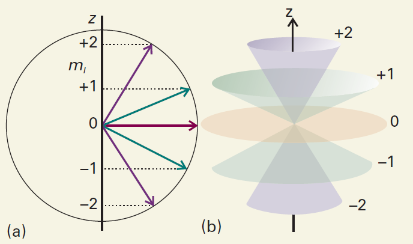
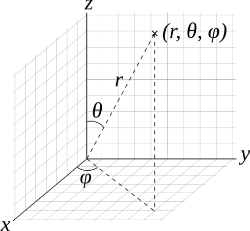
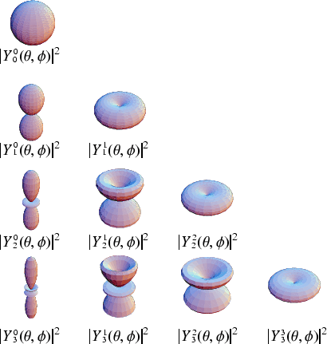

# Angular Momentum

Why does angular momentum appear so often in atomic physics? First, the Coulomb force is a central force. In a central-field description, this force conserves the electron's orbital angular momentum. Second, an charged particle with angular momentum gives rise to its magnetic moment. It therefore helps us understand both magnetic interactions inside an atom and the atom's response to an external magnetic field.

## General Angular Momentum

Start with the classical description. About a chosen origin, a particle has orbital angular momentum $\mathbf L=\mathbf r\times\mathbf p$. In Cartesian components,

$$
{\bf{L}} = {\bf{r}} \times {\bf{p}} = \left\vert  {\begin{array}{*{20}{c}} {\bf{i}}&{\bf{j}}&{\bf{k}}\\ x&y&z\\ {{p_x}}&{{p_y}}&{{p_z}} \end{array}} \right\vert
$$ {#eq-ch08-p1897}

In quantum mechanics the three components become operators, and their position representations are

$$
\begin{aligned}
{{\hat L}_x} &= \hat Y{{\hat P}_z} - \hat Z{{\hat P}_y} = - i\hbar \left( {y\frac{\partial }{{\partial z}} - z\frac{\partial }{{\partial y}}} \right) \\
{{\hat L}_y} &= \hat Z{{\hat P}_x} - \hat X{{\hat P}_z} = - i\hbar \left( {z\frac{\partial }{{\partial x}} - x\frac{\partial }{{\partial z}}} \right)\;\; \\
{{\hat L}_z} &= \hat X{{\hat P}_y} - \hat Y{{\hat P}_x} = - i\hbar \left( {x\frac{\partial }{{\partial y}} - y\frac{\partial }{{\partial x}}} \right)
\end{aligned}
$$ {#eq-zeqnnum826605}

Using the position–momentum commutator @eq-zeqnnum944007, we have

$$
\left[ {{{\hat L}_x},{{\hat L}_y}} \right] = i\hbar {\hat L_z},\;\;\;\;\;\left[ {{{\hat L}_y},{{\hat L}_z}} \right] = i\hbar {\hat L_x},\;\;\;\;\;\left[ {{{\hat L}_z},{{\hat L}_x}} \right] = i\hbar {\hat L_y}
$$ {#eq-ch08-p1901}

These relations can also be written compactly as

$$
\left[ {{{\hat L}_i},{{\hat L}_j}} \right] = i\hbar {\varepsilon _{ijk}}{\hat L_k} \qquad  {\rm{or}} \qquad  {\bf{L}} \times {\bf{L}} = i\hbar {\bf{L}}
$$ {#eq-ch08-p1903}

These relations should look familiar. The electron spin obeys the same rules:

$$
\left[ {{{\hat S}_i},{{\hat S}_j}} \right] = i\hbar {\varepsilon _{ijk}}{\hat S_k}
$$ {#eq-ch08-p1905}

This shared algebra is our starting point. In quantum mechanics, we call a vector observable $\mathbf J$ an **angular momentum** when its components obey

$$
\left[ {{{\hat J}_x},{{\hat J}_y}} \right] = i\hbar {\hat J_z}{\rm{,}}\;\;\;\;\;\left[ {{{\hat J}_y},{{\hat J}_z}} \right] = i\hbar {\hat J_x}{\rm{,}}\;\;\;\;\;\left[ {{{\hat J}_z},{{\hat J}_x}} \right] = i\hbar {\hat J_y}
$$ {#eq-zeqnnum502879}

The three equations can be combined into one:

$$
{\bf{J}} \times {\bf{J}} = i\hbar {\bf{J}}
$$ {#eq-ch08-p1909}

We also need an operator for the squared magnitude:

$$
{{\bf{\hat J}}^2} = \hat J_x^2 + \hat J_y^2 + \hat J_z^2
$$ {#eq-ch08-p1911}

Use @eq-zeqnnum502879 to check that $\mathbf{\hat J}^2$ commutes with each component:

$$
\left[ {{{{\bf{\hat J}}}^2},{{\hat J}_z}} \right] = \left[ {{{{\bf{\hat J}}}^2},{{\hat J}_x}} \right] = \left[ {{{{\bf{\hat J}}}^2},{{\hat J}_y}} \right] = 0
$$ {#eq-ch08-p1913}

No spatial direction is special, so we may choose any component to accompany $\mathbf{\hat J}^2$. By convention, we choose $\hat J_z$. These two operators commute and share eigenstates. What values can their measurements give?

### \* Deriving the Eigenvalues of ${J}^{2}$ and ${J}_{z}$

We can always write their eigenvalue equations in the form

$$
{{\bf{\hat J}}^2}\left\vert  {b,m} \right\rangle = b{\hbar ^2}\left\vert  {b,m} \right\rangle
$$ {#eq-zeqnnum611612}

$$
{\hat J_z}\left\vert  {b,m} \right\rangle = m\hbar \left\vert  {b,m} \right\rangle
$$ {#eq-zeqnnum784176}

We do not yet know the allowed real numbers $b$ and $m$. They label a state with $\mathbf{J}^2=b\hbar^2$ and $J_z=m\hbar$. To find them, introduce two **ladder operators**. We will see that the raising operator $\hat J_+$ moves us up the ladder of $m$ values; the lowering operator $\hat J_-$ moves us down:

$$
{\hat J_ + } \equiv {\hat J_x} + i{\hat J_y}, \qquad  \qquad  {\hat J_ - } \equiv {\hat J_x} - i{\hat J_y}
$$ {#eq-ch08-p1920}

Their definitions imply

$$
{\hat J_x} = \frac{1}{2}\left( {{{\hat J}_ + } + {{\hat J}_ - }} \right), \qquad  \qquad  {\hat J_y} = \frac{1}{{2i}}\left( {{{\hat J}_ + } - {{\hat J}_ - }} \right)
$$ {#eq-zeqnnum857737}

We can first work out a few identities from these definitions:

$$
\hat J_ + ^\dagger = {\hat J_ - }, \qquad  \qquad  \hat J_ - ^\dagger = {\hat J_ + }
$$ {#eq-zeqnnum223798}

$$
\left[ {{{\hat J}_ + },{{\hat J}_ - }} \right] = 2\hbar {\hat J_z}
$$ {#eq-zeqnnum772126}

$$
\left[ {{{\hat J}_z},{{\hat J}_ \pm }} \right] = \pm \hbar {\hat J_ \pm }
$$ {#eq-zeqnnum700890}

$$
\left[ {{{{\bf{\hat J}}}^2},{{\hat J}_ \pm }} \right] = 0
$$ {#eq-zeqnnum242044}

$$
{{\bf{\hat J}}^2} = \hat J_z^2 + \hbar {\hat J_z} + {\hat J_ - }{\hat J_ + }
$$ {#eq-zeqnnum732391}

$$
{{\bf{\hat J}}^2} = \hat J_z^2 - \hbar {\hat J_z} + {\hat J_ + }{\hat J_ - }
$$ {#eq-zeqnnum324145}

$$
{{\bf{J}}^2} = \hat J_z^2 + \frac{1}{2}\left( {{{\hat J}_ + }{{\hat J}_ - } + {{\hat J}_ - }{{\hat J}_ + }} \right)
$$ {#eq-zeqnnum867638}

Now let a ladder operator act on $\vert b,m\rangle$. @eq-zeqnnum242044 gives

$$
{{\bf{\hat J}}^2}\left( {{{\hat J}_ \pm }\left\vert  {b,m} \right\rangle } \right) = {\hat J_ \pm }{{\bf{\hat J}}^2}\left\vert  {b,m} \right\rangle = b{\hbar ^2}\left( {{{\hat J}_ \pm }\left\vert  {b,m} \right\rangle } \right)
$$ {#eq-zeqnnum973611}

Using @eq-zeqnnum700890, we also obtain

$$
{\hat J_z}\left( {{{\hat J}_ \pm }\left\vert  {b,m} \right\rangle } \right) = \left( {{{\hat J}_z}{{\hat J}_ \pm }} \right)\left\vert  {b,m} \right\rangle = \left( { \pm \hbar {{\hat J}_ \pm } + {{\hat J}_ \pm }{{\hat J}_z}} \right)\left\vert  {b,m} \right\rangle = \left( {m \pm 1} \right)\hbar \left( {{{\hat J}_ \pm }\left\vert  {b,m} \right\rangle } \right)
$$ {#eq-zeqnnum643676}

Compare @eq-zeqnnum973611 with @eq-zeqnnum643676. Unless the result is the zero vector, $\hat J_\pm\vert b,m\rangle$ is another simultaneous eigenstate of $\mathbf{\hat J}^2$ and $\hat J_z$. Its squared magnitude stays at $b\hbar^2$, but its $z$ component changes by one step, $\pm\hbar$. This is why we call the operators raising and lowering operators. Thus, the new state is proportional to $\vert b,m\pm1\rangle$:

$$
{\hat J_ \pm }\left\vert  {b,m} \right\rangle = {C_ \pm }\left( {b,m} \right)\left\vert  {b,m \pm 1} \right\rangle
$$ {#eq-zeqnnum904731}

The coefficient $C_\pm(b,m)$ sets the length and phase of the resulting vector.

Can the raising operator keep raising $m$ forever? Since it does not change $b$, a fixed angular-momentum magnitude should limit its projection. To find the limit, take the expectation value of @eq-zeqnnum867638 in $\vert b,m\rangle$ and use @eq-zeqnnum223798:

$$
b{\hbar ^2} = {m^2}{\hbar ^2} + \frac{1}{2}\left\langle {b,m} \right\vert {\hat J_ - ^\dagger {{\hat J}_ - }}\;\left\vert  {b,m} \right\rangle + \frac{1}{2}\left\langle {b,m} \right\vert \hat J_ + ^\dagger {\hat J_ + }\left\vert  {b,m} \right\rangle
$$ {#eq-ch08-p1939}

A squared norm cannot be negative: $\langle\psi\vert\psi\rangle\ge0$. The last two terms are therefore nonnegative, which gives $b\ge m^2$. For fixed $b$, the ladder must have a top and a bottom.

Start at any allowed $m_0$ and apply $\hat J_+$ repeatedly. Eventually we reach $m_{\max}$. The next step must give the zero vector, so $C_+(b,m_{\max})=0$:

$$
{\hat J_ + }\vert b,{m_{\max }}\rangle = \lvert\mathrm{null}\rangle
$$ {#eq-zeqnnum446313}

The same reasoning works downward. At the bottom, $C_-(b,m_{\min})=0$, so

$$
{\hat J_ - }\vert b,{m_{\min }}\rangle = \lvert\mathrm{null}\rangle
$$ {#eq-zeqnnum736764}

The ladder stops at both ends.

Let

$$
{m_{\max }} - {m_{\min }} = n
$$ {#eq-zeqnnum714513}

Each step changes $m$ by one, so $n$ is a nonnegative integer. At the two endpoints, @eq-zeqnnum732391 and @eq-zeqnnum324145 give

$$
\begin{aligned}
b\vert b,{m_{\max }}\rangle &= (m_{\max }^2 + {m_{\max }})\vert b,{m_{\max }}\rangle \\
b\vert b,{m_{\min }}\rangle &= (m_{\min }^2 - {m_{\min }})\vert b,{m_{\min }}\rangle
\end{aligned}
$$ {#eq-ch08-p1946}

It follows that

$$
m_{\max }^2 + {m_{\max }} = m_{\min }^2 - {m_{\min }}
$$ {#eq-zeqnnum714689}

Hence

$$
({m_{\max }} - {m_{\min }} + 1)({m_{\max }} + {m_{\min }}) = 0
$$ {#eq-ch08-p1950}

The first factor is positive, so

$$
{m_{\min }} = - {m_{\max }}
$$ {#eq-zeqnnum434099}

The allowed projections are symmetric about zero. This makes sense: since the sign of $m$ depends on which direction we chose as the positive $z$ direction. Reversing our choice of the positive $z$ direction should not change the physics. Using @eq-zeqnnum714513 and @eq-zeqnnum434099, we obtain

$$
{m_{\max }} = {n \mathord{\left/ {\vphantom {n {2 = j}}} \right. \kern-1.2pt } {2 = j}}, \qquad  {m_{\min }} = - {n \mathord{\left/ {\vphantom {n 2}} \right. \kern-1.2pt } 2} = - j
$$ {#eq-zeqnnum239811}

Here $j\equiv n/2$. Since $n$ is a nonnegative integer, $j$ can take only the values

$$
j = 0,\frac{1}{2},1,\frac{3}{2},2,\frac{5}{2}, \ldots
$$ {#eq-ch08-p1956}

For each $j$, there can be only $2j+1$ different $m$ values:

$$
m = j,j - 1,j - 2, \cdots , - j
$$ {#eq-ch08-p1958}

From @eq-zeqnnum714689 and @eq-zeqnnum239811,

$$
b = j\left( {j + 1} \right)
$$ {#eq-ch08-p1960}

### Results for General Angular Momentum

From now on, use $j$ instead of $b$ to label the squared magnitude. We write the same eigenstate as $\vert j,m\rangle$.

Any angular momentum obeys

$$
{{\bf{\hat J}}^2}\left\vert  {j,m} \right\rangle = j\left( {j + 1} \right){\hbar ^2}\left\vert  {j,m} \right\rangle , \qquad  j = 0,\frac{1}{2},1,\frac{3}{2},2,\frac{5}{2}, \ldots
$$ {#eq-ch08-p1964}

$$
{\hat J_z}\left\vert  {j,m} \right\rangle = m\hbar \left\vert  {j,m} \right\rangle , \qquad  m = \underbrace {j,j - 1, \cdots - j + 1, - j}_{2j + 1\text{ terms}}
$$ {#eq-ch08-p1965}

The number $j$ sets the magnitude. The number $m$ sets the measured projection along our chosen axis, it is often called the **magnetic quantum number** or **projection quantum number**. If the angular momentum is a spin, $j$ is called the spin quantum number.

If $j$ is an integer, the ladder includes $m=0$. If $j$ is a half-integer, the ladder skips zero. These discrete possibilities follow from the commutation relations alone. They are a striking example of how a little operator algebra leads to testable predictions.

We will soon see that orbital angular momentum allows only integer $j$, starting at zero. Spin can be integer or half-integer. Each particle species has its own spin quantum number, just as it has its own mass and charge.

| Particle    | Spin quantum number |
|-------------|---------------------|
| Electron    | $1/2$               |
| Proton      | $1/2$               |
| Neutron     | $1/2$               |
| Quark       | $1/2$               |
| Photon      | 1                   |
| Graviton    | 2                   |
| Higgs boson | 0                   |

We call particles with half-integer spin **fermions** and those with integer spin **bosons**. We will see that identical bosons can share a state, while identical fermions can't. These rules come from quantum indistinguishability of identical particles. They do not mean that the particles simply attract or repel one another.

### The Vector Model of Angular-Momentum Eigenstates

Can we draw a picture of $\vert j,m\rangle$? The eigenvalue of $\mathbf{\hat J}^2$ suggests a vector length

$$
\left\vert  {\bf{J}} \right\vert  = \sqrt {j\left( {j + 1} \right)} \hbar
$$ {#eq-ch08-p2006}

For $j>0$, this length is larger than $j\hbar$, the greatest allowed $z$ projection. Why can the vector not point exactly along $z$? In a state with definite $J_z$, the transverse components have fluctuations. They cannot both be sharply zero.

The **vector model** pictures the tip of $\mathbf J$ on a cone around the $z$ axis. In units of $\hbar$, the cone has height $m$ and radius $\sqrt{j(j+1)-m^2}$. For $j=2$, there are five allowed projections and hence five cones, as in panel (b). Symmetry gives zero mean for both $J_x$ and $J_y$:

$$
\langle {{{\hat J}_x}}\rangle = \langle {{{\hat J}_y}}\rangle = 0
$$ {#eq-ch08-p2008}

Ladder operators let us prove these results directly. They also give

$$
\langle {\hat J_x^2}\rangle = \langle {\hat J_y^2}\rangle = \frac{{\langle {{{{\bf{\hat J}}}^2}}\rangle - \langle {\hat J_z^2}\rangle }}{2} = \frac{{j(j + 1) - {m^2}}}{2}{\hbar ^2}
$$ {#eq-ch08-p2010}

Use the cone as a picture of the allowed magnitude, projection, and transverse fluctuations. It is not a literal path traced by a hidden classical vector. Also keep it distinct from the mean vector $\langle\mathbf J\rangle$. In $\vert j,m\rangle$, that mean vector points along $z$ and has $z$ component $m\hbar$.

{width="465px"}

::: source-caption
Figure 8.1. The vector model of angular momentum. Source: http://hyperphysics.phy-astr.gsu.edu/hbase/quantum/vecmod.html
:::

### \* Matrix Elements of Angular-Momentum Operators

We now know how the angular-momentum operators act on $\vert j,m\rangle$. Let us turn those rules into matrices in this basis.

1)  $\mathbf{\hat J}^2$ and $\hat J_z$. The basis states are eigenstates of both operators, so both matrices are diagonal:

$$
\left\langle {j',m'} \right\vert {\hat J^2}\left\vert  {j,m} \right\rangle = {\delta _{j'j}}{\delta _{m'm}}j\left( {j + 1} \right){\hbar ^2}
$$ {#eq-ch08-p2017}

$$
\left\langle {j',m'} \right\vert {\hat J_z}\left\vert  {j,m} \right\rangle = {\delta _{j'j}}{\delta _{m'm}}m\hbar
$$ {#eq-ch08-p2018}

2)  **The ladder operators** $\hat J_\pm$. @eq-zeqnnum904731 tells us that each operator connects neighboring $m$ values. To find the coefficient's magnitude, take the squared norm:

$$
\left\langle {j,m} \right\vert \hat J_ + ^\dagger {\hat J_ + }\left\vert  {j,m} \right\rangle = {\left\vert  {{C_ + }\left( {j,m} \right)} \right\vert ^2}
$$ {#eq-zeqnnum141497}

Now use $\hat J_+^\dagger=\hat J_-$ and the identity $\hat J_-\hat J_+=\mathbf{\hat J}^2-\hat J_z^2-\hbar\hat J_z$ from @eq-zeqnnum732391:

$$
\begin{aligned}
\left\langle {j,m} \right\vert \hat J_ + ^\dagger {{\hat J}_ + }\left\vert  {j,m} \right\rangle &= \left\langle {j,m} \right\vert {{\hat J}_ - }{{\hat J}_ + }\left\vert  {j,m} \right\rangle \\
 &= \left\langle {j,m} \right\vert {{{\bf{\hat J}}}^2} - \hat J_z^2 - \hbar {{\hat J}_z}\left\vert  {j,m} \right\rangle \\
 &= j\left( {j + 1} \right){\hbar ^2} - {m^2}{\hbar ^2} - m{\hbar ^2} \\
 &= {\hbar ^2}\left[ {j\left( {j + 1} \right) - m\left( {m + 1} \right)} \right]
\end{aligned}
$$ {#eq-zeqnnum904686}

Combining @eq-zeqnnum141497 and @eq-zeqnnum904686, we obtain

$$
{\left\vert  {{C_ + }\left( {j,m} \right)} \right\vert ^2} = {\hbar ^2}\left[ {j\left( {j + 1} \right) - m\left( {m + 1} \right)} \right]
$$ {#eq-ch08-p2024}

Choose the phases of the basis states so that $C_+(j,m)$ is real and positive away from the endpoint:

$$
{C_ + }\left( {j,m} \right) = \hbar \sqrt {j\left( {j + 1} \right) - m\left( {m + 1} \right)} = \hbar \sqrt {\left( {{j^2} + j} \right) - \left( {{m^2} + m} \right)}
$$ {#eq-ch08-p2026}

Substituting into @eq-zeqnnum904731 gives

$$
{\hat J_ + }\left\vert  {j,m} \right\rangle = \hbar \sqrt {j\left( {j + 1} \right) - m\left( {m + 1} \right)} \vert {j,m + 1}\rangle
$$ {#eq-ch08-p2028}

Similarly,

$$
{C_ - }\left( {j,m} \right) = \hbar \sqrt {j\left( {j + 1} \right) - m\left( {m - 1} \right)} = \hbar \sqrt {({j^2} + j) - ({m^2} - m)}
$$ {#eq-ch08-p2030}

$$
{\hat J_ - }\left\vert  {j,m} \right\rangle = \hbar \sqrt {j\left( {j + 1} \right) - m\left( {m - 1} \right)} \vert {j,m} - 1\rangle
$$ {#eq-zeqnnum592417}

Check the endpoints. The square roots vanish at precisely the places required by @eq-zeqnnum446313 and @eq-zeqnnum736764:

$$
{\hat J_ + }\vert {j,j}\rangle = \lvert\mathrm{null}\rangle, \qquad  \qquad  {\hat J_ - }\vert {j, - j}\rangle = \lvert\mathrm{null}\rangle
$$ {#eq-ch08-p2033}

The nonzero matrix elements of the ladder operators are therefore

$$
\left\langle {j,m - 1} \right\vert {\hat J_ - }\left\vert  {j,m} \right\rangle = \left\langle {j,m} \right\vert {\hat J_ + }\left\vert  {j,m - 1} \right\rangle = \hbar \sqrt {j\left( {j + 1} \right) - m\left( {m - 1} \right)}
$$ {#eq-zeqnnum713322}

3)  $\hat J_x$ and $\hat J_y$. Express them in terms of the ladder operators. Using @eq-zeqnnum857737 and @eq-zeqnnum713322 gives their nonzero matrix elements:

$$
\left\langle {j,m - 1} \right\vert {{J_x}}\left\vert  {j,m} \right\rangle = \left\langle {j,m} \right\vert {{J_x}}\left\vert  {j,m - 1} \right\rangle = \frac{\hbar }{2}\sqrt {j(j + 1) - m(m - 1)}
$$ {#eq-ch08-p2037}

$$
\left\langle {j,m - 1} \right\vert {{J_y}}\left\vert  {j,m} \right\rangle = - \left\langle {j,m} \right\vert {{J_y}}\left\vert  {j,m - 1} \right\rangle = \frac{{i\hbar }}{2}\sqrt {j(j + 1) - m(m - 1)}
$$ {#eq-ch08-p2038}

For a fixed $j$, we order the basis by decreasing $m$: $j,j-1,\ldots,-j$. The top-left element of any operator matrix is then $\langle j,j\vert\hat A\vert j,j\rangle$.

Example 1: $j = {1 \mathord{\left/ {\vphantom {1 2}} \right. \kern-1.2pt } 2}$. The matrices ${\hat S_{x,y,z}}$ introduced earlier use this convention; see @eq-zeqnnum931030.

Example 2: $j = 1$.

$$
\frac{{{{\hat J}^2}}}{{{\hbar ^2}}} = 2\left[ {\begin{array}{*{20}{c}} 1&0&0\\ 0&1&0\\ 0&0&1 \end{array}} \right], \qquad  \frac{{{{\hat J}_z}}}{\hbar } = \left[ {\begin{array}{*{20}{c}} 1&0&0\\ 0&0&0\\ 0&0&{ - 1} \end{array}} \right]
$$ {#eq-ch08-p2042}

$$
\frac{{{{\hat J}_ + }}}{\hbar } = \sqrt 2 \left[ {\begin{array}{*{20}{c}} 0&1&0\\ 0&0&1\\ 0&0&0 \end{array}} \right], \qquad  \frac{{{{\hat J}_ - }}}{\hbar } = \sqrt 2 \left[ {\begin{array}{*{20}{c}} 0&0&0\\ 1&0&0\\ 0&1&0 \end{array}} \right]
$$ {#eq-ch08-p2043}

$$
\frac{{{{\hat J}_x}}}{\hbar } = \frac{1}{{\sqrt 2 }}\left[ {\begin{array}{*{20}{c}} 0&1&0\\ 1&0&1\\ 0&1&0 \end{array}} \right], \qquad  \frac{{{{\hat J}_y}}}{\hbar } = \frac{i}{{\sqrt 2 }}\left[ {\begin{array}{*{20}{c}} 0&{ - 1}&0\\ 1&0&{ - 1}\\ 0&1&0 \end{array}} \right]
$$ {#eq-ch08-p2044}

## Orbital Angular Momentum

Orbital angular momentum comes from motion about a reference point. We normally write it as $\mathbf L$ and use $l$ for its angular-momentum quantum number. The general theory we just developed gives

$$
\begin{aligned}
{{{\bf{\hat L}}}^2}\left\vert  {l,m} \right\rangle &= l\left( {l + 1} \right){\hbar ^2}\left\vert  {l,m} \right\rangle \\
{{\hat L}_z}\left\vert  {l,m} \right\rangle &= m\hbar \left\vert  {l,m} \right\rangle
\end{aligned}
$$ {#eq-zeqnnum747222}

To describe orbital motion, we need spatial wavefunctions. Write $\Lambda_{l,m}(x,y,z)\equiv\langle x,y,z\vert l,m\rangle$. Spherical coordinates are a natural choice because angular momentum concerns motion about an origin. In these coordinates, @eq-zeqnnum747222 becomes

$$
\begin{aligned}
{{\bf{L}}^2}{\Lambda _{l,m}}\left( {r,\theta ,\phi } \right) &= l\left( {l + 1} \right){\hbar ^2}{\Lambda _{l,m}}\left( {r,\theta ,\phi } \right) \\
{L_z}{\Lambda _{l,m}}\left( {r,\theta ,\phi } \right) &= m\hbar {\Lambda _{l,m}}\left( {r,\theta ,\phi } \right)
\end{aligned}
$$ {#eq-zeqnnum921413}where the operators are represented in spherical coordinates.

Using the coordinate transformations

$$
 \left\{ {\begin{array}{*{20}{c}} {x = r\sin \theta \cos\phi }\\ {y = r\sin\theta \sin\phi }\\ {z = r\cos\theta } \end{array}} \right., \qquad  \qquad  \left\{ {\begin{array}{*{20}{c}} {r = \sqrt {{x^2} + {y^2} + {z^2}} }\\ {\theta = {{\tan }^{ - 1}}\left( {{{\sqrt {{x^2} + {y^2}} } \mathord{\left/ {\vphantom {{\sqrt {{x^2} + {y^2}} } z}} \right. \kern-1.2pt } z}} \right)}\\ {\phi = {{\tan }^{ - 1}}\left( {{y \mathord{\left/ {\vphantom {y x}} \right. \kern-1.2pt } x}} \right)} \end{array}} \right.
$$

$$ \frac{\partial }{{\partial x}} = \frac{{\partial r}}{{\partial x}}\frac{\partial }{{\partial r}} + \frac{{\partial \theta }}{{\partial x}}\frac{\partial }{{\partial \theta }} + \frac{{\partial \phi }}{{\partial x}}\frac{\partial }{{\partial \phi }} $$

{width="212px"}

we convert the Cartesian expression @eq-zeqnnum826605 for ${\hat L_{x,y,z}}$ into

$$
\begin{aligned}
{{\hat L}_x} &= - i\hbar \left( {y\frac{\partial }{{\partial z}} - z\frac{\partial }{{\partial y}}} \right) = - i\hbar \left( { - \sin \phi \frac{\partial }{{\partial \theta }} - \cot \theta \cos \phi \frac{\partial }{{\partial \phi }}} \right) \\
{{\hat L}_y} &= - i\hbar \left( {z\frac{\partial }{{\partial x}} - x\frac{\partial }{{\partial z}}} \right) = - i\hbar \left( {\cos \phi \frac{\partial }{{\partial \theta }} - \cot \theta \sin \phi \frac{\partial }{{\partial \phi }}} \right) \\
{{\hat L}_z} &= - i\hbar \left( {x\frac{\partial }{{\partial y}} - y\frac{\partial }{{\partial x}}} \right) = - i\hbar \frac{\partial }{{\partial \phi }}
\end{aligned}
$$ {#eq-zeqnnum721118}

and obtain the spherical-coordinate expression for ${{\bf{\hat L}}^2}$:

$$
{{\bf{\hat L}}^2} = {\hat L_x}{\hat L_x} + {\hat L_y}{\hat L_y} + {\hat L_z}{\hat L_z} = - {\hbar ^2}\left\{ {\frac{1}{{\sin \theta }}\frac{\partial }{{\partial \theta }}\left( {\sin \theta \frac{\partial }{{\partial \theta }}} \right) + \frac{1}{{{{\sin }^2}\theta }}\frac{{{\partial ^2}}}{{\partial {\phi ^2}}}} \right\}
$$ {#eq-zeqnnum657148}

Notice that all of the angular momentum operators depend on angles, not on the distance $r$. This suggests us writing the wavefunction as a radial factor times an angular factor:

$$
{\Lambda _{l,m}}\left( {r,\theta ,\phi } \right) = R\left( r \right){Y_{l,m}}\left( {\theta ,\phi } \right)
$$ {#eq-zeqnnum193092}

The function $R(r)$ describes the radial part, while $Y_{l,m}(\theta,\phi)$ describes the angular part. Angular momentum alone leaves $R(r)$ undetermined. Use @eq-zeqnnum721118–@eq-zeqnnum193092 in @eq-zeqnnum921413 and cancel the common radial factor. The remaining equations are

$$
- i\hbar \frac{\partial }{{\partial \phi }}{Y_{l,m}}\left( {\theta ,\phi } \right) = m\hbar {Y_{l,m}}\left( {\theta ,\phi } \right)
$$ {#eq-zeqnnum252734}

$$
- {\hbar ^2}\left\{ {\frac{1}{{\sin \theta }}\frac{\partial }{{\partial \theta }}\left( {\sin \theta \frac{\partial }{{\partial \theta }}} \right) + \frac{1}{{{{\sin }^2}\theta }}\frac{{{\partial ^2}}}{{\partial {\phi ^2}}}} \right\}{Y_{l,m}}\left( {\theta ,\phi } \right) = l\left( {l + 1} \right){\hbar ^2}{Y_{l,m}}\left( {\theta ,\phi } \right)
$$ {#eq-zeqnnum649652}

Since the operator $\hat L_z$ involves only $\phi$, we can try a second separation:

$$
{Y_{l,m}}\left( {\theta ,\phi } \right) = \Theta \left( \theta \right)\Phi \left( \phi \right)
$$ {#eq-zeqnnum129644}

The $\hat L_z$ @eq-zeqnnum252734 now becomes an azimuthal equation involves only $\phi$:

$$
\frac{\partial }{{\partial \phi }}\Phi = im\Phi
$$ {#eq-zeqnnum956196}

The eigenvalue equation for ${{\bf{\hat L}}^2}$ becomes

$$
\frac{\Phi }{{\sin \theta }}\frac{\partial }{{\partial \theta }}\left( {\sin \theta \frac{{\partial \Theta }}{{\partial \theta }}} \right) + \frac{\Theta }{{{{\sin }^2}\theta }}\frac{{{\partial ^2}\Phi }}{{\partial {\phi ^2}}} = - l\left( {l + 1} \right)\Theta \Phi
$$ {#eq-zeqnnum839472}

Multiply @eq-zeqnnum839472 by ${{{{\sin }^2}\theta } \mathord{\left/ {\vphantom {{{{\sin }^2}\theta } {\Theta \Phi }}} \right. \kern-1.2pt } {\Theta \Phi }}$ and separate the terms involving $\theta$ and $\phi$ onto opposite sides:

$$
\frac{{\sin \theta }}{\Theta }\frac{\partial }{{\partial \theta }}\left( {\sin \theta \frac{{\partial \Theta }}{{\partial \theta }}} \right) + l\left( {l + 1} \right){\sin ^2}\theta = - \frac{1}{\Phi }\frac{{{\partial ^2}\Phi }}{{\partial {\phi ^2}}}
$$ {#eq-zeqnnum309925}

From @eq-zeqnnum956196,

$$
- \frac{1}{\Phi }\frac{{{\partial ^2}\Phi }}{{\partial {\phi ^2}}} = {m^2}
$$ {#eq-zeqnnum135231}

Substitute @eq-zeqnnum135231 into @eq-zeqnnum309925. We are left with a polar equation involving only $\theta$:

$$
\frac{{\sin \theta }}{\Theta }\frac{\partial }{{\partial \theta }}\left( {\sin \theta \frac{{\partial \Theta }}{{\partial \theta }}} \right) + l\left( {l + 1} \right){\sin ^2}\theta = {m^2}
$$ {#eq-zeqnnum830038}

Start with the simpler equation, @eq-zeqnnum956196. Its solution is

$$
{\Phi _m}\left( \phi \right) = \frac{1}{{\sqrt {2\pi } }}{e^{im\phi }}
$$ {#eq-zeqnnum989444}

The constant follows from normalization:

$$
\int_0^{2\pi } {d\phi \;\Phi _{m'}^*\left( \phi \right){\Phi _m}\left( \phi \right)} = {\delta _{m'm}}
$$ {#eq-ch08-p2079}

A full turn of $\phi$ brings us back to the same spatial point. The wavefunction must have the same value at $\phi$ and $\phi+2\pi$, so

$$
{\Phi _m}\left( \phi \right) = {\Phi _m}\left( {\phi + 2\pi } \right)
$$ {#eq-ch08-p2081}

That is,

$$
\begin{aligned}
\exp \left[ {im\phi } \right] &= \exp \left[ {im(\phi + 2\pi )} \right] \\
m\phi &= m(\phi + 2\pi ) + n2\pi , && n \in {\rm{Integer}}
\end{aligned}
$$ {#eq-zeqnnum804907}

A full turn therefore restricts the allowed values of $m$.

The phase condition requires integer $m$. Solving the remaining polar @eq-zeqnnum830038 gives

$$
\begin{aligned}
l &= 0,\;1,\;2,\; \cdots \\
m &= 0,\; \pm 1,\; \cdots ,\; \pm l
\end{aligned}
$$ {#eq-zeqnnum917846}

We will omit the longer differential-equation calculation. Note: although we have borrow the form of general angular momentum theory to write the eigenvalue equation for the orbital angular momentum. The final solution does not need any assumption about the possible values of $l$ and $m$ that was required by the general angular momentum theory. The two differential equations of @eq-zeqnnum649652 , by themselves, are sufficient to solve the eigenvalues @eq-zeqnnum917846 .

With these allowed values, the polar @eq-zeqnnum830038 has solutions

$$
{\Theta _{l,m}}\left( \theta \right) = {N_{l,m}}P_l^m\left( {\cos \theta } \right),
$$ {#eq-zeqnnum839509}

Here $P_l^m(\cos\theta)$ is a real **associated Legendre function**.[^08-angular-momentum-1] You do not need its full formula to follow the argument. The constant $N_{l,m}$ sets the normalization:

[^08-angular-momentum-1]: http://mathworld.wolfram.com/AssociatedLegendrePolynomial.html

$$
\int_0^\pi {d\theta \sin \theta \;\Theta _{l',m}^*\left( \theta \right){\Theta _{l,m}}\left( \theta \right)} = {\delta _{l'l}}
$$ {#eq-ch08-p2089}

Combine @eq-zeqnnum839509 and @eq-zeqnnum989444 using @eq-zeqnnum129644. The angular functions are

$$
{Y_{l,m}}\left( {\theta ,\phi } \right) = \frac{{{N_{l,m}}}}{{\sqrt {2\pi } }}P_l^m\left( {\cos \theta } \right){e^{im\phi }}
$$ {#eq-ch08-p2091}

These functions are the **spherical harmonics**. Each has definite squared orbital angular momentum and a definite $z$ projection:

$$
\begin{aligned}
{{{\bf{\hat L}}}^2}{Y_{l,m}}\left( {\theta ,\phi } \right) &= l(l + 1)\hbar {Y_{l,m}}\left( {\theta ,\phi } \right) \\
{{\hat L}_z}{Y_{l,m}}\left( {\theta ,\phi } \right) &= m\hbar {Y_{l,m}}\left( {\theta ,\phi } \right)
\end{aligned}
$$ {#eq-ch08-p2093}

Here are the spherical harmonics for $l=0,1,2$. Notice the constant angular function at $l=0$ and the richer patterns at higher $l$.

$$
\begin{aligned}
{Y_{0,0}} &= \sqrt {\frac{1}{{4\pi }}} \\
Y{{\kern 1pt} _{1,0}} &= \sqrt {\frac{3}{{4\pi }}} \cos \theta \\
Y{{\kern 1pt} _{1, \pm 1}} &= \mp \sqrt {\frac{3}{{8\pi }}} \sin \theta \;{e^{ \pm i\phi }} \\
Y{{\kern 1pt} _{2,0}} &= \sqrt {\frac{5}{{16\pi }}} \left( {3{{\cos }^2}\theta - 1} \right) \\
Y{{\kern 1pt} _{2, \pm 1}} &= \mp \sqrt {\frac{{15}}{{8\pi }}} \sin \theta \cos \theta \;{e^{ \pm i\phi }} \\
Y{{\kern 1pt} _{2, \pm 2}} &= \mp \sqrt {\frac{{15}}{{32\pi }}} {\sin ^2}\theta \;{e^{ \pm 2i\phi }}
\end{aligned}
$$ {#eq-zeqnnum238379}

{width="289px"}

::: source-caption
Figure 8.2. Angular probability-density surfaces. The radial length in direction $(\theta ,\varphi )$ represents ${\left\vert  {Y_l^m\left( {\theta ,\phi } \right)} \right\vert ^2}$: a longer radius indicates a greater probability of finding the particle in that direction.
:::

Both angular factors are normalized, so their product $Y_{l,m}(\theta,\phi)$ is normalized over solid angle:

$$
\int_0^{2\pi } {d\phi \int_0^\pi {d\theta \;\sin \theta Y_{l',m'}^*{Y_{l,m}}} } = {\delta _{l'l}}{\delta _{m'm}}
$$ {#eq-ch08-p2099}

Put the radial factor back to recover the spatial wavefunction:

$$
{\Lambda _{l,m}}\left( {r,\theta ,\phi } \right) = R\left( r \right){Y_{l,m}}\left( {\theta ,\phi } \right)
$$ {#eq-ch08-p2101}

The angular part already has unit normalization. We therefore only need to normalize $R(r)$ with the radial volume factor $r^2dr$:

$$
\int_0^\infty {{{\left\vert  {R\left( r \right)} \right\vert }^2}{r^2}dr} = 1
$$ {#eq-ch08-p2103}

Then ${\Lambda _{l,m}}\left( {r,\theta ,\phi } \right)$ is automatically normalized:

$$
\iiint_V {dV{{\left\vert  {{\Lambda _{l,m}}\left( {r,\theta ,\phi } \right)} \right\vert }^2}} = \left[ {\int_0^\infty {dr\;{{\left\vert  {R\left( r \right)} \right\vert }^2}{r^2}} } \right] \cdot \left[ {\int_0^{2\pi } {d\phi } \int_0^\pi {d\theta \;\sin \theta \;{{\left\vert  {{Y_{l,m}}(\theta ,\phi )} \right\vert }^2}} } \right] = 1
$$ {#eq-ch08-p2105}

Angular momentum fixes the angular pattern, but it does not tell us how far the particle lies from the origin. We need the radial function for that.

In $\vert l,m\rangle$, the quantity $|Y_{l,m}(\theta,\phi)|^2$ gives probability per unit solid angle. We call it the **angular probability density**. Its magnitude is independent of $\phi$, so the density is symmetric under rotations about $z$. The wavefunction itself may still have a $\phi$-dependent phase.

## \* Rotations and Angular Momentum

Momentum generates translations. Does angular momentum play a similar role for rotations? Let us find out.

### \* The Infinitesimal Rotation Operator

Imagine turning the whole system through a tiny angle $d\phi$ about $z$. Define an operator $\hat D(\mathbf z,d\phi)$ for this rotation. It takes the initial state to

$$
\hat D\left( {{\bf{z}},d\phi } \right)\left\vert  \psi \right\rangle = \left\vert  {\psi (d\phi )} \right\rangle
$$ {#eq-ch08-p2111}

As with translations, we require a zero rotation to do nothing, successive small rotations about the same axis to add, and probabilities to stay unchanged:

$$
\begin{aligned}
\mathop {\lim }\limits_{d\phi \to 0} \hat D\left( {{\bf{z}},d\phi } \right) &= \hat I \\
\hat D\left( {{\bf{z}},d{\phi _1}} \right)\hat D\left( {{\bf{z}},d{\phi _2}} \right) &= \hat D\left( {{\bf{z}},d{\phi _2}} \right)\hat D\left( {{\bf{z}},d{\phi _1}} \right) = \hat D\left( {{\bf{z}},d{\phi _1} + d{\phi _2}} \right) \\
{{\hat D}^\dagger }\left( {{\bf{z}},d\phi } \right) &= {{\hat D}^{ - 1}}\left( {{\bf{z}},d\phi } \right) = \hat D\left( {{\bf{z}}, - d\phi } \right)
\end{aligned}
$$ {#eq-ch08-p2113}

The final condition requires the rotation operator to be unitary.

We can construct $\hat D\left( {{\bf{z}},d\phi } \right)$ as

$$
\hat D\left( {{\bf{z}},d\phi } \right) = \left[ {\hat I - i\frac{{{{\hat J}_z}}}{\hbar }d\phi } \right]
$$ {#eq-zeqnnum304369}

The operator $\hat J_z$ is Hermitian and has units of angular momentum. Experiment identifies it with the system's $z$ component of angular momentum. We have found the parallel we hoped for: momentum generates translations (@eq-zeqnnum333148), and angular momentum generates rotations.

### \* Orbital Angular Momentum

For a position eigenstate, a small rotation about $z$ changes $\phi$ to $\phi+d\phi$. The coordinates $r$ and $\theta$ stay the same:

$$
\hat D\left( {{\bf{z}},d\phi } \right)\left\vert  {r,\theta ,\phi } \right\rangle = \left\vert  {r,\theta ,\phi + d\phi } \right\rangle
$$ {#eq-zeqnnum108507}

This part of the rotation changes spatial position, so its generator is the orbital component $\hat L_z$. Using @eq-zeqnnum304369 gives

$$
\left[ {\hat I - i\frac{{{{\hat L}_z}}}{\hbar }d\phi } \right]\left\vert  {r,\theta ,\phi } \right\rangle = \left\vert  {r,\theta ,\phi + d\phi } \right\rangle
$$ {#eq-ch08-p2122}

In the bra space this reads

$$
\left\langle {r,\theta ,\phi } \right\vert \left[ {\hat I + i\frac{{{{\hat L}_z}}}{\hbar }d\phi } \right] = \left\langle {r,\theta ,\phi + d\phi } \right\vert
$$ {#eq-ch08-p2124}

Thus

$$
\left\langle {r,\theta ,\phi } \right\vert \left[ {\hat I - i\frac{{{{\hat L}_z}}}{\hbar }d\phi } \right] = \left\langle {r,\theta ,\phi - d\phi } \right\vert
$$ {#eq-ch08-p2126}

Let both sides act on any state $\vert\psi\rangle$. Then expand the shifted wavefunction to first order in $d\phi$:

$$
\begin{aligned}
\left\langle {r,\theta ,\phi } \right\vert \left[ {\hat I - i\frac{{{{\hat L}_z}}}{\hbar }d\phi } \right]\left\vert  \psi \right\rangle &= \left\langle {{r,\theta ,\phi - d\phi }} \mathrel{\left \vert  {\vphantom {{r,\theta ,\phi - d\phi } \psi }} \right. \kern-1.2pt } {\psi } \right\rangle \\
\left\langle {{r,\theta ,\phi }} \mathrel{\left \vert  {\vphantom {{r,\theta ,\phi } \psi }} \right. \kern-1.2pt } {\psi } \right\rangle - i\frac{{d\phi }}{\hbar }\left\langle {r,\theta ,\phi } \right\vert {{\hat L}_z}\left\vert  \psi \right\rangle &\approx \left\langle {{r,\theta ,\phi }} \mathrel{\left \vert  {\vphantom {{r,\theta ,\phi } \psi }} \right. \kern-1.2pt } {\psi } \right\rangle - d\phi \frac{\partial }{{\partial \phi }}\left\langle {{r,\theta ,\phi }} \mathrel{\left \vert  {\vphantom {{r,\theta ,\phi } \psi }} \right. \kern-1.2pt } {\psi } \right\rangle
\end{aligned}
$$ {#eq-ch08-p2128}

Finally,

$$
\left\langle {r,\theta ,\phi } \right\vert {\hat L_z}\left\vert  \psi \right\rangle = - i\hbar \frac{\partial }{{\partial \phi }}\left\langle {{r,\theta ,\phi }} \mathrel{\left \vert  {\vphantom {{r,\theta ,\phi } \psi }} \right. \kern-1.2pt } {\psi } \right\rangle
$$ {#eq-ch08-p2130}

We recover the position-space rule for orbital angular momentum:

$$
{\hat L_z} = - i\hbar \frac{\partial }{{\partial \phi }}
$$ {#eq-ch08-p2132}

## Exercises

**8.1** Consider the state $\vert j,m\rangle$. It has $\mathbf{\hat J}^2=j(j+1)\hbar^2$ and $\hat J_z=m\hbar$. Use symmetry to prove

$$
\langle {\hat J_x^2}\rangle = \langle {\hat J_y^2}\rangle = \frac{{j(j + 1) - {m^2}}}{2}{\hbar ^2}
$$ {#eq-ch08-p2137}

**8.2** Start with the ladder rule @eq-zeqnnum904731, $\hat J_\pm\vert j,m\rangle=C_\pm(j,m)\vert j,m\pm1\rangle$. Use @eq-zeqnnum732391 and @eq-zeqnnum324145 to find $|C_\pm(j,m)|^2$. Then use the result to check the ladder coefficients derived above.

**8.3** A particle in a central field $V = V(r)$ has wavefunction

$$
\psi ({\bf{r}}) = (x + y + 3z)f(r)
$$ {#eq-ch08-p2141}

- Is $\psi$ an eigenstate of ${{\bf{\hat L}}^2}$? If so, what is $l$? Otherwise, what values can $l$ take?

- What are the possible values of ${\hat L_z}$, and their probabilities?

Hint: Use @eq-zeqnnum736187 and @eq-zeqnnum238379.