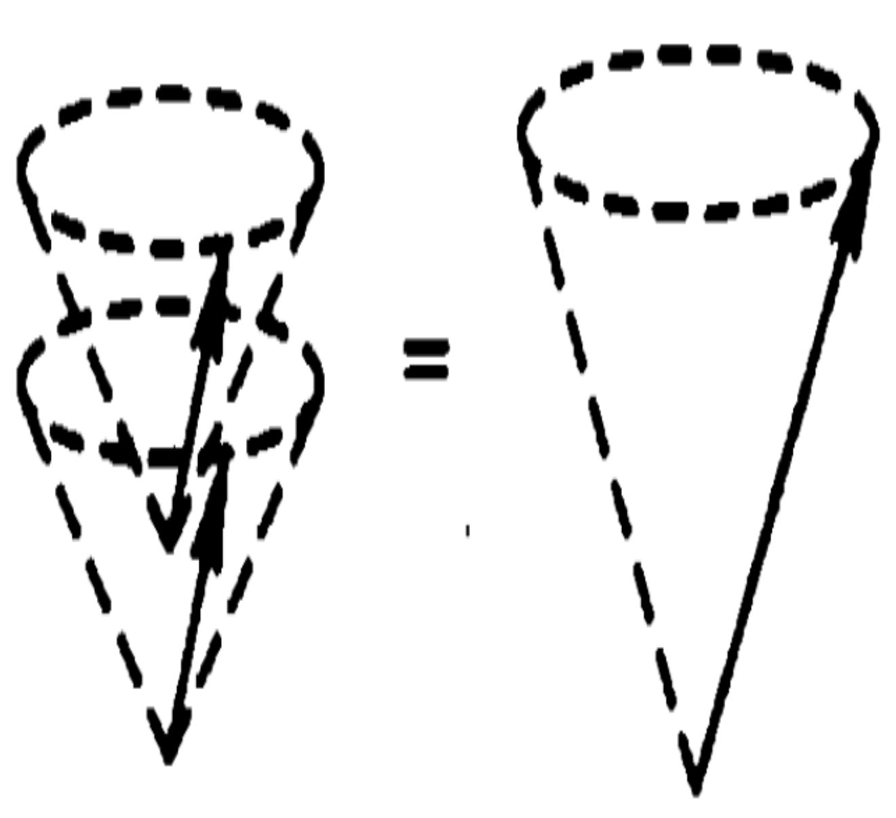
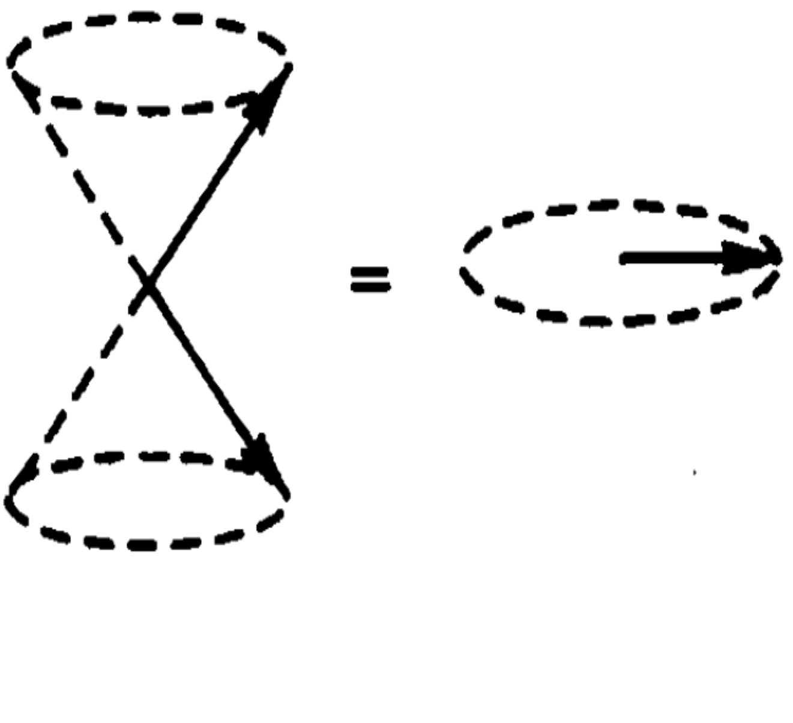
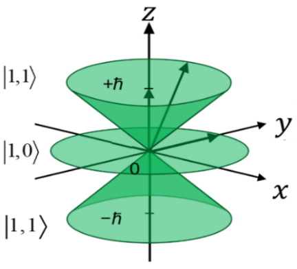
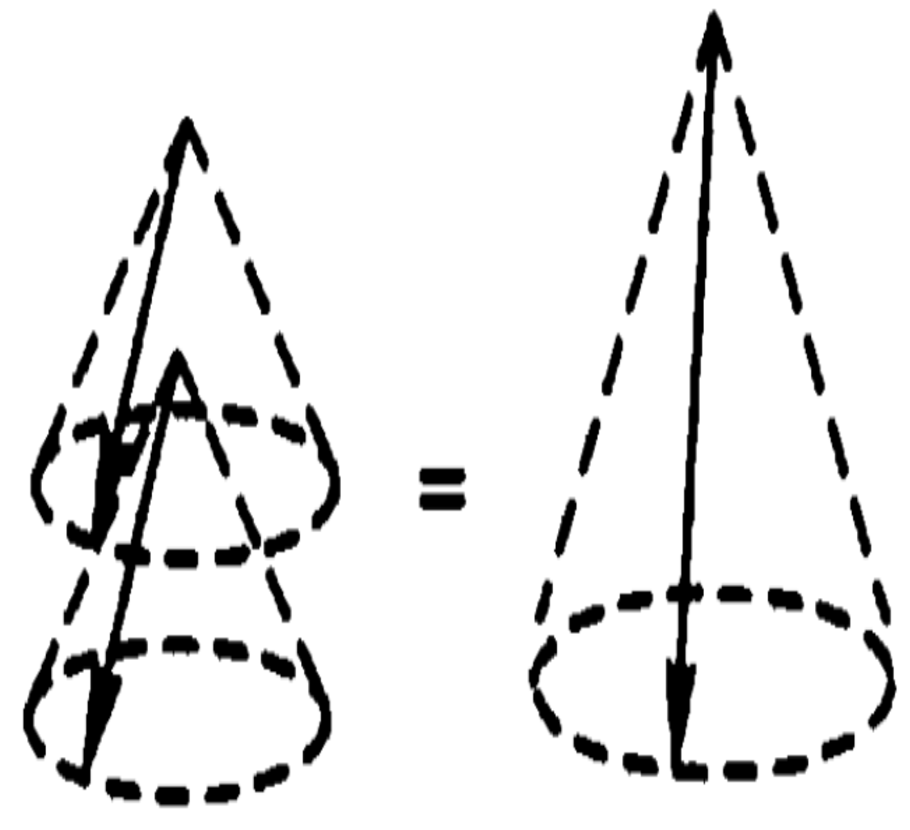
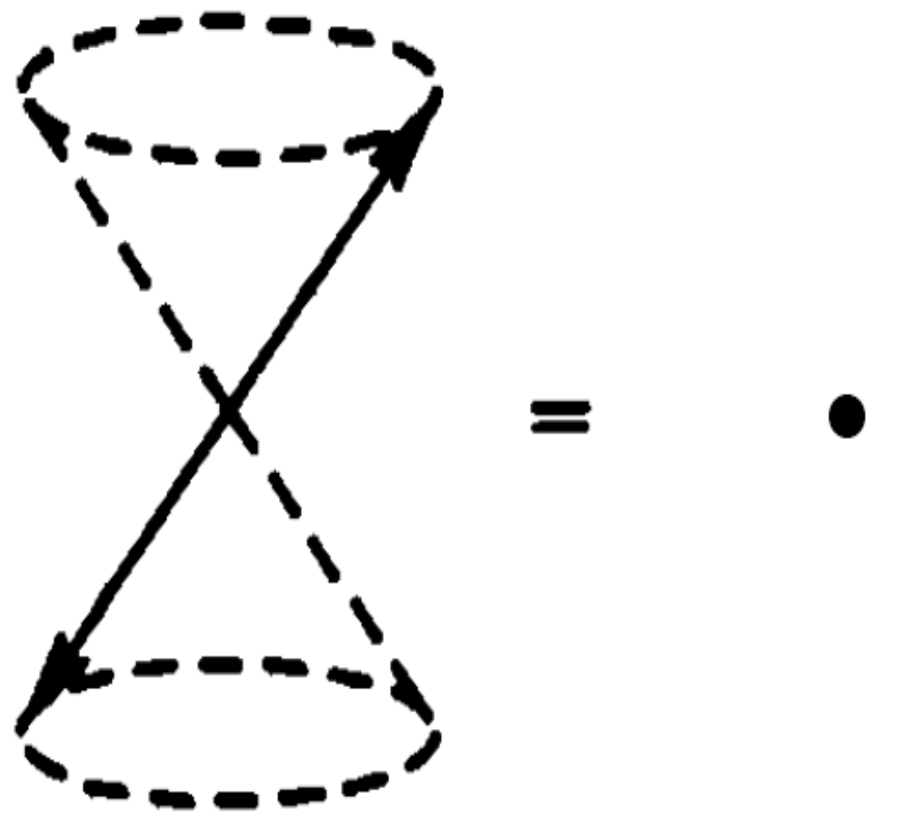
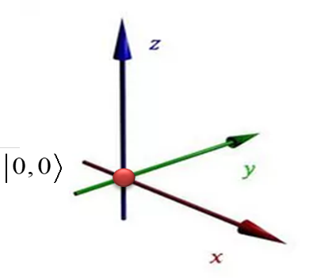

# Coupling Two Angular Momenta

An electron can carry both orbital angular momentum and spin. How do we combine them? The same question arises for two electrons, or for an electron and a nucleus. The answer helps us understand fine structure, hyperfine structure, magnetic splitting, and the $LS$ and $jj$ coupling schemes of many-electron atoms. We can learn the main ideas without starting with complicated coefficient formulas.

First distinguish the two subsystems. They may be different particles, or different degrees of freedom of one particle, such as orbital motion and spin. Each has its own state space. An operator for one subsystem leaves the other alone, so operators acting on different subsystems commute.

## Composite Vector Spaces (Tensor Products)

Take two angular momenta, $\mathbf J_1$ and $\mathbf J_2$, with fixed quantum numbers $j_1$ and $j_2$. The first subsystem has $2j_1+1$ basis states; the second has $2j_2+1$. Their bases are $\{\vert j_1,m_1\rangle\}$ and $\{\vert j_2,m_2\rangle\}$.

How do we describe both together? A natural first guess is to give each subsystem its own state and multiply the two:

$$
\vert \Psi \rangle = \vert {\psi _1}\rangle \otimes \vert {\psi _2}\rangle \equiv \vert {\psi _1}\rangle \vert {\psi _2}\rangle = \left( {\sum\limits_{{m_1}} {\left\vert  {{j_1}{m_1}} \right\rangle \left\langle {{{j_1}{m_1}}} \mathrel{\left \vert  {\vphantom {{{j_1}{m_1}} {{\psi _1}}}} \right. \kern-1.2pt } {{{\psi _1}}} \right\rangle } } \right)\left( {\sum\limits_{{m_2}} {\left\vert  {{j_2}{m_2}} \right\rangle \left\langle {{{j_2}{m_2}}} \mathrel{\left \vert  {\vphantom {{{j_2}{m_2}} {{\psi _2}}}} \right. \kern-1.2pt } {{{\psi _2}}} \right\rangle } } \right)
$$ {#eq-zeqnnum878336}

This **product state** uses $2j_1+1$ amplitudes for the first subsystem and $2j_2+1$ for the second. But product states do not exhaust the possibilities. We need a larger space.

**Quantum Postulate 7:** To build a basis for a composite system, take every product of subsystem basis vectors. The dimension of the composite space is the product of the subsystem dimensions.

For the two angular momenta considered here, the composite basis vectors are

$$
\left\vert  {{j_1},{m_1}} \right\rangle \otimes \left\vert  {{j_2},{m_2}} \right\rangle \equiv \left\vert  {{j_1},{m_1}} \right\rangle \left\vert  {{j_2},{m_2}} \right\rangle \equiv \left\vert  {{j_1}{m_1};{j_2}{m_2}} \right\rangle , \qquad  ( - {j_1} \le {m_1} \le {j_1},\; - {j_2} \le {m_2} \le {j_2})
$$ {#eq-ch09-p2154}

There are $(2j_1+1)(2j_2+1)$ such products: one for every pair $(m_1,m_2)$. Together they span the **tensor-product space**. A general state is a superposition of these product basis states:

$$
\vert \Psi \rangle = \sum\limits_{{m_1}} {\sum\limits_{{m_2}} {\left\vert  {{j_1}{m_1};{j_2}{m_2}} \right\rangle \left\langle {{{j_1}{m_1};{j_2}{m_2}}} \mathrel{\left \vert  {\vphantom {{{j_1}{m_1};{j_2}{m_2}} \Psi }} \right. \kern-1.2pt } {\Psi } \right\rangle } }
$$ {#eq-zeqnnum695918}

A general state can need $(2j_1+1)(2j_2+1)$ amplitudes. We can always expand a product state, @eq-zeqnnum878336, in the form @eq-zeqnnum695918. But we cannot always reverse the process and factor the result into two individual states.

We call a pure state **entangled** when this factorization is impossible. The pair has a pure state, but neither subsystem has a pure state of its own. For two spin-1/2 particles, an example is the normalized superposition $(\vert U\rangle_1\vert D\rangle_2+\vert D\rangle_1\vert U\rangle_2)/\sqrt2$. The correlations belong to the pair.

Let $\hat A_1$ act on subsystem 1 and $\hat A_2$ act on subsystem 2. Each operator affects only its own factor in a product state. For example,

$$
\begin{array}{c} \hat J_1^2{{\hat J}_{2z}}\vert {j_1}{m_1};{j_2}{m_2}\rangle \equiv \hat J_1^2{{\hat J}_{2z}}\left\vert  {{j_1},{m_1}} \right\rangle \left\vert  {{j_2},{m_2}} \right\rangle = \left( {\hat J_1^2\left\vert  {{j_1},{m_1}} \right\rangle } \right)\left( {{{\hat J}_{2z}}\left\vert  {{j_2},{m_2}} \right\rangle } \right)\\ = {j_1}({j_1} + 1){m_2}{\hbar ^3}\left\vert  {{j_1},{m_1}} \right\rangle \left\vert  {{j_2},{m_2}} \right\rangle \end{array}
$$ {#eq-zeqnnum356609}

$$
\begin{array}{c} \left( {\hat J_1^2 + \hat J_{2z}^2} \right)\left\vert  {{j_1},{m_1}} \right\rangle \left\vert  {{j_2},{m_2}} \right\rangle = \left( {\hat J_1^2\left\vert  {{j_1},{m_1}} \right\rangle } \right)\left\vert  {{j_2},{m_2}} \right\rangle + \left\vert  {{j_1},{m_1}} \right\rangle \left( {\hat J_{2z}^2\left\vert  {{j_2},{m_2}} \right\rangle } \right)\\ = \left[ {{j_1}({j_1} + 1) + m_2^2} \right]{\hbar ^2}\left\vert  {{j_1},{m_1}} \right\rangle \left\vert  {{j_2},{m_2}} \right\rangle \end{array}
$$ {#eq-zeqnnum297307}

Keep the subsystem labels attached to the kets. They tell us which angular momentum each state describes. We sometimes rearrange labeled factors as a shorthand, but a tensor-product calculation uses a fixed factor order. Reordering the written labels does not mean physically exchanging the particles.

## Matrix Representations in the Tensor-Product Space

To calculate with matrices, we need two operations: a tensor product, written $\otimes$, and a sum of operators acting on different factors. A small example makes the distinction clear.

Suppose each subsystem has two basis states. Write its state as a column:

$$
\left\vert  {{\psi _1}} \right\rangle = \left( {\begin{array}{*{20}{c}} {{\alpha _1}}\\ {{\beta _1}} \end{array}} \right), \qquad  \qquad  \left\vert  {{\psi _2}} \right\rangle = \left( {\begin{array}{*{20}{c}} {{\alpha _2}}\\ {{\beta _2}} \end{array}} \right)
$$ {#eq-ch09-p2165}

The product state has one entry for each pair of subsystem basis states:

$$
\left\vert  {{\psi _1}} \right\rangle \left\vert  {{\psi _2}} \right\rangle \equiv \left\vert  {{\psi _1}} \right\rangle \otimes \left\vert  {{\psi _2}} \right\rangle = \left( {\begin{array}{*{20}{c}} {{\alpha _1}\left\vert  {{\psi _2}} \right\rangle }\\ {{\beta _1}\left\vert  {{\psi _2}} \right\rangle } \end{array}} \right) = \left( {\begin{array}{*{20}{c}} {{\alpha _1}\left( {\begin{array}{*{20}{c}} {{\alpha _2}}\\ {{\beta _2}} \end{array}} \right)}\\ {{\beta _1}\left( {\begin{array}{*{20}{c}} {{\alpha _2}}\\ {{\beta _2}} \end{array}} \right)} \end{array}} \right) = \left( {\begin{array}{*{20}{c}} {\begin{array}{*{20}{c}} {{\alpha _1}{\alpha _2}}\\ {{\alpha _1}{\beta _2}} \end{array}}\\ {\begin{array}{*{20}{c}} {{\beta _1}{\alpha _2}}\\ {{\beta _1}{\beta _2}} \end{array}} \end{array}} \right)
$$ {#eq-ch09-p2167}

Now give each subsystem an operator with the following matrix:

$$
{\hat A_1} = \left( {\begin{array}{*{20}{c}} {{a_1}}&{{b_1}}\\ {{c_1}}&{{d_1}} \end{array}} \right), \qquad  \qquad  {\hat A_2} = \left( {\begin{array}{*{20}{c}} {{a_2}}&{{b_2}}\\ {{c_2}}&{{d_2}} \end{array}} \right),
$$ {#eq-ch09-p2169}

In the composite representation,

**Tensor product, $\hat A_1\otimes\hat A_2$.** Each entry of the first matrix multiplies the whole second matrix:

$$
{\hat A_1} \otimes {\hat A_2} = \left( {\begin{array}{*{20}{c}} {{a_1}{{\hat A}_2}}&{{b_1}{{\hat A}_2}}\\ {{c_1}{{\hat A}_2}}&{{d_1}{{\hat A}_2}} \end{array}} \right) = \left( {\begin{array}{*{20}{c}} {\begin{array}{*{20}{c}} {{a_1}{a_2}}&{{a_1}{b_2}}\\ {{a_1}{c_2}}&{{a_1}{d_2}} \end{array}}&{\begin{array}{*{20}{c}} {{b_1}{a_2}}&{{b_1}{b_2}}\\ {{b_1}{c_2}}&{{b_1}{d_2}} \end{array}}\\ {\begin{array}{*{20}{c}} {{c_1}{a_2}}&{{c_1}{b_2}}\\ {{c_1}{c_2}}&{{c_1}{d_2}} \end{array}}&{\begin{array}{*{20}{c}} {{d_1}{a_2}}&{{d_1}{b_2}}\\ {{d_1}{c_2}}&{{d_1}{d_2}} \end{array}} \end{array}} \right)
$$ {#eq-ch09-p2172}

**Sum, $\hat A_1+\hat A_2$.** Each operator must first be extended to act on the full composite space.

We cannot simply add the original matrices entry by entry. They describe different spaces, which may even have different dimensions. Instead, use an identity operator on the factor that is left alone:

$$
\begin{array}{c} {{\hat A}_1} + {{\hat A}_2} \equiv {{\hat A}_1} \otimes {{\hat I}_2} + {{\hat I}_1} \otimes {{\hat A}_2}\\ {\rm{ = }}\left( {\begin{array}{*{20}{c}} {{a_1}}&0&{{b_1}}&0\\ 0&{{a_1}}&0&{{b_1}}\\ {{c_1}}&0&{{d_1}}&0\\ 0&{{c_1}}&0&{{d_1}} \end{array}} \right) + \left( {\begin{array}{*{20}{c}} {{a_2}}&0&{{b_2}}&0\\ 0&{{a_2}}&0&{{b_2}}\\ {{c_2}}&0&{{d_2}}&0\\ 0&{{c_2}}&0&{{d_2}} \end{array}} \right)\\ = \left( {\begin{array}{*{20}{c}} {{a_1} + {a_2}}&0&{{b_1} + {b_2}}&0\\ 0&{{a_1} + {a_2}}&0&{{b_1} + {b_2}}\\ {{c_1} + {c_2}}&0&{{d_1} + {d_2}}&0\\ 0&{{c_1} + {c_2}}&0&{{d_1} + {d_2}} \end{array}} \right) \end{array}
$$ {#eq-ch09-p2175}

Our example uses two equal-sized spaces, but the same rules work when the subsystem dimensions differ.

Use these matrix rules to check

$$
\left( {{{\hat A}_1} \otimes {{\hat A}_2}} \right)\left( {\left\vert  {{\psi _1}} \right\rangle \otimes \left\vert  {{\psi _2}} \right\rangle } \right) = \left( {{{\hat A}_1}\left\vert  {{\psi _1}} \right\rangle } \right) \otimes \left( {{{\hat A}_2}\left\vert  {{\psi _2}} \right\rangle } \right)
$$ {#eq-ch09-p2178}

$$
\begin{array}{c} \left( {{{\hat A}_1} + {{\hat A}_2}} \right)\left( {\left\vert  {{\psi _1}} \right\rangle \otimes \left\vert  {{\psi _2}} \right\rangle } \right) = \left( {{{\hat A}_1} \otimes {{\hat I}_2} + {{\hat I}_1} \otimes {{\hat A}_2}} \right)\left( {\left\vert  {{\psi _1}} \right\rangle \otimes \left\vert  {{\psi _2}} \right\rangle } \right)\\ = \left( {{{\hat A}_1} \otimes {{\hat I}_2}} \right)\left( {\left\vert  {{\psi _1}} \right\rangle \otimes \left\vert  {{\psi _2}} \right\rangle } \right) + \left( {{{\hat I}_1} \otimes {{\hat A}_2}} \right)\left( {\left\vert  {{\psi _1}} \right\rangle \otimes \left\vert  {{\psi _2}} \right\rangle } \right)\\ = {{\hat A}_1}\left\vert  {{\psi _1}} \right\rangle \otimes {{\hat I}_2}\left\vert  {{\psi _2}} \right\rangle + {{\hat I}_1}\left\vert  {{\psi _1}} \right\rangle \otimes {{\hat A}_2}\left\vert  {{\psi _2}} \right\rangle \\ = {{\hat A}_1}\left\vert  {{\psi _1}} \right\rangle \otimes \left\vert  {{\psi _2}} \right\rangle + \left\vert  {{\psi _1}} \right\rangle \otimes {{\hat A}_2}\left\vert  {{\psi _2}} \right\rangle \end{array}
$$ {#eq-ch09-p2179}

We omitted the symbol $\otimes$ in @eq-zeqnnum356609. Written out explicitly, the operation is

$$
\left( {\hat J_1^2 \otimes {{\hat J}_{2z}}} \right)\left( {\left\vert  {{j_1},{m_1}} \right\rangle \otimes \left\vert  {{j_2},{m_2}} \right\rangle } \right) = \left( {\hat J_1^2\left\vert  {{j_1},{m_1}} \right\rangle } \right) \otimes \left( {{{\hat J}_{2z}}\left\vert  {{j_2},{m_2}} \right\rangle } \right)
$$ {#eq-ch09-p2181}

Likewise, the explicit form of @eq-zeqnnum297307 is

$$
\left( {\hat J_1^2 \otimes {{\hat I}_2} + {{\hat I}_1} \otimes \hat J_{2z}^2} \right)\left( {\left\vert  {{j_1},{m_1}} \right\rangle \otimes \left\vert  {{j_2},{m_2}} \right\rangle } \right) = \left( {\hat J_1^2\left\vert  {{j_1},{m_1}} \right\rangle } \right) \otimes \left\vert  {{j_2},{m_2}} \right\rangle + \left\vert  {{j_1},{m_1}} \right\rangle \otimes \left( {\hat J_{2z}^2\left\vert  {{j_2},{m_2}} \right\rangle } \right)
$$ {#eq-ch09-p2183}

We will often omit $\otimes$ to keep the notation short. Remember the rule behind the shorthand: each operator acts on its own subsystem.

## The Uncoupled Basis

Let us first label the two angular momenta separately. For fixed $j_1$ and $j_2$, the following four operators commute with one another:

$$
\left[ {{\bf{\hat J}}_1^2,\;{{\hat J}_{1z}},\;{\bf{\hat J}}_2^2{\rm{,}}\;{\rm{ }}{{\hat J}_{2z}}} \right] = 0
$$ {#eq-zeqnnum597965}

Their common eigenstates form the **uncoupled basis**. Each state specifies the two individual projections, $m_1$ and $m_2$. We may write it as $\vert j_1,m_1\rangle\vert j_2,m_2\rangle$, as $\vert j_1j_2m_1m_2\rangle$, or simply as $\vert m_1,m_2\rangle$ when $j_1,j_2$ are understood.

$$
\begin{array}{l} {\bf{\hat J}}_1^2\left\vert  {{j_1},{m_1}} \right\rangle \left\vert  {{j_2},{m_2}} \right\rangle = {j_1}({j_1} + 1){\hbar ^2}\left\vert  {{j_1},{m_1}} \right\rangle \left\vert  {{j_2},{m_2}} \right\rangle \\ {\bf{\hat J}}_2^2\left\vert  {{j_1},{m_1}} \right\rangle \left\vert  {{j_2},{m_2}} \right\rangle = {j_2}({j_2} + 1){\hbar ^2}\left\vert  {{j_1},{m_1}} \right\rangle \left\vert  {{j_2},{m_2}} \right\rangle \\ {{\hat J}_{1z}}\left\vert  {{j_1},{m_1}} \right\rangle \left\vert  {{j_2},{m_2}} \right\rangle = {m_1}\hbar \left\vert  {{j_1},{m_1}} \right\rangle \left\vert  {{j_2},{m_2}} \right\rangle , & {m_1} = {j_1},{j_1} - 1, \cdots , - {j_1}\\ {{\hat J}_{2z}}\left\vert  {{j_1},{m_1}} \right\rangle \left\vert  {{j_2},{m_2}} \right\rangle = {m_2}\hbar \left\vert  {{j_1},{m_1}} \right\rangle \left\vert  {{j_2},{m_2}} \right\rangle , & {m_2} = {j_2},{j_2} - 1, \cdots , - {j_2} \end{array}
$$ {#eq-ch09-p2189}

## The Coupled Basis

Sometimes we care more about the total angular momentum than the individual projections. We can choose a new basis for the same space: the **coupled basis**.

First add the component operators to define the total angular momentum, $\mathbf{\hat J}\equiv\mathbf{\hat J}_1+\mathbf{\hat J}_2$:

$$
{\hat J_z} \equiv {\hat J_{1z}} + {\hat J_{2z}}, \qquad  {\hat J_x} \equiv {\hat J_{1x}} + {\hat J_{2x}}, \qquad  {\hat J_y} \equiv {\hat J_{1y}} + {\hat J_{2y}}
$$ {#eq-zeqnnum643050}

The total ladder operators are therefore

$$
{\hat J_ \pm } \equiv {\hat J_x} \pm i{\hat J_y} = \left( {{{\hat J}_{1x}} \pm i{{\hat J}_{1y}}} \right) + \left( {{{\hat J}_{2x}} \pm i{{\hat J}_{2y}}} \right) = {\hat J_{1 \pm }} + {\hat J_{2 \pm }}
$$ {#eq-ch09-p2195}

The squared total angular momentum ${{\bf{\hat J}}^2}$ is

$$
{{\bf{\hat J}}^2} = {\left( {{{{\bf{\hat J}}}_1} + {{{\bf{\hat J}}}_2}} \right)^2} = {\bf{\hat J}}_1^2 + {\bf{\hat J}}_2^2 + 2{{\bf{\hat J}}_1} \cdot {{\bf{\hat J}}_2} = \hat J_x^2 + \hat J_y^2 + \hat J_z^2
$$ {#eq-zeqnnum961018}

Check that the total components obey the angular-momentum algebra:

$$
\left[ {{{\hat J}_x},{{\hat J}_y}} \right] = i\hbar {\hat J_z}, \qquad  \qquad  \left[ {{{{\bf{\hat J}}}^2},{{\hat J}_z}} \right] = 0
$$ {#eq-ch09-p2199}

You can also show that

$$
\left[ {{{\hat J}_z},{\mathbf{\hat J}}_1^2} \right] = \left[ {{{\hat J}_z},{\mathbf{\hat J}}_2^2} \right] = 0, \qquad  \qquad  \left[ {{{{\mathbf{\hat J}}}^2},{\mathbf{\hat J}}_1^2} \right] = \left[ {{{{\mathbf{\hat J}}}^2},{\mathbf{\hat J}}_2^2} \right] = 0
$$ {#eq-ch09-p2201}

We now have another set of four operators that commute with one another:

$$
\left[ {{\bf{\hat J}}_1^2,{\bf{\hat J}}_2^2,{{{\bf{\hat J}}}^2},{{\hat J}_z}} \right] = 0
$$ {#eq-zeqnnum733299}

Their common eigenstates form the coupled basis. The labels $j$ and $m$ specify the total magnitude and total projection. We write these states as $\vert j_1j_2jm\rangle$, or as $\vert j,m\rangle$ when the individual magnitudes are understood.

$$
\begin{array}{l} {\bf{\hat J}}_1^2\left\vert  {{j_1}{j_2}jm} \right\rangle = {j_1}({j_1} + 1){\hbar ^2}\left\vert  {{j_1}{j_2}jm} \right\rangle \\ {\bf{\hat J}}_2^2\left\vert  {{j_1}{j_2}jm} \right\rangle = {j_2}({j_2} + 1){\hbar ^2}\left\vert  {{j_1}{j_2}jm} \right\rangle \\ {{{\bf{\hat J}}}^2}\left\vert  {{j_1}{j_2}jm} \right\rangle = j(j + 1){\hbar ^2}\left\vert  {{j_1}{j_2}jm} \right\rangle \\ {{\hat J}_z}\left\vert  {{j_1}{j_2}jm} \right\rangle = m\hbar \left\vert  {{j_1}{j_2}jm} \right\rangle \end{array}
$$ {#eq-ch09-p2205}

Which total values of $j$ can occur? We will outline the result rather than give the full proof. First recall the possible projections of the individual angular momenta:

$$
- {j_1} \le {m_1} \le {j_1},\;\; \qquad  - {j_2} \le {m_2} \le {j_2}
$$ {#eq-ch09-p2207}

The component identity $\hat J_z=\hat J_{1z}+\hat J_{2z}$ requires $m=m_1+m_2$. Hence

$$
- {j_1} \le m - {m_2} \le {j_1},\; \qquad  - {j_2} \le m - {m_1} \le {j_2}
$$ {#eq-zeqnnum783552}

For each total $j$, the projection runs from $-j$ to $j$ in unit steps. Its greatest value cannot exceed $j_1+j_2$:

$$
- {j_1} \le j - {j_2} \le {j_1},\; \qquad  \qquad  - {j_2} \le j - {j_1} \le {j_2}
$$ {#eq-ch09-p2211}

That is,

$$
{j_2} - {j_1} \le j \le {j_1} + {j_2},\; \qquad  {j_1} - {j_2} \le j \le {j_1} + {j_2}
$$ {#eq-ch09-p2213}

The allowed total quantum numbers are therefore

$$
\left\vert  {{j_1} - {j_2}} \right\vert  \le j \le {j_1} + {j_2}
$$ {#eq-zeqnnum838538}

The endpoints resemble ordinary vector addition: two lengths combine to give a total between their difference and their sum. Quantum mechanics adds a further rule: the allowed $j$ values occur in unit steps.

For each allowed $j$ in @eq-zeqnnum838538, there are $2j+1$ values of $m$. Let us count all the coupled basis states. Taking $j_1>j_2$ for this count gives

$$
\sum\limits_{j = {j_1} - {j_2}}^{{j_1} + {j_2}} {2j + 1} = (2{j_1} + 1)(2{j_2} + 1)
$$ {#eq-ch09-p2218}

The count matches the uncoupled basis. That is a useful check: changing the basis must not change the size of the state space.

There is a tradeoff in the labels. The total projection $\hat J_z$ commutes with both individual projections. But $\mathbf{\hat J}^2$ generally does not: $[\mathbf{\hat J}^2,\hat J_{1z}]\ne0$ and $[\mathbf{\hat J}^2,\hat J_{2z}]\ne0$. We therefore cannot use all these observables together as a simultaneous eigenbasis.

## Relating the Coupled and Uncoupled Bases

The two bases describe the same space, so we can expand either one in the other. For a coupled state,

$$
\left\vert  {{j_1}{j_2}jm} \right\rangle = \sum\limits_{{m_1} = - {j_1}}^{{j_1}} {\sum\limits_{{m_2} = - {j_2}}^{{j_2}} {\left\vert  {{j_1}{m_1};{j_2}{m_2}} \right\rangle \left\langle {{{j_1}{m_1};{j_2}{m_2}}} \mathrel{\left \vert  {\vphantom {{{j_1}{m_1};{j_2}{m_2}} {{j_1}{j_2}jm}}} \right. \kern-1.2pt } {{{j_1}{j_2}jm}} \right\rangle } }
$$ {#eq-zeqnnum358642}

In the other direction,

$$
\left\vert  {{j_1}{m_1};{j_2}{m_2}} \right\rangle = \sum\limits_{j = \left\vert  {{j_1} - {j_2}} \right\vert }^{{j_1} + {j_2}} {\sum\limits_{m = - j}^j {\left\vert  {{j_1}{j_2}jm} \right\rangle \left\langle {{{j_1}{j_2}jm}} \mathrel{\left \vert  {\vphantom {{{j_1}{j_2}jm} {{j_1}{m_1};{j_2}{m_2}}}} \right. \kern-1.2pt } {{{j_1}{m_1};{j_2}{m_2}}} \right\rangle } }
$$ {#eq-zeqnnum779006}

The overlap amplitudes in these expansions are the **Clebsch–Gordan coefficients**, or **CG coefficients**. They tell us how much of each uncoupled basis state appears in a coupled state. Before calculating them, note three rules:

1) The labels must be allowed quantum numbers: $|j_1-j_2|\le j\le j_1+j_2$, $-j\le m\le j$, $-j_1\le m_1\le j_1$, and $-j_2\le m_2\le j_2$, with the usual unit steps.

2) A coefficient can be nonzero only if $m=m_1+m_2$. The total projection must equal the sum of the individual projections.

3) We can choose phases for the basis states so that all the CG coefficients are real. Their signs then follow the chosen convention.

Let us prove the second property.

**Theorem 9.1.** If $m \ne {m_1} + {m_2}$, the CG coefficient vanishes.

- Proof: Since $({\hat J_z} - {\hat J_{1z}} - {\hat J_{2z}})\left\vert  {{j_1}{j_2}jm} \right\rangle = \lvert\mathrm{null}\rangle$,

$$
\begin{array}{c} \left\langle {{j_1}{m_1};{j_2}{m_2}} \right\vert \left( {{{\hat J}_z} - {{\hat J}_{1z}} - {{\hat J}_{2z}}} \right)\left\vert  {{j_1}{j_2}jm} \right\rangle = 0\\ \left\langle {{j_1}{m_1};{j_2}{m_2}} \right\vert {{\hat J}_z}\left\vert  {{j_1}{j_2}jm} \right\rangle - \left\langle {{j_1}{m_1};{j_2}{m_2}} \right\vert {{\hat J}_1}\left\vert  {{j_1}{j_2}jm} \right\rangle - \left\langle {{j_1}{m_1};{j_2}{m_2}} \right\vert {{\hat J}_2}\left\vert  {{j_1}{j_2}jm} \right\rangle = 0\\ \left( {m - {m_1} - {m_2}} \right)\left\langle {{{j_1}{m_1};{j_2}{m_2}}} \mathrel{\left \vert  {\vphantom {{{j_1}{m_1};{j_2}{m_2}} {{j_1}{j_2}jm}}} \right. \kern-1.2pt } {{{j_1}{j_2}jm}} \right\rangle = 0 \end{array}
$$ {#eq-ch09-p2233}

Thus $\left\langle {{{j_1}{m_1};{j_2}{m_2}}} \mathrel{\left \vert  {\vphantom {{{j_1}{m_1};{j_2}{m_2}} {{j_1}{j_2}jm}}} \right. \kern-1.2pt } {{{j_1}{j_2}jm}} \right\rangle$ can be nonzero only when $m = {m_1} + {m_2}$.

Once we choose $m_1$, the condition fixes $m_2=m-m_1$. The double sum in @eq-zeqnnum358642 therefore reduces to a single sum:

$$
\left\vert  {{j_1}{j_2}jm} \right\rangle = \sum\limits_{{m_1} = - {j_1}}^{{j_1}} {\vert {j_1}{m_1};{j_2}m - {m_1}\rangle \langle {j_1}{m_1};{j_2}m - {m_1}\vert {j_1}{j_2}jm\rangle }
$$ {#eq-ch09-p2236}

Similarly, @eq-zeqnnum779006 simplifies to

$$
\left\vert  {{j_1}{m_1};{j_2}{m_2}} \right\rangle = \sum\limits_{j = \vert {j_1} - {j_2}\vert }^{{j_1} + {j_2}} {\vert {j_1}{j_2}j,{m_1} + {m_2}\rangle \langle {j_1}{j_2}j,{m_1} + {m_2}\vert {j_1}{m_1};{j_2}{m_2}\rangle }
$$ {#eq-ch09-p2238}

To keep the next example readable, write a coupled state as $\vert j,m\rangle$ and an uncoupled state as $\vert m_1;m_2\rangle$. Notice the punctuation: a comma separates the total labels, while a semicolon separates the two individual projections.

### Coupling Two Spin-1/2 Particles

Take two spin-1/2 particles, so $j_1=j_2=1/2$. Each spin has two states, so the pair has four basis states. Let us describe those same four dimensions in the two bases.

First list the uncoupled states, using $\vert m_1;m_2\rangle$:

$$
\left\vert  {\frac{1}{2};\frac{1}{2}} \right\rangle ,\;\;\;\;\;\left\vert  {\frac{1}{2}; - \frac{1}{2}} \right\rangle ,\;\;\;\;\;\left\vert  { - \frac{1}{2};\frac{1}{2}} \right\rangle ,\;\;\;\;\;\left\vert  { - \frac{1}{2}; - \frac{1}{2}} \right\rangle
$$ {#eq-ch09-p2243}

The total quantum number can be $j=1$ or $j=0$, by @eq-zeqnnum838538. The coupled states are

$$
\left\vert  {1,1} \right\rangle ,\;\;\;\;\;\left\vert  {1,0} \right\rangle ,\;\;\;\;\;\left\vert  {1, - 1} \right\rangle ,\;\;\;\;\;\left\vert  {0,0} \right\rangle
$$ {#eq-ch09-p2245}

The three $j=1$ states form a **triplet**. The single $j=0$ state is a **singlet**. Using @eq-zeqnnum358642 and the CG coefficients derived below gives

$$
\begin{array}{c} \left\vert  {j,m} \right\rangle = \sum\nolimits_{{m_1},{m_2}} {\left\vert  {{m_1};{m_2}} \right\rangle \left\langle {{{m_1};{m_2}}} \mathrel{\left \vert  {\vphantom {{{m_1};{m_2}} {j,m}}} \right. \kern-1.2pt } {{j,m}} \right\rangle } \\ \begin{array}{*{20}{l}} \begin{array}{c} \left\vert  {1,1} \right\rangle = \left\vert  {\frac{1}{2};\frac{1}{2}} \right\rangle \\ \left\vert  {1,0} \right\rangle = \frac{1}{{\sqrt 2 }}\left( {\left\vert  {\frac{1}{2}; - \frac{1}{2}} \right\rangle + \;\left\vert  { - \frac{1}{2};\frac{1}{2}} \right\rangle } \right)\;,\;\;\;\\ \left\vert  {1, - 1} \right\rangle = \left\vert  { - \frac{1}{2}; - \frac{1}{2}} \right\rangle \; \end{array}&{\left\vert  {0,0} \right\rangle = \frac{1}{{\sqrt 2 }}\left( {\left\vert  {\frac{1}{2}; - \frac{1}{2}} \right\rangle - \left\vert  { - \frac{1}{2};\frac{1}{2}} \right\rangle } \right)} \end{array} \end{array}
$$ {#eq-zeqnnum909689}

The extreme states are easy to understand. To get $m=1$, both spins must have projection $+1/2$. To get $m=-1$, both must have projection $-1/2$.

The two $m=0$ states are more interesting. Each combines one up spin and one down spin, but their relative signs differ. If we measure the two individual $z$ components, either state gives opposite results with equal probabilities. A measurement of total $J_z$ alone gives zero; it does not distinguish those two individual arrangements.

So how can the triplet state $\vert1,0\rangle$ differ from the singlet $\vert0,0\rangle$? The relative sign changes correlations along other axes. To see this, expand the states in the product basis for the individual $x$ components:

$$
\begin{array}{c} \left\vert  {1,0} \right\rangle = \frac{1}{{\sqrt 2 }}\left( {\left\vert  {\frac{1}{2}; - \frac{1}{2}} \right\rangle + \;\left\vert  { - \frac{1}{2};\frac{1}{2}} \right\rangle } \right) \equiv \frac{1}{{\sqrt 2 }}\left( {\left\vert  U \right\rangle \left\vert  D \right\rangle + \left\vert  D \right\rangle \;\left\vert  U \right\rangle } \right)\\ = \frac{1}{{\sqrt 2 }}\left[ {\frac{1}{{\sqrt 2 }}\left( {\left\vert  R \right\rangle + \left\vert  L \right\rangle } \right)\frac{1}{{\sqrt 2 }}\left( {\left\vert  R \right\rangle - \left\vert  L \right\rangle } \right) + \frac{1}{{\sqrt 2 }}\left( {\left\vert  R \right\rangle - \left\vert  L \right\rangle } \right)\frac{1}{{\sqrt 2 }}\left( {\left\vert  R \right\rangle + \left\vert  L \right\rangle } \right)} \right]\\ = \frac{1}{{\sqrt 2 }}\left( {\left\vert  R \right\rangle \left\vert  R \right\rangle - \left\vert  L \right\rangle \left\vert  L \right\rangle } \right) \end{array}
$$ {#eq-zeqnnum419967}

Keep the two ket factors in a fixed order. @eq-zeqnnum419967 says that, in $\vert1,0\rangle$, measurements of the individual $x$ components give $\vert R\rangle\vert R\rangle$ or $\vert L\rangle\vert L\rangle$, each with probability $50\%$. The total $J_x$ is therefore $+\hbar$ or $-\hbar$. The same holds along $y$. In this state, the two spins give opposite projections along $z$, but matching projections along $x$ or $y$.

Now try the singlet. Its expansion in the same $x$ basis is

$$
\left\vert  {0,0} \right\rangle = \frac{1}{{\sqrt 2 }}\left( {\vert R\rangle \vert L\rangle - \vert L\rangle \vert R\rangle } \right)
$$ {#eq-ch09-p2252}

::: {layout-ncol=3}

{width=440px}

{width=440px}

{width=440px}

{width=440px}

{width=440px}

{width=440px}

:::

Figure 9.1. Vector illustrations of the triplet and singlet formed by coupling two spin-1/2 particles. Each individual vector has an uncertain direction, but the directions are correlated. Dashed lines show the range of possible directions. The vector-addition sketches are reproduced from Yang Fujia, *Atomic Physics*.

In $\vert0,0\rangle$, measurements of the individual $x$ components give $\vert R\rangle\vert L\rangle$ or $\vert L\rangle\vert R\rangle$, each with probability $50\%$. Their sum is always zero. The same is true along $y$, along $z$, and along any common measurement axis. This is the singlet's distinctive correlation: the two results are always opposite.

### Spin–Orbit Coupling

An atomic electron always has spin $s=1/2$. It may also have orbital angular momentum with quantum number $l$. If $l=0$, only $j=1/2$ is possible. If $l>0$, the total has two possible values:

$$
j = l \pm \frac{1}{2}
$$ {#eq-ch09-p2257}

## \* Calculating Clebsch–Gordan Coefficients

We can choose the phases of the basis states so that the CG coefficients are real. With this convention,

$$
\left\langle {{{j_1}{m_1};{j_2}{m_2}}} \mathrel{\left \vert  {\vphantom {{{j_1}{m_1};{j_2}{m_2}} {{j_1}{j_2}jm}}} \right. \kern-1.2pt } {{{j_1}{j_2}jm}} \right\rangle = \left\langle {{{j_1}{j_2}jm}} \mathrel{\left \vert  {\vphantom {{{j_1}{j_2}jm} {{j_1}{m_1};{j_2}{m_2}}}} \right. \kern-1.2pt } {{{j_1}{m_1};{j_2}{m_2}}} \right\rangle
$$ {#eq-ch09-p2260}

As before, use $\vert j,m\rangle$ for a coupled state and $\vert m_1;m_2\rangle$ for an uncoupled state. Start with the largest allowed total:

$$
{j_{\max }} \equiv {j_1} + {j_2}
$$ {#eq-ch09-p2262}

**Step 1: build the states with $j=j_{\max}$.**

Begin at the top of the ladder, $m=j_{\max}$. There is only one way to make this projection: both individual spins must have their largest projections. Thus

$$
\left\vert  {{j_{\max }},{j_{\max }}} \right\rangle = \left\vert  {{j_1};{j_2}} \right\rangle
$$ {#eq-ch09-p2265}

Apply the lowering operator ${\hat J_ - } = {\hat J_{1 - }} + {\hat J_{2 - }}$ to both sides and use @eq-zeqnnum592417:

$$
\begin{array}{c} {{\hat J}_ - }\left\vert  {{j_{\max }},{j_{\max }}} \right\rangle = {{\hat J}_{1 - }}\left\vert  {{j_1};{j_2}} \right\rangle + {{\hat J}_{2 - }}\left\vert  {{j_1};{j_2}} \right\rangle \\ \sqrt {2{j_{\max }}} \left\vert  {{j_{\max }},{j_{\max }} - 1} \right\rangle = \sqrt {2{j_1}} \left\vert  {{j_1} - 1;{j_2}} \right\rangle + \sqrt {2{j_2}} \left\vert  {{j_1};{j_2} - 1} \right\rangle \end{array}
$$ {#eq-ch09-p2267}

This gives the expansion of the next state down, $\vert j_{\max},j_{\max}-1\rangle$. Keep lowering to build the whole $j_{\max}$ ladder.

**Step 2: build the states with $j=j_{\max}-1$.**

Start at the top of this new ladder, where $m=j_{\max}-1$. The projection-sum rule leaves two possible uncoupled terms:

$$
\begin{array}{c} \left\vert  {{j_{\max }} - 1,{j_{\max }} - 1} \right\rangle = {c_1}\left\vert  {{j_1} - 1;{j_2}} \right\rangle + {c_2}\left\vert  {{j_1};{j_2} - 1} \right\rangle \\ c_1^2 + c_2^2 = 1 \end{array}
$$ {#eq-ch09-p2271}

The new state must be orthogonal to the state with the same $m$ from step 1. It must also be normalized:

$$
\left\langle {{{j_{\max }},{j_{\max }} - 1}} \mathrel{\left \vert  {\vphantom {{{j_{\max }},{j_{\max }} - 1} {{j_{\max }} - 1,{j_{\max }} - 1}}} \right. \kern-1.2pt } {{{j_{\max }} - 1,{j_{\max }} - 1}} \right\rangle = 0
$$ {#eq-ch09-p2273}

These conditions determine $c_1$ and $c_2$, up to an overall phase. Once we have the top state, apply $\hat J_-=\hat J_{1-}+\hat J_{2-}$ repeatedly to build the rest of this ladder.

**Step 3: build the states with $j=j_{\max}-2$.**

Again start at the top. This time, three uncoupled terms can contribute:

$$
\begin{array}{c} \left\vert  {{j_{\max }} - 2,{j_{\max }} - 2} \right\rangle = {d_1}\left\vert  {{j_1} - 2;{j_2}} \right\rangle + {d_2}\left\vert  {{j_1} - 1;{j_2} - 1} \right\rangle + {d_3}\left\vert  {{j_1};{j_2} - 2} \right\rangle \\ d_1^2 + d_2^2 + d_3^2 = 1 \end{array}
$$ {#eq-ch09-p2277}

Require normalization and orthogonality to the two states already found at this $m$:

$$
\begin{array}{c} \left\langle {{{j_{\max }} - 1,{j_{\max }} - 2}} \mathrel{\left \vert  {\vphantom {{{j_{\max }} - 1,{j_{\max }} - 2} {{j_{\max }} - 2,{j_{\max }} - 2}}} \right. \kern-1.2pt } {{{j_{\max }} - 2,{j_{\max }} - 2}} \right\rangle = 0\\ \left\langle {{{j_{\max }},{j_{\max }} - 2}} \mathrel{\left \vert  {\vphantom {{{j_{\max }},{j_{\max }} - 2} {{j_{\max }} - 2,{j_{\max }} - 2}}} \right. \kern-1.2pt } {{{j_{\max }} - 2,{j_{\max }} - 2}} \right\rangle = 0 \end{array}
$$ {#eq-ch09-p2279}

These conditions fix $d_1,d_2,d_3$, up to an overall phase. Then lower again. Continue the pattern until every allowed $j$ has its own ladder.

The pattern makes a useful recursive algorithm: find a new top state by orthogonality, then lower through its ladder. For numerical work, Mathematica also provides $ClebschGordan[\{j_1,m_1\},\{j_2,m_2\},\{j,m\}]$.

**Example.** The following calculation shows how the method expands coupled states in the uncoupled basis.

$$
\left\vert  {j,m} \right\rangle = \sum\limits_{{m_1} = - {j_1}}^{{j_1}} {\left\vert  {{m_1};m - {m_1}} \right\rangle \left\langle {{{m_1};m - {m_1}}} \mathrel{\left \vert  {\vphantom {{{m_1};m - {m_1}} {j,m}}} \right. \kern-1.2pt } {{j,m}} \right\rangle }
$$ {#eq-ch09-p2283}

$$
{j_1} = {j_2} = {1 \mathord{\left/ {\vphantom {1 2}} \right. \kern-1.2pt } 2}
$$ {#eq-ch09-p2284}

$$
\begin{array}{*{20}{l}} \begin{array}{l} \left\vert  {1,1} \right\rangle = \left\vert  {\frac{1}{2};\frac{1}{2}} \right\rangle \\ \left\vert  {1,0} \right\rangle = \frac{1}{{\sqrt 2 }}\left( {\left\vert  {\frac{1}{2}; - \frac{1}{2}} \right\rangle + \;\left\vert  { - \frac{1}{2};\frac{1}{2}} \right\rangle } \right)\;,\;\;\;\\ \left\vert  {1, - 1} \right\rangle = \left\vert  { - \frac{1}{2}; - \frac{1}{2}} \right\rangle \; \end{array}&{\left\vert  {0,0} \right\rangle = \frac{1}{{\sqrt 2 }}\left( {\left\vert  {\frac{1}{2}; - \frac{1}{2}} \right\rangle - \left\vert  { - \frac{1}{2};\frac{1}{2}} \right\rangle } \right)} \end{array}
$$ {#eq-ch09-p2285}

$$
{j_1} = {j_2} = 1
$$ {#eq-ch09-p2286}

$$
\begin{array}{*{20}{c}} \begin{array}{l} \left\vert  {2,2} \right\rangle = \left\vert  {1;1} \right\rangle \\ \left\vert  {2,1} \right\rangle = \frac{{\left\vert  {1;0} \right\rangle + \left\vert  {0;1} \right\rangle }}{{\sqrt 2 }}\\ \left\vert  {2,0} \right\rangle = \frac{{\left\vert  { - 1;1} \right\rangle + 2\left\vert  {0;0} \right\rangle + \left\vert  {1; - 1} \right\rangle }}{{\sqrt 6 }},\;\;\\ \left\vert  {2, - 1} \right\rangle = \frac{{\left\vert  {0; - 1} \right\rangle + \left\vert  { - 1;0} \right\rangle }}{{\sqrt 2 }}\\ \left\vert  {2, - 2} \right\rangle = \left\vert  { - 1; - 1} \right\rangle \end{array}&\begin{array}{l} \left\vert  {1,1} \right\rangle = \frac{{\left\vert  {1;0} \right\rangle - \left\vert  {0;1} \right\rangle }}{{\sqrt 2 }}\\ \left\vert  {1,0} \right\rangle = \frac{{\left\vert  {1; - 1} \right\rangle - \left\vert  { - 1;1} \right\rangle }}{{\sqrt 2 }}\;,\\ \left\vert  {1, - 1} \right\rangle = \frac{{\left\vert  {0; - 1} \right\rangle - \left\vert  { - 1;0} \right\rangle }}{{\sqrt 2 }}\;\; \end{array}&{\left\vert  {0,0} \right\rangle = \frac{{\left\vert  {1; - 1} \right\rangle - \left\vert  {0;0} \right\rangle + \left\vert  { - 1;1} \right\rangle }}{{\sqrt 3 }}} \end{array}
$$ {#eq-ch09-p2287}

## \* Exchange Symmetry of CG Coefficients

CG coefficients satisfy the symmetry relation[^f7]

$$
\left\langle {{{j_1}{m_1};{j_2}{m_2}}} \mathrel{\left \vert  {\vphantom {{{j_1}{m_1};{j_2}{m_2}} {jm}}} \right. \kern-1.2pt } {{jm}} \right\rangle = {\left( { - 1} \right)^{{j_1} + {j_2} - j}}\left\langle {{{j_2}{m_2};{j_1}{m_1}}} \mathrel{\left \vert  {\vphantom {{{j_2}{m_2};{j_1}{m_1}} {jm}}} \right. \kern-1.2pt } {{jm}} \right\rangle
$$ {#eq-zeqnnum431426}

If the two angular momenta belong to two particles, this relation tells us how the coefficients change when we exchange their labels. The sign depends on whether $j_1+j_2-j$ is even or odd. We can use it to find a useful rule for two equivalent valence electrons in $LS$ coupling.

**Even-sum rule:** For two equivalent valence electrons in $LS$ coupling, an allowed state must have even $L+S$.

**Proof.** Write the two-electron state as a radial factor $\vert R(r_1,r_2)\rangle$ times an angular-and-spin factor $\vert LSJM\rangle$. Electrons are fermions, so the full state must change sign when we exchange them. The two factors must therefore have opposite exchange symmetries.

Equivalent electrons occupy the same $nl$ subshell. Their radial factor is

$$
\left\vert  {R({r_1},{r_2})} \right\rangle = {\left\vert  {nl} \right\rangle _1}{\left\vert  {nl} \right\rangle _2}
$$ {#eq-ch09-p2295}

This factor is symmetric under exchange. The angular-and-spin factor must therefore be antisymmetric. Expand it as

$$
\left\vert  {LSJM} \right\rangle = \sum\limits_{{M_L}{M_S}} {\left\vert  {L{M_L};S{M_S}} \right\rangle \left\langle {{L{M_L};S{M_S}}} \mathrel{\left \vert  {\vphantom {{L{M_L};S{M_S}} {LSJM}}} \right. \kern-1.2pt } {{LSJM}} \right\rangle }
$$ {#eq-zeqnnum649848}

For two equivalent electrons,

$$
\begin{array}{l} {l_1} = {l_2} = l \to {l_1} + {l_2} = 2l,\;\left\vert  {{l_1} - {l_2}} \right\vert  = 0\\ {s_1} = {s_2} = {1 \mathord{\left/ {\vphantom {1 2}} \right. \kern-1.2pt } 2} \to {s_1} + {s_2} = 1,\;\left\vert  {{s_1} - {s_2}} \right\vert  = 0 \end{array}
$$ {#eq-ch09-p2299}

Before imposing exchange symmetry, the addition rules allow $L=2l,2l-1,\ldots,0$ and $S=1,0$.

Let $\hat X$ be the electron-exchange operator. Using the CG identity @eq-zeqnnum431426 gives

$$
\begin{array}{c} \hat X\left\vert  {L{M_L}} \right\rangle = \hat X\sum\limits_{{m_1},{m_2}} {\left\vert  {l{m_1};l{m_2}} \right\rangle \left\langle {{l{m_1};l{m_2}}} \mathrel{\left \vert  {\vphantom {{l{m_1};l{m_2}} {L{M_L}}}} \right. \kern-1.2pt } {{L{M_L}}} \right\rangle } \\ = \sum\limits_{{m_1},{m_2}} {\left\vert  {l{m_2};l{m_1}} \right\rangle \left\langle {{l{m_1};l{m_2}}} \mathrel{\left \vert  {\vphantom {{l{m_1};l{m_2}} {L{M_L}}}} \right. \kern-1.2pt } {{L{M_L}}} \right\rangle } \\ = {( - 1)^{2l - L}}\sum\limits_{{m_1},{m_2}} {\left\vert  {l{m_1};l{m_2}} \right\rangle \left\langle {{l{m_1};l{m_2}}} \mathrel{\left \vert  {\vphantom {{l{m_1};l{m_2}} {L{M_L}}}} \right. \kern-1.2pt } {{L{M_L}}} \right\rangle } \\ = {( - 1)^{2l - L}}\left\vert  {L{M_L}} \right\rangle \end{array}
$$ {#eq-zeqnnum405893}

Similarly,

$$
\hat X\left\vert  {S{M_S}} \right\rangle = {( - 1)^{2s - S}}\left\vert  {S{M_S}} \right\rangle = {( - 1)^{1 - S}}\left\vert  {S{M_S}} \right\rangle
$$ {#eq-ch09-p2304}

Since $2l$ is even, odd $L$ gives an antisymmetric orbital factor and even $L$ gives a symmetric one. For spin, the triplet $S=1$ is symmetric and the singlet $S=0$ is antisymmetric.

Their product is antisymmetric in two cases: even $L$ with $S=0$, or odd $L$ with $S=1$. In both cases, $L+S$ is even.

Every term in @eq-zeqnnum649848 has the same $L$ and $S$, so every term has the same exchange symmetry. The full angular-and-spin state inherits that symmetry. To make the two-electron state antisymmetric, we must therefore choose even $L+S$.

## Exercises

**9.1** Using the definitions @eq-zeqnnum643050 and @eq-zeqnnum961018 of total angular momentum ${\bf{\hat J}}$, prove that

$$
\left[ {{{\hat J}_z},{\mathbf{\hat J}}_1^2} \right] = 0, \qquad  \qquad  \left[ {{{{\mathbf{\hat J}}}^2},{\mathbf{\hat J}}_1^2} \right] = 0
$$ {#eq-ch09-p2310}

**9.2**\* Relate the coupled and uncoupled bases of two spin-1/2 particles. Using ${C_ \pm }(j,m)$ from Exercise 8.2, chosen positive, apply the lowering operator ${\hat J_ - } = {\hat J_{1 - }} + {\hat J_{2 - }}$ to both sides of

$$
\left\vert  {1,1} \right\rangle = \left\vert  {\frac{1}{2};\frac{1}{2}} \right\rangle
$$ {#eq-ch09-p2312}

and find the uncoupled expansion of $\vert {1,0}\rangle$. Then use orthogonality of $\vert {1,0}\rangle$ and $\vert {0,0}\rangle$ to calculate the expansion of $\vert {0,0}\rangle$.

[^f7]: Hecht, Quantum Mechanics. Cf. Symmetry Properties of Clebsch—Gordan Coefficients
